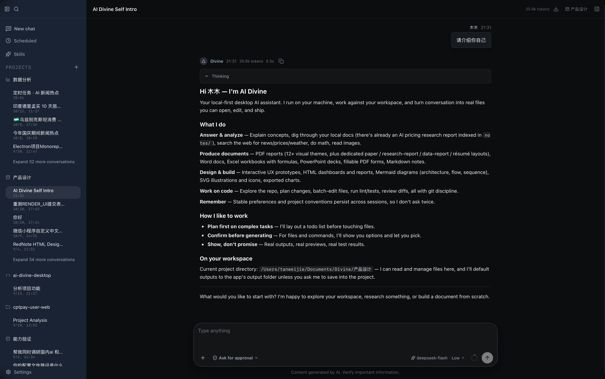
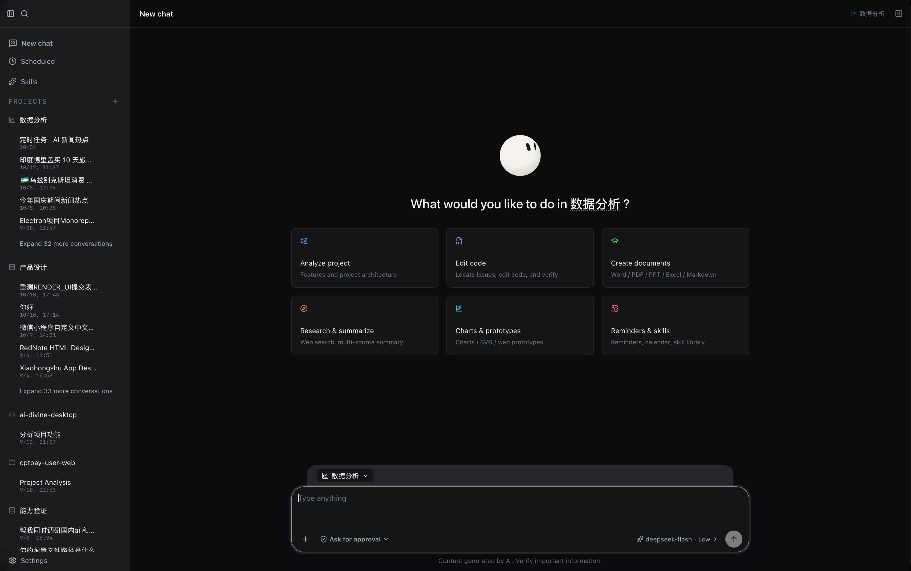
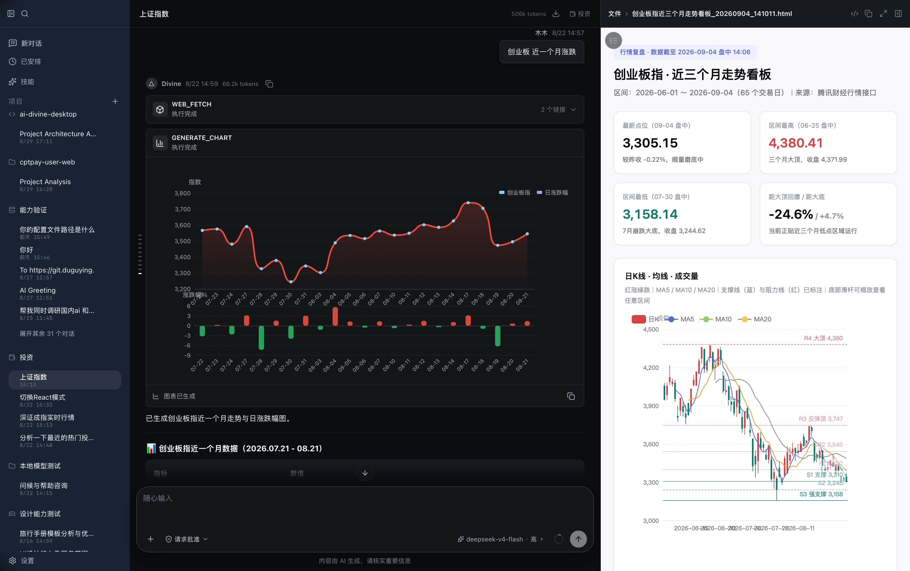
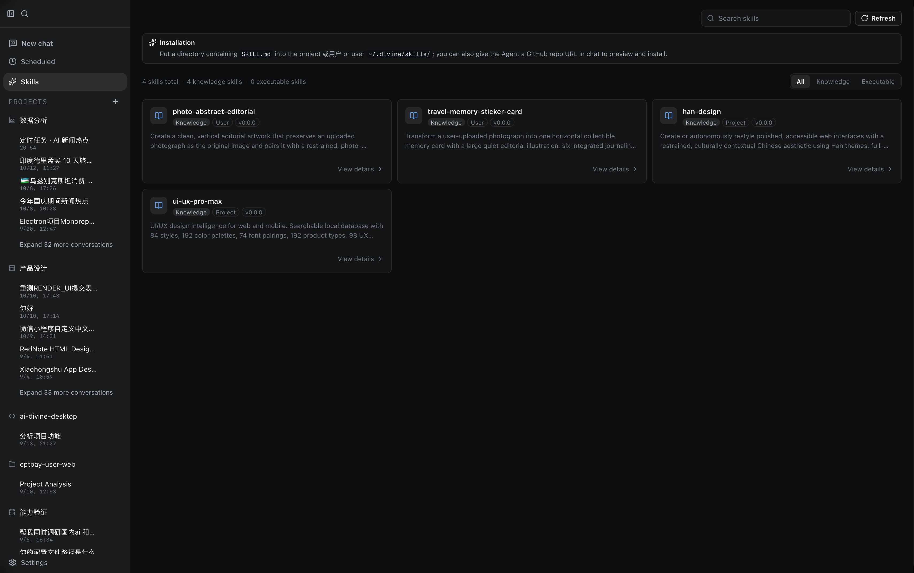
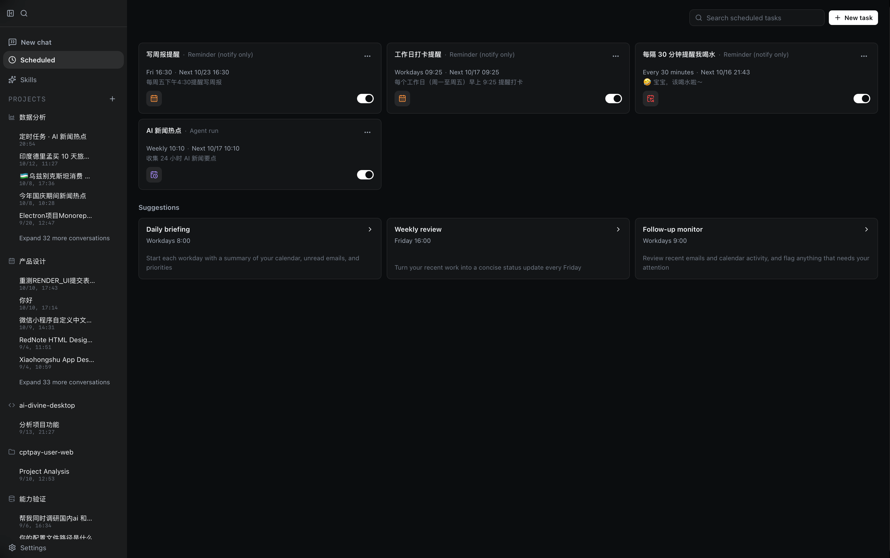
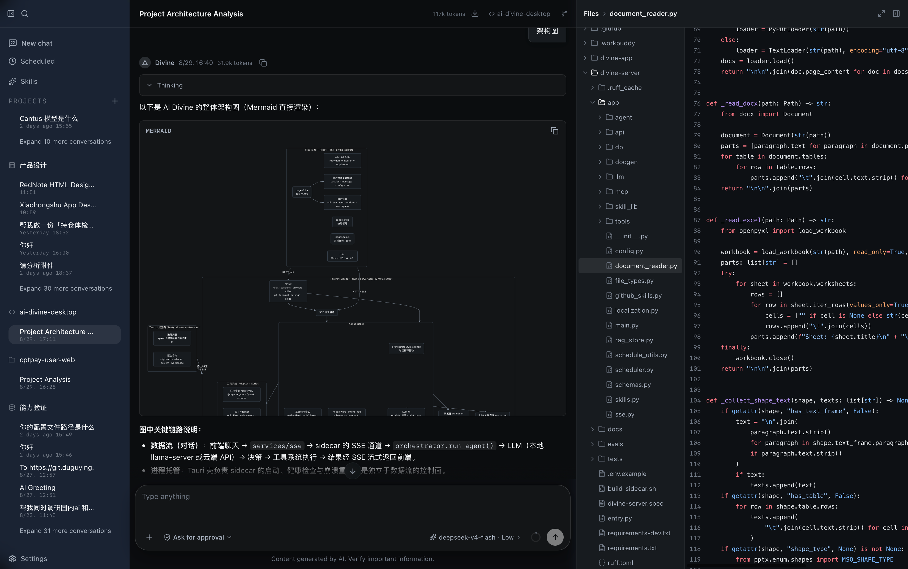
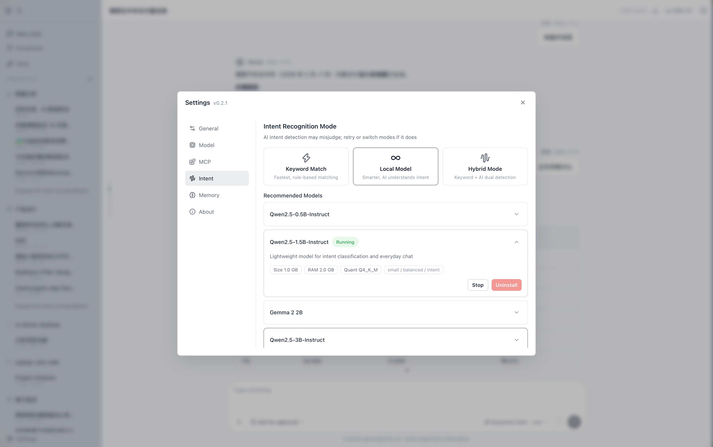
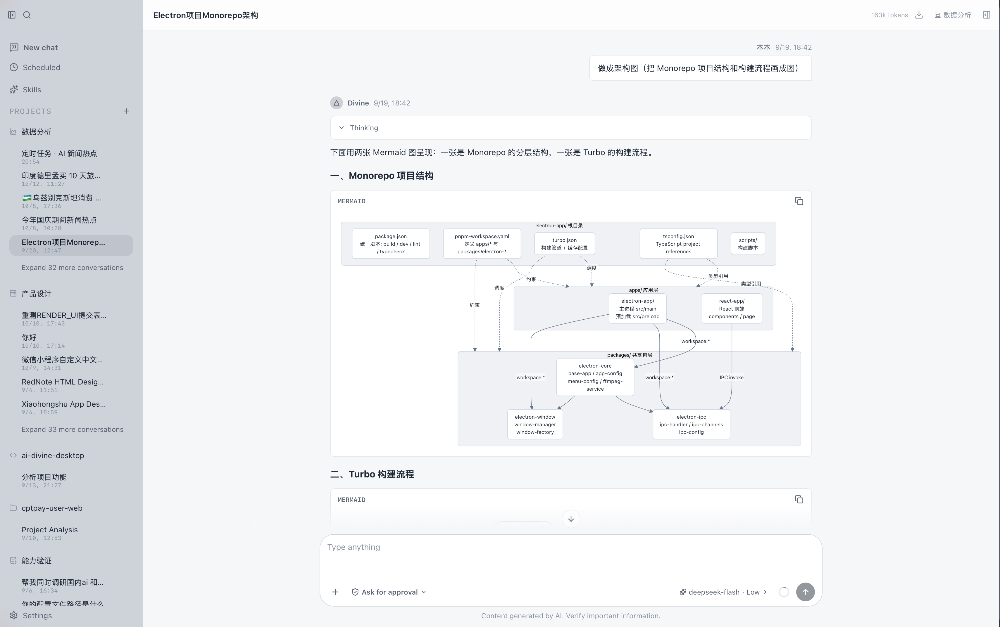

# Divine

**简体中文** · [English](README.en.md)

Divine：本地优先、隐私可控的桌面 AI 助手。后端为 FastAPI sidecar，前端为 Vite + React + TypeScript，桌面壳为 Tauri 2 + Rust。

默认端口约定：

| 服务                 | 端口   | 说明                                 |
| -------------------- | ------ | ------------------------------------ |
| FastAPI sidecar      | `8019` | Agent、SSE、SQLite、工具系统         |
| Vite dev server      | `8010` | 前端开发服务，`/api` 代理到 sidecar  |
| llama-server（可选） | `8016` | 本地小模型，在设置里开启后由后端托管 |

## 功能特性

### 对话与模型

- 多模型对话：DeepSeek 流式对话（深度思考 + 推理强度档位），支持多模型配置与按会话切换；无 Key 时自动降级本地演示 Agent
- 模型提供商目录外置：新增/调整提供商及其模型列表写入可编辑的 `divine-model-provider.json`，设置页与 `manage_model_providers` 工具都可维护
- 工具调用范式按模型可选：`tool_mode` = `auto`（默认，自动解析）/ `native`（强制原生 function calling）/ `react`
- 本地模型（可选）：llama-server 驱动的意图识别、长文本预整理与本地问答，数据不出本机

### 会话与记忆

- 会话能力：会话历史、标题自动生成、会话搜索（含拼音检索）、项目化组织（项目工作区/图标）、上下文用量查看与手动压缩、会话导出
- 对话内引用：`@` 引用工作区文件、`/` 引用技能（候选浮层 + 气泡内胶囊渲染；技能名经会话技能集合校验，避免把 `见 /docs 目录` 这类路径误标成技能）
- 多层长期记忆：L0 工作记忆（窗口内消息）→ L1 情景记忆（每次会话的结论与过程，可跨会话检索）→ L2 语义记忆（用户画像/偏好/稳定事实，按 `project_id` 做项目作用域隔离）→ L3 程序记忆（做事的方法与成功轨迹）。写入侧显式、隐式抽取与显式覆盖三通道；自动覆盖只防高重复（极性相同 + 高相似度），语义更新必须显式指定覆盖对象；极性冲突时新记忆落到 `pending` 由用户确认/拒绝，被覆盖的记忆软删除并留 `superseded_by` 痕迹。设置弹窗内有记忆管理页，`remember` / `recall_memories` / `forget_memory` 三个工具供模型主动读写
- 历史回溯：提问窗口之外的问题自动检索早期对话并注入

### 交互与执行

- 主动提问：需求有歧义、或需要用户拍板时，`ask_user` 带候选选项提问并等待回答
- 计划与审批：复杂任务先建待办计划；高危操作（终端命令、git 提交、文件改动等）请求用户确认，等待时长由 `approval_timeout` 控制
- 执行中可插话纠偏（steering），回合可随时取消
- 后台任务与子代理：dev server / 长任务后台运行并可查状态；大任务并行拆分给多个子 Agent
- 交互式终端、Markdown 渲染与 Shiki 代码高亮、消息列表展示回复耗时

### 通用 Web 任务引擎（浏览器自动化）

- 给一个 URL + 一句话要求，Agent 在真实浏览器的专属标签页里完成网页任务：查询/整理页面信息、填表单、发布内容，以及自动购物等任意站点场景
- CDP 接管专用浏览器 profile（Chrome 136+ 唯一可行路径）：一次性登录持久复用、随机端口自动发现、端点丢失自动引导重启（自愈），全程零系统权限
- aria 快照 + 单调 ref 定位，不裸用 CSS selector；contenteditable 富文本编辑器与框架委托事件的可点控件（cursor:pointer）均可寻址；变更操作自动带回新快照
- 风险四级闸门：只读/可逆动作自动执行；提交/删除/支付类不可逆动作强制「抽取 → 操作确认卡 → 用户确认 → confirmed 委派段」；密码/验证码/API key 输入无条件拒绝；高风险词典兜底防误标
- 委派入口 `web_task`：10 个 browser 操作原语只在 browser 子 agent 内注册，不占主 agent 工具表与 prefix cache；每步 SSE 心跳实时可见
- 设计文档见 `docs/design/031-generic-web-task-20261024.md`（购物域策略包、站点配方与分期计划同文档）

### 生成与编辑（docgen）

- 文档与可视化生成：Word、PPT、Excel、PDF（报告/商业分析/旅行/路线图/书/幻灯片配方，另含学术报告 / 论文投稿 / 数据分析报告 / 研究报告 / 金句手绘解读五套页式模板）、Markdown、SVG 矢量图、ECharts 图表、Mermaid 图、完整 UX 交互 HTML、通用 HTML 页面、可编辑简历 HTML（19 套模板）
- 本地文档编辑：修改已有 Word/Excel/PPT（run 级保样式、模板占位符填充、表格行展开、公式与图表无损保留），外部文件生成编辑副本不碰原件，编辑前自动备份、`undo_last_turn` 可撤销
- PDF 表单：读取与填写 AcroForm 字段，生成带真实控件的可填写表单 PDF
- PPT：15 种版式 × 19 套主题；按页渲染 PNG 预览（不需要装 LibreOffice）；支持对已有 PPT 改文字与标题
- 可交互图形：GraphIR 契约 + 前端 X6 渲染，覆盖流程/决策流、任务 DAG、数据加工、状态机、组织架构、思维导图、拓扑、架构图、ER、泳道、时序、知识图谱、UML 类图、鱼骨图、时间线 15 个场景；支持节点详情、数据流动画与导出 PNG/SVG
- 交互式面板（A2UI）：`render_ui` 把「文字 + 徽标 + 表格 + 进度 + 步骤条 + 输入控件」组合成一块面板，用户可在面板里改参数、点按钮，操作带着面板当前状态回到对话，形成「看 → 调 → 再看」闭环；总开关 `ui_a2ui_enabled`

### 数据与检索

- 本地文件分析：Word、Excel、Markdown、PDF、图片识别（GLM 视觉）、网页抓取（JS 动态页自动浏览器兜底）、批量抓取、联网搜索
- 本地 RAG：工作区文档自研 SQLite 倒排索引检索（词频 + doc_freq，无需 embedding 模型）
- 只读 SQLite 查询

### 扩展与自动化

- 技能系统：安装/迁移/预览第三方 SKILL.md 技能（GitHub/Gitee），内置技能中心。知识型技能把正文直接注入本轮消息，可执行技能注入工具调用契约，避免「`/` 了没用」
- MCP 连接器：配置并连接外部 MCP server，工具自动并入 Agent（隐私：连接结果需信任授权）
- 定时任务与日程：提醒、定时任务（每次执行用专属会话、保留运行记录、支持 webhook 投递、跑完弹通知）、日历事件，macOS 可同步系统日历；后台写入的消息通过常驻事件流 `GET /api/events` 实时推给前端
- 离线评测与自动调试：`divine-server/evals` 是独立评测 harness（fake_model + scenarios，可离线验证 Agent）；Agent 侧落地了故障驱动的自动调试闭环（诊断解析 + 收敛刹车）

### 桌面与体验

- 界面三语言：简体中文 / 繁体中文 / English（`divine-app/src/i18n`，配套 `pnpm i18n:*` 脚本）
- 深色 / 浅色双主题；自研 React UI 组件，不引入 AntD
- 长列表虚拟滚动；流式渲染与会话重建做过重复扫描/重复解析消除
- 快捷键：应用内统一 keymap（macOS ⌘ / 其他平台 Ctrl），系统级全局快捷键唤起/隐藏窗口
- SQLite 本地存储，数据默认保存在本机，不依赖云端账号
- Tauri 2 + Rust 桌面壳：启动自动拉起并监控 FastAPI sidecar（掉线重启）
- 工作区文件浏览与多格式预览（PDF / PPTX / 文档）

## 技术栈

| 层     | 技术                                                                                                                                                                                       |
| ------ | ------------------------------------------------------------------------------------------------------------------------------------------------------------------------------------------ |
| 后端   | FastAPI、Uvicorn、SQLite（自研倒排索引检索）、LangChain + LangGraph（SQLite checkpointer）、多模型（DeepSeek / GLM / MiniMax）、llama-server 本地模型、WeasyPrint + reportlab、PyInstaller |
| 前端   | Vite、React 19、TypeScript、Less、react-i18next（zh-CN / zh-TW / en）、@tanstack/react-virtual、react-markdown、Shiki、ECharts、@antv/x6 + @antv/layout、自研组件                          |
| 桌面壳 | Tauri 2 + Rust，sidecar 生命周期管理、托盘、macOS Calendar 桥接                                                                                                                            |

## 目录结构

| 目录                               | 说明                                                                                                    |
| ---------------------------------- | ------------------------------------------------------------------------------------------------------- |
| `divine-server`                    | FastAPI sidecar：API、Agent、SSE、SQLite、工具系统                                                      |
| `divine-server/app/agent`          | Agent 编排（LangGraph）、prompt、工具执行、意图裁剪与 SSE 拆分、记忆抽取                                |
| `divine-server/app/api`            | HTTP/SSE/WebSocket 路由（chat、sessions、settings、mcp、skills、local_llm 等）                          |
| `divine-server/app/db`             | SQLite 连接、迁移与按领域拆分的仓储（含自研检索原语、长期记忆）                                         |
| `divine-server/app/docgen`         | 文档生成（PDF / Word / PPT / Excel / 图表 / 简历等渲染器，含页式模板 `ppt/renderer`、`pdf/pdf_themes`） |
| `divine-server/app/llm`            | LLM provider、DSML 流解析与 LangChain 适配                                                              |
| `divine-server/app/mcp`            | MCP server 连接管理（stdio/SSE）                                                                        |
| `divine-server/app/skills`         | SKILL.md 技能注册与执行                                                                                 |
| `divine-server/app/tools/adapters` | 工具注册与参数定义                                                                                      |
| `divine-server/app/tools/browser_engine` | 通用 Web 任务引擎（CDP 会话、aria 快照 + ref、风险分级、购物策略钩子）                             |
| `divine-server/app/tools/scripts`  | 工具子进程脚本                                                                                          |
| `divine-server/app/tools/graph`    | GraphIR 契约（封闭枚举 schema + validator + 签入的 `graph_ir.schema.json`）                             |
| `divine-server/app/tools/ui`       | A2UI 面板：组件目录（签入 `divine_catalog.json`）、IR 校验、v0.9.1 信封                                 |
| `divine-server/tests`              | pytest 测试（含契约漂移守卫）                                                                           |
| `divine-server/evals`              | 独立评测 harness（fake_model + scenarios，agent 离线验证）                                              |
| `divine-app`                       | Vite + React + TypeScript 前端，自研组件                                                                |
| `divine-app/src-tauri`             | Tauri 2 + Rust 桌面壳                                                                                   |
| `docs`                             | 项目方案文档（plan / design / fix / review / templates，见 `docs/README.md` 索引）                      |
| `screenshots`                      | README 界面截图（见文末「界面截图」）                                                                   |
| `scripts`                          | macOS 打包、签名、公证与发布脚本                                                                        |

## 快速开始

### 1. 启动后端

需要 Python 3.12+（代码使用了 3.12 f-string 语法），开发环境当前使用 Python 3.14。

```bash
cd divine-server
python3 -m venv .venv
source .venv/bin/activate
pip install -r requirements.txt
cp .env.example .env
python run.py
```

后端启动后可通过 <http://127.0.0.1:8019/api/health> 检查健康状态。未配置 `DEEPSEEK_API_KEY` 时，`AI_PROVIDER=auto` 会使用本地演示 Agent；填入 Key 后自动切换为真实 DeepSeek 流式对话。

开发时用 `python run.py`；`python entry.py` 模拟打包后的 sidecar 启动方式，并把日志写入数据目录下的 `divine-server.log`，PyInstaller 也以 `entry.py` 为入口。

跑测试（沙箱/CI 下需要把 `--basetemp` 指到可写目录，否则 fixture 会失败）：

```bash
cd divine-server
source .venv/bin/activate
pytest --basetemp=.pytest_tmp
```

### 2. 启动前端

需要 Node.js 20+ 和 pnpm 9+。

```bash
cd divine-app
pnpm install
pnpm dev
```

浏览器访问 <http://localhost:8010>，Vite 会把 `/api` 请求代理到 `http://127.0.0.1:8019`。

常用脚本：

| 命令                                               | 说明                           |
| -------------------------------------------------- | ------------------------------ |
| `pnpm dev`                                         | 本地开发（8010）               |
| `pnpm typecheck`                                   | `tsc -b` 类型检查              |
| `pnpm lint` / `pnpm lint:fix`                      | ESLint                         |
| `pnpm build` / `pnpm build:test`                   | `tsc -b` + 生产 / 测试模式构建 |
| `pnpm i18n:extract` / `i18n:status` / `i18n:check` | 三语言文案抽取与校验           |
| `pnpm i18n:tw`                                     | 生成繁体（zh-TW）文案          |

### 3. 桌面开发

Tauri 会自行拉起并监控 sidecar，但需要先为本机平台生成 sidecar 可执行文件：

```bash
cd divine-server
pip install -r requirements.txt pyinstaller
bash build-sidecar.sh        # 自动检测当前平台

cd ../divine-app
pnpm install
pnpm tauri:dev
```

## 环境变量

### divine-server

配置文件为 `divine-server/.env`，参考 [.env.example](divine-server/.env.example)。

| 变量                        | 默认值                                 | 说明                                                                                                         |
| --------------------------- | -------------------------------------- | ------------------------------------------------------------------------------------------------------------ |
| `DEEPSEEK_BASE_URL`         | `https://api.deepseek.com`             | DeepSeek OpenAI 兼容接口地址                                                                                 |
| `DEEPSEEK_API_KEY`          | 空                                     | DeepSeek API Key                                                                                             |
| `DEEPSEEK_MODEL`            | `deepseek-flash`                       | DeepSeek 模型名（代码默认值；`.env.example` 里给的是 `deepseek-v4-flash`，复制成 `.env` 后会覆盖代码默认值） |
| `DEEPSEEK_REASONING_EFFORT` | `high`                                 | 深度思考强度：`low` / `medium` / `high` / `xhigh` / `max`（`medium`、`xhigh` 由接口映射为 `high`）           |
| `AI_PROVIDER`               | `auto`                                 | `auto` 有 Key 时用 DeepSeek，否则用本地演示；`mock` 强制本地演示；`langchain` 使用 LangChain DeepSeek        |
| `GLM_BASE_URL`              | `https://open.bigmodel.cn/api/paas/v4` | GLM 视觉模型地址                                                                                             |
| `GLM_API_KEY`               | 空                                     | GLM API Key，用于 `read_image`                                                                               |
| `GLM_MODEL`                 | `glm-4.6v-flash`                       | GLM 视觉模型名                                                                                               |
| `HOST`                      | `127.0.0.1`                            | sidecar 监听地址                                                                                             |
| `PORT`                      | `8019`                                 | sidecar 监听端口                                                                                             |
| `CORS_ORIGINS`              | `http://localhost:8010,...`            | 逗号分隔的允许来源（含 `tauri://localhost` 等桌面壳来源）                                                    |
| `DIVINE_DATA_DIR`           | `divine-server/data`                   | 数据目录：数据库、`settings.json`、日志                                                                      |
| `DIVINE_WORKSPACE_DIR`      | `divine-server/workspace`              | 工作区根目录（**只有这个变量生效**；`.env.example` 里遗留的 `WORKSPACE_DIR` 不会被读取）                     |
| `DIVINE_PROJECTS_DIR`       | 空                                     | 预留的项目根目录变量，当前代码未使用                                                                         |
| `DB_PATH`                   | `<data_dir>/ai_workspace.db`           | SQLite 数据库路径                                                                                            |

#### 多模型配置

`settings.json` 支持配置多个模型（在设置 → 模型里维护，也可手改文件）：

```json
{
  "models": [
    {
      "id": "default",
      "name": "DeepSeek V4 Flash",
      "provider": "auto",
      "model": "deepseek-flash",
      "base_url": "https://api.deepseek.com",
      "api_key": "sk-...",
      "active": true,
      "tool_mode": "auto"
    }
  ]
}
```

- `active` 为 `true` 的条目是默认模型，同时会镜像到顶层 `provider` / `model` / `base_url` / `api_key` 字段，保持与旧配置兼容。
- 对话时可在输入框发送按钮左侧的模型选择器中按会话切换模型（每个会话记住各自的模型选择，未选择时用默认模型）；同一个入口还能调深度思考与推理强度。
- `provider`：`auto`（有 Key 用 DeepSeek，否则本地演示）、`langchain`（LangChain DeepSeek）、`mock`（本地演示）。
- `tool_mode`：`auto`（默认）/ `native`（强制原生 function calling）/ `react`（ReAct 文本协议），按模型能力选择。
- 模型提供商目录（提供商名称、`base_url`、可选模型列表）单独存放在 `divine-model-provider.json`，可用设置页或 `manage_model_providers` 工具维护。

#### 其他扁平设置项

`settings.json` 是**扁平 dict**，新增开关直接用平铺键（不写点号路径）。常用项：

| 键                                                                                                    | 默认值       | 说明                                                                         |
| ----------------------------------------------------------------------------------------------------- | ------------ | ---------------------------------------------------------------------------- |
| `username`                                                                                            | `用户`       | 界面称呼                                                                     |
| `think_default`                                                                                       | `false`      | 是否默认开启深度思考                                                         |
| `reasoning_effort`                                                                                    | `high`       | 深度思考强度档位                                                             |
| `context_limit`                                                                                       | `30`         | 注入上下文的历史消息条数上限                                                 |
| `approval_timeout`                                                                                    | `180`        | 高危操作确认 / 主动提问的等待秒数（下限 30）                                 |
| `global_shortcut_enabled`                                                                             | `true`       | 是否启用系统级全局快捷键                                                     |
| `ui_a2ui_enabled`                                                                                     | `true`       | A2UI 交互面板（`render_ui`）总开关；关闭时不注入工具、前端也忽略 `a2ui` 事件 |
| `local_llm_enabled` / `local_llm_mode` / `local_llm_port` / `local_llm_model` / `local_llm_threshold` | —            | 本地模型开关与参数                                                           |
| `local_llm_preprocess_*`                                                                              | —            | 本地预整理（输入侧预处理）开关与阈值                                         |
| `installed_models`                                                                                    | `[]`         | 本地模型清单                                                                 |
| `max_retries` / `timeout`                                                                             | 可选手动编辑 | 请求重试次数与超时，可写在顶层或某个模型条目内                               |

桌面端启动 sidecar 时会注入 `DIVINE_DATA_DIR` 和 `DIVINE_WORKSPACE_DIR`，指向系统应用数据目录，因此打包后不会依赖仓库内的 `data/` 和 `workspace/`。

普通字段优先读取 `data/settings.json`，未保存时回退到环境变量或默认值；`HOST` 和 `PORT` 始终以环境变量为准。UI 中的设置会写入 `settings.json`，`DIVINE_WORKSPACE_DIR` 只在设置中未指定工作区时生效。

### divine-app

前端使用模式对应的 env 文件：

| 文件        | 模式   | 使用场景                                   |
| ----------- | ------ | ------------------------------------------ |
| `.env.dev`  | `dev`  | `pnpm dev`、`pnpm tauri:dev`               |
| `.env.test` | `test` | `pnpm build:test`、`pnpm tauri:build:test` |
| `.env.prod` | `prod` | `pnpm build`、`pnpm tauri:build:prod`      |

| 变量                        | 说明                                               |
| --------------------------- | -------------------------------------------------- |
| `VITE_SERVICE_API_URL`      | sidecar API 地址，默认 `http://127.0.0.1:8019/api` |
| `VITE_DISABLE_CONTEXT_MENU` | 正式包禁用 WebView 右键菜单                        |

## 工具系统

当前注册 91 个工具（随 MCP/技能动态增减），按名称排序：

| 工具                                  | 用途                                                                                                         |
| ------------------------------------- | ------------------------------------------------------------------------------------------------------------ |
| `apply_patch`                         | 应用 unified diff 补丁（多文件/新建），允许行号漂移与空白容错                                                |
| `ask_user`                            | 需求模糊或需用户拍板时提问并等待回答（优先给候选选项）                                                       |
| `bg_kill` / `bg_output` / `bg_status` | 后台任务：停止、读取最近输出、查看状态                                                                       |
| `calculator`                          | 安全计算数学表达式                                                                                           |
| `clipboard`                           | 读取、写入、清空系统剪贴板                                                                                   |
| `create_plan`                         | 为复杂任务创建待办计划                                                                                       |
| `describe_svg`                        | 读取现有 SVG，返回画布、元素、关键 id 与结构摘要                                                             |
| `directory_tree`                      | 查看目录树结构（忽略 .gitignore/node_modules）                                                               |
| `discover_importable_skills`          | 扫描本机其他 AI 工具已安装的技能，列出可迁移候选                                                             |
| `document_outline`                    | 查看 Word/Excel/PPT 文档结构大纲（段落/表格/sheet/页），输出可编辑坐标                                       |
| `draw_svg`                            | 从零生成 SVG 矢量图/图标/插画                                                                                |
| `edit_docx`                           | 编辑已有 Word：替换文字（run 级保样式）、改表格单元格、追加章节、删段落                                      |
| `edit_files`                          | 按 SEARCH/REPLACE 批量修改/创建文件（SEARCH 需精确匹配）                                                     |
| `edit_lines`                          | 按行号范围精确编辑单个文件                                                                                   |
| `edit_pptx`                           | 编辑已有 PPT 文本：替换文字（含组合形状/表格）、改指定页标题                                                 |
| `edit_svg`                            | 基于现有 SVG 局部修改，只动用户提到的元素                                                                    |
| `edit_xlsx`                           | 编辑已有 Excel：改单元格/样式、追加行、增删工作表、写公式、插入图表与图片                                    |
| `fill_template`                       | 填充 Word/Excel 模板 `{{占位符}}`，Word 支持表格整行展开（合同/通知函等套模板场景）                          |
| `forget_memory`                       | 删除一条长期记忆（用户纠正"记错了"时）                                                                       |
| `format_code`                         | 代码格式化（ruff format / prettier 自动识别）                                                                |
| `generate_chart`                      | 生成 ECharts 图表并在对话中内联展示                                                                          |
| `git_commit` / `git_revert`           | 提交改动 / 还原未提交改动（均需确认）                                                                        |
| `git_diff` / `git_log` / `git_status` | 查看未提交 diff / 提交历史 / 仓库状态                                                                        |
| `glob_files`                          | 按 glob 模式匹配文件（`**` 递归），新→旧排序                                                                 |
| `grep_files`                          | 按内容搜索文本文件（正则），返回行级命中                                                                     |
| `html_common`                         | 原样保存用户提供的完整 HTML（不注入基座、不改内容）                                                          |
| `html_generate`                       | 生成完整 HTML 页面（报告/看板/仪表盘/落地页等），注入设计 token 基座并做静态校验                             |
| `html_resume`                         | 简历的可编辑 HTML 输出（19 套模板，浏览器内可直接改字、下载/打印导出 PDF）                                   |
| `image_generate`                      | 文生图/图生图（MiniMax 与 GLM-Image 后端）                                                                   |
| `image_resize`                        | 缩放本地图片                                                                                                 |
| `install_skill`                       | 从 GitHub/Gitee 安装 SKILL.md 技能                                                                           |
| `lint_check`                          | 静态检查（ruff/mypy/eslint/tsc 自动识别），返回结构化问题                                                    |
| `list_definitions`                    | 代码文件结构大纲（类/函数 + 起始行号）                                                                       |
| `manage_model_providers`              | 维护模型提供商目录（提供商与其可选模型列表、base_url）                                                       |
| `mermaid_export`                      | 把 Mermaid 源码保存为 `.mmd` 文件                                                                            |
| `migrate_skill` / `migrate_skills`    | 把本机发现的技能迁移到 AI Divine（单个/批量）                                                                |
| `move_file`                           | workspace 内移动/重命名文件或目录                                                                            |
| `notes`                               | 生成 Markdown 笔记                                                                                           |
| `pdf_form_fields`                     | 读取 PDF 交互表单（AcroForm）字段清单：字段名/类型/可选状态/页码                                             |
| `pdf_form_fill`                       | 按字段名填写 PDF 交互表单（复选框 true/false 语义、失败整体中止、支持备份撤销）                              |
| `pdf_form_generate`                   | 生成带 AcroForm 真控件的**可填写**表单 PDF（文本框/复选框/单选/下拉，声明式字段清单）                        |
| `pdf_generate`                        | 统一 PDF 生成入口（报告/商业/旅行/路线图/书/幻灯片配方，及学术报告/论文/数据分析/研究报告/金句手绘页式模板） |
| `pdf_render`                          | 把 Markdown 渲染为排版 PDF（weasyprint，失败自动转 reportlab 富渲染）                                        |
| `pdf_to_word`                         | 把 PDF 文本内容转换为可编辑 Word（标题/表格/列表保留；扫描件不支持）                                         |
| `pdf_split_merge`                     | 拆分、合并 PDF                                                                                               |
| `pptx_to_png`                         | 把 PPT 每页渲染成 PNG（不需要 LibreOffice），可指定缩放、单页或输出目录                                      |
| `presentation`                        | 生成 PPT（15 种版式，简单图表内嵌为 PowerPoint 原生可编辑图表）                                              |
| `preview_skill_repo`                  | 只读预览远程仓库中的 SKILL.md 后再决定安装                                                                   |
| `rag_index`                           | 扫描工作区文本并建立本地索引                                                                                 |
| `rag_search`                          | 在工作区本地索引中检索相关内容（自研倒排，非向量库）                                                         |
| `read_file`                           | 读取文本/Office/PDF/表格等；支持行号分段                                                                     |
| `read_image`                          | 用 GLM 视觉模型识别图片（本地路径或 URL）                                                                    |
| `recall_memories`                     | 主动检索长期记忆（注入信息不够、或纠正记忆前查旧记忆 id）                                                    |
| `remember`                            | 保存用户稳定的偏好/事实/事件到长期记忆（自动去重与过期）                                                     |
| `render_graph`                        | 把已确认的「节点 + 边」拓扑重绘为可交互图形（15 个场景，可点详情/播放流向/导出）                             |
| `render_ui`                           | 把一组组件渲染成可交互面板（数据表 + 输入控件 + 按钮），操作带面板状态回到对话                               |
| `review_changes`                      | 对工作区未提交改动做自动 code review，输出问题清单                                                           |
| `run_subagents`                       | 把大任务拆成独立子任务，并行委托子 Agent 并汇总                                                              |
| `run_tests`                           | 运行自动化测试（pytest/jest/vitest 自动识别），返回失败列表                                                  |
| `schedule_task`                       | 创建定时提醒/定时任务                                                                                        |
| `search_files`                        | 按文件名/路径关键字搜索工作区文件                                                                            |
| `spreadsheet`                         | 生成带专业样式的 Excel（主题/斑马纹/冻结表头/自动筛选）                                                      |
| `sqlite_query`                        | 只读查询本地 SQLite（仅 SELECT/PRAGMA/WITH）                                                                 |
| `svg_to_png` / `svg_to_png_batch`     | SVG 导出 PNG / 批量导出多尺寸（iOS/Android 图标）                                                            |
| `terminal`                            | 执行终端命令，高危命令需确认；会话内工作目录延续                                                             |
| `undo_last_turn`                      | 撤销 Agent 最近的文件改动（恢复快照）                                                                        |
| `ux_html`                             | 保存 Agent 设计的完整 UX 交互 HTML，可文件面板预览                                                           |
| `web_fetch` / `web_fetch_batch`       | 抓取网页/批量抓取，JS 动态页自动浏览器兜底，可监听数据接口取 JSON                                            |
| `web_search`                          | 联网搜索，返回标题/链接/摘要                                                                                 |
| `web_task`                            | 通用 Web 任务引擎：把「URL + 要求」委托给 browser 子 Agent 在真实浏览器里执行（导航/快照/填表/点击/抽取），不可逆动作强制确认卡 |
| `word_document`                       | 生成 Word 文档（标题/表格/图片/代码块等元素），支持以用户 docx 为样式基底                                    |
| `write_calendar`                      | 写入日程/日历事件                                                                                            |
| `write_file`                          | 创建/写入 workspace 内文本文件                                                                               |

工具行为的两条默认：输出路径必须落在 workspace 内（越界拒绝）；高危操作（terminal、git 提交/还原、文件改动等）一律先征求用户确认。

另有 `browser_navigate` / `browser_snapshot` / `browser_click` / `browser_fill` / `browser_select` / `browser_scroll` / `browser_extract` / `browser_wait` / `browser_press_key` / `browser_read_page` 10 个浏览器操作原语，只在 browser 子 agent 内注册——不进主 agent 工具表（保护 system prompt 与 prefix cache），主 agent 只通过 `web_task` 委派。

`render_ui` 与 `render_graph` 都属于「默认不要调用」的工具：单纯展示结论用正文 Markdown，一张图用 `generate_chart`，一张表用 Markdown 表格，静态图先走 Mermaid；只有需要**组合呈现**、**在界面里操作**、或用户明确要求**可交互/可导出**时才调用，避免为了形式感付出 token 与渲染成本。

## API

| 路由                             | 说明                                                                     |
| -------------------------------- | ------------------------------------------------------------------------ |
| `POST /api/stream_chat`          | SSE 流式对话（含 `a2ui` 等自定义事件）                                   |
| `POST /api/chat/answer`          | 回答 Agent 的确认/提问                                                   |
| `POST /api/chat/surface-action`  | A2UI 面板动作回流（`action_id` 幂等，会话流式中返回 409）                |
| `POST /api/chat/retry_cloud`     | 本地回答不满意时改用云端模型重试                                         |
| `POST /api/sessions/{id}/cancel` | 取消当前回合                                                             |
| `POST /api/sessions/{id}/inject` | 执行中介入纠偏（steering）                                               |
| `GET /api/health`                | 健康检查，返回 provider、model、工具数量                                 |
| `/api/sessions`                  | 会话管理（搜索、导出、清空、上下文用量、压缩、选项状态、面板编辑态读写） |
| `/api/projects`                  | 项目管理（排序、置顶）                                                   |
| `/api/scheduled-tasks`           | 定时任务管理（含运行记录与确认）                                         |
| `/api/calendar-events`           | 日程管理                                                                 |
| `/api/events`                    | 常驻 SSE 事件流（后台变更推送，如 `sessions_changed`）                   |
| `/api/files`                     | 工作区文件列表与下载，含 PDF / PPTX / 文档预览                           |
| `/api/workspace/mentions`        | `@` 引用候选（工作区文件）                                               |
| `/api/workspace/skill-names`     | 会话可用技能名集合（前端校验 `/技能` 是否真实存在）                      |
| `/api/memories`                  | 长期记忆读写，含 `pending` 列表与确认/拒绝                               |
| `/api/settings`                  | 运行时设置（含多模型、MCP 配置）与余额查询                               |
| `/api/model-providers`           | 模型提供商目录读写                                                       |
| `/api/mcp`                       | MCP server 状态查询与连接测试                                            |
| `/api/skills`                    | 技能（SKILL.md）安装与管理                                               |
| `/api/local_llm`                 | 本地模型（llama-server）状态、启停、下载与模型管理                       |
| `/api/pdf/themes`                | PDF 主题管理与预览                                                       |
| `/api/git`                       | git 操作入口                                                             |
| `WS /api/terminal`               | 交互式终端                                                               |
| `POST /api/terminal/decide`      | 审批待确认的终端命令                                                     |

错误响应统一为 `{"detail": ...}`：业务校验 4xx（HTTPException），未捕获异常 500（全局 exception handler 兜底，detail 截断可读信息）。

## 数据目录

开发模式下：

- 数据库：`divine-server/data/ai_workspace.db`
- 设置：`divine-server/data/settings.json`
- 日志：`divine-server/data/divine-server.log`
- 工作区：`divine-server/workspace/{documents,spreadsheets,notes,pdf,presentations,diagrams,html,svg}`（子目录按需创建）

桌面安装版默认使用系统应用数据目录，不写入项目目录。数据库、设置和日志由 `DIVINE_DATA_DIR` 控制，工作区由 `DIVINE_WORKSPACE_DIR` 控制。

## 打包

### 打包 sidecar

```bash
cd divine-server
source .venv/bin/activate
pip install -r requirements.txt pyinstaller
bash build-sidecar.sh                  # 自动检测当前平台
bash build-sidecar.sh darwin-arm64     # 显式指定平台
bash build-sidecar.sh darwin-x64
bash build-sidecar.sh win32-x64
bash build-sidecar.sh linux-x64
```

产物输出到 `divine-server/bin/<target>/`，并同步复制为 Tauri externalBin 文件到 `divine-app/src-tauri/binaries/`。

> 改动 Python 源码后必须重新构建 sidecar —— 运行态是 PyInstaller 二进制，不会热更新。构建按当前工作区编译，未提交的改动会一并进产物。

### 打包桌面端

```bash
cd divine-app
pnpm tauri:build:prod    # 正式包，不包含右键调试菜单
pnpm tauri:build:test    # test 包，保留右键 Reload / Inspect Element，不签名不公证
pnpm tauri:build:debug   # 调试包，开启 devtools
```

各配置的 `beforeBuildCommand` 是 `pnpm build` / `pnpm build:test`，其中已包含 `tsc -b`，所以类型错误会直接中断打包。

### macOS 签名与公证

```bash
./scripts/release-macos.sh                  # Developer ID 签名 + 公证
./scripts/release-macos.sh --skip-notarize  # 只签名，跳过公证
./scripts/release-macos.sh --keychain-profile <profile>  # 使用已保存的 notarytool profile
./scripts/release-macos.sh --adhoc          # 本机测试，ad-hoc 签名
```

完整签名需要安装 Developer ID Application 证书；公证需要设置 `APPLE_ID`、`APPLE_PASSWORD`、`APPLE_TEAM_ID`，或使用 App Store Connect API Key（`APPLE_API_ISSUER`、`APPLE_API_KEY`、`APPLE_API_KEY_PATH`）。
也可以先用 `xcrun notarytool store-credentials <profile> --apple-id ... --team-id ...` 保存凭据，再用 `--keychain-profile` 公证。

签名证书不要写进 `tauri.conf.json`。在项目根目录创建 `.env`（参考 `.env.example`）填入：

```bash
APPLE_SIGNING_IDENTITY="Developer ID Application: Your Name (TEAMID)"
```

`release-macos.sh` 打包时会读取 `.env`，用临时配置覆盖 `signingIdentity`；`.env` 已被 gitignore，不会提交到远程仓库。

### 自动更新与发布

首次为 updater 生成独立签名密钥，公钥会写入 `tauri.conf.json`，私钥不要提交到仓库：

```bash
cd divine-app
pnpm tauri signer generate -w ~/.tauri/divine.key
```

如果本机 shell 里遗留了其他项目的 `TAURI_SIGNING_PRIVATE_KEY` 环境变量，发布前需要取消，避免用错密钥：

```bash
unset TAURI_SIGNING_PRIVATE_KEY
export TAURI_SIGNING_PRIVATE_KEY_PATH="$HOME/.tauri/divine.key"
```

本地打包并上传 Release：

```bash
bash scripts/publish-macos.sh \
  --version 0.2.1 \
  --arch arm64 \
  --updater-key ~/.tauri/divine.key \
  --keychain-profile <profile> \
  --upload
```

脚本会构建签名包、生成 `.app.tar.gz` 和 `release-assets/latest.json`，并上传到 Release。客户端启动后自动检查该清单，发现新版本后可在设置页或右下角提示中下载并重启。

`--arch` 指定目标架构（`arm64` / `x86_64`，默认取当前机器架构），`--keychain-profile` 使用已保存的 notarytool 凭据；`--repo` 默认从 git remote 推断，`--notes` 默认读取 `release-notes.md`。其他常用开关：`--bundles`（默认 `app,dmg`）、`--skip-sidecar`（复用已有 sidecar 产物）、`--adhoc`。

更新说明默认读取仓库根目录 `release-notes.md` 中 `## v<version>` 区块（例如 `## v0.2.1`）；也可以用 `--notes` 或 `--notes-file` 覆盖。

需要覆盖已发布的同名版本时用：

```bash
bash scripts/overwrite-release.sh 0.2.1
```

### CI

仓库内置两条工作流，都支持推送 `v*` tag 或手动触发：

- `.github/workflows/build.yml`（`Build Desktop Apps`）：构建 macOS ARM64 / macOS x64 / Windows x64 / Linux x64，产物作为 Actions Artifact 上传，推送 tag 时同时上传到 Release。
- `.gitea/workflows/release-macos-universal.yaml`（`macOS DMG Release`）：在 macOS self-hosted runner 上构建、签名、公证并发布 arm64 / x64 两个 DMG。

## 界面截图

以下均为本地实际运行截图（默认深色主题，设置页为浅色主题）。

**自我介绍** — 开箱直接问「请介绍一下你自己」，Agent 会按「我能做什么 / 我的工作方式 / 你的工作区」三块交代清楚自己的能力边界。



**对话首页** — 左侧是会话与项目侧栏，中间是能力入口卡片，底部输入区可切换模型、推理强度与审批策略。



**对话内的工具链与产物预览** — 联网抓取 + ECharts 图表内联渲染，右侧面板同步预览生成的 HTML 看板（K 线遵循 A 股涨红跌绿）。



**技能中心** — 安装、搜索与预览 SKILL.md 技能，按来源（User / Project）与类型（Knowledge / Executable）区分。



**定时任务** — 提醒与 Agent 任务两类，可随时启停、查看下次执行时间，也能从内置模板快速创建。



**项目架构解读与工作区浏览** — 正文原生渲染 Mermaid 架构图，右侧打开文件树与只读代码视图（示例为 `document_reader.py`）。



**设置：意图识别与本地模型** — 关键词 / 本地模型 / 混合三档意图识别，以及本地模型的下载、运行状态与量化占用信息。



**架构图生成** — 一句「做成架构图」即可把 Monorepo 项目结构与 Turbo 构建流程画成两张 Mermaid 图。


