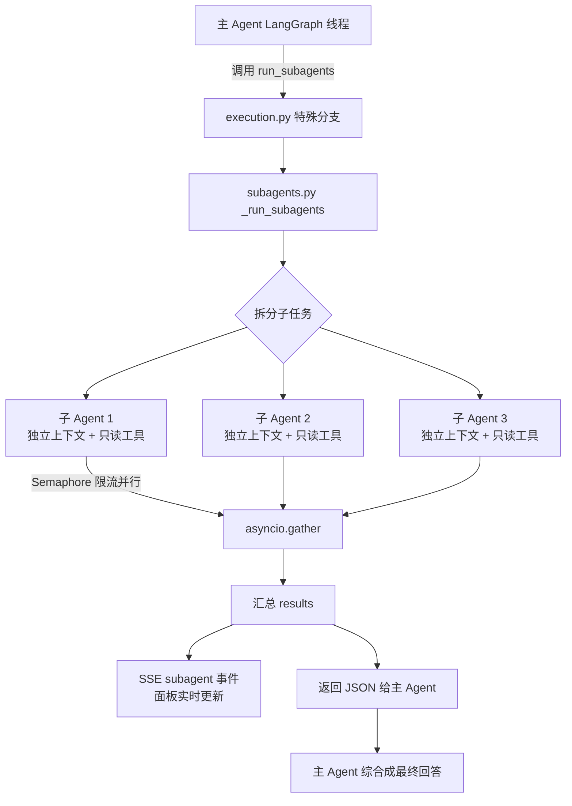

# 子 Agent（并行分工）功能设计

> 编号：003 ｜ 类型：design ｜ 日期：2026-08-21 ｜ 状态：已实施
> 版本：v1.0
> 关联模块：`divine-server/app/agent/subagents.py`（新增）、`divine-server/app/agent/execution.py`、`divine-server/app/agent/context.py`、`divine-server/app/agent/orchestrator.py`、`divine-server/app/agent/constants.py`、`divine-server/app/tools/adapters/subagents.py`（新增）、`divine-app/src/pages/chat/hooks/useChatStream.ts`、`divine-app/src/pages/chat/components/MessageItem/SubAgentPanel.tsx`（新增）、`divine-app/src/services/api.ts`


## 1. 背景与目标

当前 Agent 是单一上下文、串行执行的 LangGraph Agent：一个任务从开始到结束都在同一条会话线程里顺序调用工具。对于“同时调研多个主题”“从多个来源收集资料”“并行分析多份文件”这类任务，主 Agent 只能逐个处理，耗时长、上下文被无关中间步骤挤占。

本设计引入**并行分工子 Agent**：

- 主 Agent 把大任务拆成多个相互独立的子任务，通过新增工具 `run_subagents` 一次委托给多个子 Agent。
- 每个子 Agent 拥有**独立上下文**（只看到自己的任务说明 + 系统约束），互不干扰，可安全并行。
- 子 Agent 并行执行（默认最多 4 个同时运行），各自使用受限的**只读工具集**完成调研/分析。
- 结果按子任务汇总返回主 Agent，由主 Agent 综合成最终回答。
- 聊天界面在主 Agent 消息下方展示**可折叠进度面板**：每个子 Agent 的状态（运行中/完成/失败）与产出摘要实时可见。

### 目标

- 支持“同时调研多个话题 / 多来源收集 / 并行分析”类任务，缩短总耗时。
- 子 Agent 与主 Agent 上下文严格隔离，不污染会话线程。
- 子 Agent 默认只读，不引入新的审批风险面。
- 前端以可折叠面板呈现执行过程，流式更新、刷新后可从历史恢复最终状态。

### 非目标

- 不做可写子 Agent：子 Agent 不写文件、不执行终端命令、不创建日程（v2 演进，见 §9）。
- 不做子 Agent 之间互相通信（无消息传递、无共享变量）。
- 不做后台/异步子 Agent：子 Agent 在主 SSE 流内同步等待完成（v2 可演进为后台任务）。
- 不新增数据库表：子 Agent 运行细节不落库，只把汇总结果作为 `run_subagents` 工具的输出持久化。

## 2. 使用场景

### 2.1 用户主动要求并行调研

- “同时调研 DeepSeek R1、Claude Opus 和 Gemini 2.5 的定价，对比后给我建议”
- “分别查一下苹果、谷歌、微软本季度的财报要点”
- “帮我从 5 个不同角度分析这份文档”

### 2.2 主 Agent 自主拆解

- 用户需求天然包含多个独立子问题（“A 怎么做 + B 怎么做 + C 怎么做”）。
- 多源收集类任务（多个 URL、多个数据源），适合拆成每源一个子 Agent。
- 生成了 `write_todos` 计划后，其中相互独立的调研项可并行执行。

### 2.3 明确的排除场景

- 需要写文件、执行命令、需要用户确认的子任务：不委托子 Agent，由主 Agent 串行处理。
- 子任务之间强依赖（下一步依赖上一步结果）：不拆，保持主 Agent 串行。

## 3. 整体架构



关键约束：

- `run_subagents` 是**元工具（meta tool）**：注册在工具注册表供模型看到 schema，但执行不经过子进程脚本，由 `execution.py` 按工具名特殊分支到 `subagents.py`（与 `migrate_skill` / `install_skill` 的既有特殊分支模式一致）。
- 子 Agent 复用现有 `create_agent` + LangChain 工具体系，每个子 Agent 一个独立线程（fresh `InMemorySaver` + 独立 thread_id），线程间互不共享消息。
- SSE 增加一种事件类型 `subagent`，其余协议不变；子 Agent 内部工具调用不产生 `tool` SSE 事件，避免刷屏。
- 子 Agent 内部工具调用不写入 `tool_runs` 表，只记日志；`run_subagents` 本身作为一次工具运行持久化输入输出。

## 4. 后端设计

### 4.1 工具契约：run_subagents

在 `divine-server/app/tools/adapters/subagents.py` 注册（仅 schema，供模型可见）：

参数：

| 参数 | 类型 | 说明 |
| --- | --- | --- |
| `tasks` | array | 子任务数组，2–8 个；每个含 `id`、`name`、`prompt`、可选 `tools` |
| `max_parallel` | integer | 可选，最大并行数，默认 3，上限 4 |

子任务对象：

| 字段 | 类型 | 说明 |
| --- | --- | --- |
| `id` | string | 子任务唯一 id（`sa-1` 之类），必填 |
| `name` | string | 面板显示的短标题（如“调研定价”），必填 |
| `prompt` | string | 自包含的任务说明：子 Agent 看不到主对话历史，prompt 必须包含全部所需背景与要求，必填 |
| `tools` | array | 可选白名单；默认使用只读工具集（见 4.3） |

示例：

```json
{
  "tasks": [
    {
      "id": "sa-pricing",
      "name": "调研 DeepSeek 定价",
      "prompt": "使用 web_fetch 访问 https://api-docs.deepseek.com/zh-cn/quick_start/pricing，提取 DeepSeek-V4 各模型的输入/输出价格（每百万 tokens），用中文输出要点列表。"
    },
    {
      "id": "sa-compare",
      "name": "对比三家定价",
      "prompt": "基于以下三家定价信息，输出对比表：\n- DeepSeek-V4: ...\n- Claude: ...\n- Gemini: ...\n只输出对比结论，不超过 300 字。"
    }
  ],
  "max_parallel": 2
}
```

适配器 stub：`RunSubagentsAdapter.run()` 直接抛 `ToolExecutionError("内部元工具，不可直接执行")`，防止绕过 Agent 特殊分支被外部直接调用。

### 4.2 执行入口：execution.py 特殊分支

在 `_handle_adapter_call` 的 try 块最前面（`migrate_skill` 分支之前）增加：

```python
if name == "run_subagents":
    return await _run_subagents(ctx, runtime, arguments)
```

- `run_subagents` 加入 `constants.py` 的 `_NO_PLAN_TOOLS`：调用时不弹“先出方案”询问（子 Agent 本身只读，元工具不做计划门禁；复杂任务主 Agent 会先走 `write_todos`）。
- 不进入外部路径确认、终端策略、日程写入等既有审批流程。
- 受主 SSE 流生命周期约束：用户停止生成时通过 `cancel_event` 取消整个批次（见 4.5）。

### 4.3 子 Agent 运行器：subagents.py（新增）

新增 `divine-server/app/agent/subagents.py`，包含：

**子 Agent 系统提示（SUBAGENT_SYSTEM_PROMPT）**：

```text
你是 Divine 的并行子 Agent，负责独立完成分配给你的一个子任务。
规则：
- 只能使用下方提供的工具；没有工具可完成时直接输出已有结论，不要编造工具。
- 不要请求用户确认，不要询问问题，不要输出方案。
- 使用语言与主对话一致（中文/英文），直接输出任务要求的结论。
- 输出保持简洁：要点列表优先，不要长篇大论。
```

**只读工具集**（从注册表按白名单过滤，默认集合）：

```
read_file, read_image, search_files, directory_tree, rag_search,
sqlite_query, calculator, web_fetch, web_fetch_batch,
generate_chart, describe_svg, load_skill
```

- `terminal`、`edit_files`、`write_file`、`notes`、`word_document`、`spreadsheet`、`presentation`、`pdf_generate`、`schedule_task`、`write_calendar`、`remember`、`forget_memory`、技能迁移/安装类工具**一律不在默认集合**。
- 即使 `tools` 白名单显式传入写类工具，运行器也会剔除并在日志中警告（v1 硬约束）。
- 子 Agent 工具通过轻量执行器 `_run_subagent_tool` 直接调用 `adapter.run(workspace, args, locale)`（带超时），**不写 tool_runs、不发 tool SSE 事件、不触发任何审批**。
- 外部路径约束：调用 `adapter.external_paths()`，命中 `ctx.approved_paths` 之外的外部路径时自动拒绝，把“无权访问该路径”作为工具错误返回给子 Agent。

**运行流程 `_run_subagents(ctx, runtime, arguments)`**：

1. 校验：`tasks` 非空、2–8 个；`id`/`name`/`prompt` 必填；超限直接返回错误 JSON。
2. 发 `tool` 事件（`run_subagents`，status=running）。
3. 对每个子任务发 `subagent` 事件（status=running）。
4. 用 `asyncio.Semaphore(max_parallel)` + `asyncio.gather` 并行执行 `_run_subagent`。
5. 每个子任务完成后发 `subagent` 事件（done + summary / error + error）。
6. 发 `tool` 事件（done/error，携带 results 摘要）。
7. 返回聚合 JSON（见 4.4）。

**单个子 Agent `_run_subagent(ctx, task)`**：

1. 构造 `AgentRunContext` 副本：继承 session_id、workspace、locale、approved_paths；`approval_mode="assist"`（子 Agent 内不弹确认）。
2. `_build_llm` 复用主运行的 think / effort / model_id（从 ctx 读取，见 4.6）。
3. `create_agent`：`system_prompt=SUBAGENT_SYSTEM_PROMPT + 任务说明`，tools=过滤后的只读工具，middleware 仅 `ModelCallLimitMiddleware(run_limit=16, exit_behavior="end")` + `ToolErrorMiddleware`；`checkpointer=InMemorySaver()`（fresh，thread_id=`{session_id}:sub:{task_id}`）。
4. `await agent.ainvoke({"messages": [HumanMessage(task.prompt)]})`，外层 `asyncio.wait_for(timeout=180)`。
5. 提取最终 content → `summary`（截断 800 字符）+ `output`（截断 12000 字符，供主 Agent 参考）。
6. 超时/异常 → status=error，附错误信息。

**限制常量**（放 `subagents.py`）：

| 常量 | 值 | 说明 |
| --- | --- | --- |
| `MAX_SUBAGENTS` | 8 | 单批次子任务上限 |
| `MAX_SUBAGENT_PARALLEL` | 4 | 并行上限 |
| `SUBAGENT_MAX_TOOL_TURNS` | 16 | 单个子 Agent 工具轮次上限 |
| `SUBAGENT_TIMEOUT` | 180s | 单个子 Agent 总超时 |
| `SUBAGENT_SUMMARY_CAP` | 800 字符 | 面板摘要截断 |
| `SUBAGENT_OUTPUT_CAP` | 12000 字符 | 回传主 Agent 的完整输出截断 |

### 4.4 返回协议（给主 Agent 的 JSON）

```json
{
  "success": true,
  "message": "4 个子任务完成，1 个失败",
  "results": [
    {"id": "sa-1", "name": "调研定价", "status": "done", "summary": "DeepSeek-V4 输入 2 元/百万 tokens...", "output": "完整输出"},
    {"id": "sa-2", "name": "对比三家", "status": "error", "error": "子 Agent 超时（180s）"}
  ]
}
```

主 Agent 拿到后综合所有 `summary` 形成最终回答；失败的子任务在回答中说明原因并给出替代方案。

### 4.5 SSE 协议

新增事件类型 `subagent`，由 `_run_subagents` 直接用 `sse_event("subagent", {...})` 发出（复用现有 `app/sse.py`，无需新增分支）：

```
event: subagent
data: {"session_id":"...","sub_id":"sa-1","name":"调研定价","status":"running"}
data: {"session_id":"...","sub_id":"sa-1","name":"调研定价","status":"done","summary":"DeepSeek-V4 输入 2 元/百万 tokens..."}
data: {"session_id":"...","sub_id":"sa-2","name":"对比三家","status":"error","error":"子 Agent 超时（180s）"}
```

- `status`：`running` | `done` | `error`。
- `done` 时带 `summary`，`error` 时带 `error`。
- 前端按 `sub_id` 幂等 upsert 到当前消息的 `subagents` 数组。

### 4.6 AgentRunContext 扩展

`divine-server/app/agent/context.py` 增加字段：

```python
think: bool = False
effort: str | None = None
model_id: str | None = None
cancel_event: asyncio.Event | None = None
```

`orchestrator.run_agent` 构造 ctx 时传入当前运行的 `think` / `effort` / `model_id` / `cancel_event`：

- 子 Agent 继承主运行的模型与思考设置，保证一致性。
- `_run_subagents` 在 `gather` 外层用 `asyncio.wait` 监听 `cancel_event`，用户停止生成时取消整个批次（与 orchestrator 的取消语义对齐）。

### 4.7 Prompt 规则（constants.py SYSTEM_PROMPT 增量）

在 `divine-server/app/agent/constants.py` 的 SYSTEM_PROMPT 中追加：

```text
当任务包含多个相互独立的子任务（如同时调研多个主题/产品/来源、并行分析多份资料、
多角度对比）时，调用 run_subagents 并行执行，规则：
- tasks 每个子任务必须提供 id、name 和自包含的 prompt（子 Agent 看不到本对话历史，
  prompt 要写清背景、目标、数据来源和输出要求）；
- 每个子任务指定明确可执行的动作（如“用 web_fetch 访问 X，提取 Y”），
  不要写“请分析”这类含糊指令；
- 子 Agent 只能使用只读工具，不要委托需要写文件、运行命令或用户确认的子任务；
- 全部完成后，把每个子任务的结果汇总成最终回答，失败的子任务要说明原因。
```

## 5. 前端设计

### 5.1 类型（types.ts）

```ts
export interface SubAgentItem {
  id: string;
  name: string;
  status: "running" | "done" | "error";
  summary?: string;
  error?: string;
}

export interface ChatMessage {
  // ...现有字段
  subagents?: SubAgentItem[];
}
```

### 5.2 SSE 消费（useChatStream.ts + sse.ts）

- `services/sse.ts` 的 `SSEHandlers` 增加 `subagent?: (data: SubAgentEvent) => void`。
- `useChatStream` 增加 `subagent` 处理器：按 `data.sub_id` 在 `message.subagents` 中 upsert（存在则替换，不存在则追加），状态实时更新到当前 assistant 消息。

### 5.3 可折叠进度面板（SubAgentPanel.tsx，新增）

新增 `divine-app/src/pages/chat/components/MessageItem/SubAgentPanel.tsx`，渲染位置在 `MessageItem` 中 `PlanCard` 之后、工具卡片之前：

- 用 `<details className="subagent-block">` 实现，结构与 `PlanCard` / `ThinkBlock` 一致。
- 标题栏：`子 Agent` + 进度 `完成数/总数`（如 `3/4`）+ 折叠箭头。
- 每个子 Agent 一行：状态图标（运行中 spinner / 完成 ✓ / 失败 ⚠）+ `name` + 摘要或错误（单行截断，`title` 显示全文）。
- 有子 Agent 处于 running 时默认展开，全部结束后保持用户当前折叠状态（不强制收起）。
- 流式期间只追加/更新行，不重建整个面板；组件卸载或消息结束清理未完成态。

样式：复用 `message-item` 现有的 details 视觉 token（边框、圆角、间距），新增 `.subagent-block` / `.subagent-item` / `.subagent-status-*` 少量样式到 `index.less`，不引入新色值。

### 5.4 历史恢复（services/api.ts）

`messagesToChatMessages` 映射 `tool_runs` 时，遇到 `run.tool_name === "run_subagents"` 且 output 可解析：

- 从 `output.data.results`（或顶层 `results`）解析出最终 `SubAgentItem[]`（status 恒为 done/error，无 running）。
- 附加到对应 assistant 消息的 `subagents` 字段，刷新/重进会话后面板显示最终状态。

### 5.5 国际化

三个 locale 文件（`zh-CN` / `zh-TW` / `en`）增加：

| key | zh-CN | en |
| --- | --- | --- |
| `message.subagents` | 子 Agent | Sub-agents |
| `message.subagentProgress` | `{{done}}/{{total}}` | `{{done}}/{{total}}` |
| `tool.subagentsRunning` | 正在并行执行 {{count}} 个子任务 | Running {{count}} sub-tasks in parallel |
| `tool.subagentsDone` | 子任务完成：成功 {{done}}，失败 {{failed}} | Sub-tasks done: {{done}} succeeded, {{failed}} failed |
| `tool.subagentTimeout` | 子 Agent 执行超时 | Sub-agent timed out |

## 6. 安全与稳定性

| 风险 | 对策 |
| --- | --- |
| 子 Agent 执行写操作 | 工具白名单硬剔除写类/命令类/日程类工具，v1 只读 |
| 子 Agent 访问外部路径 | `external_paths` 检查，非 `approved_paths` 自动拒绝并返回工具错误 |
| 并行度过高打爆 API/子进程 | `Semaphore(max_parallel≤4)`，子 Agent 轮次上限 16、单 Agent 超时 180s |
| 子 Agent 输出过大撑爆主上下文 | summary 800 字符、output 12000 字符截断后回传 |
| 子 Agent 之间互相干扰 | 每个子 Agent 独立线程（fresh checkpointer + 独立 thread_id），无共享状态 |
| 用户中途停止 | `cancel_event` 经 ctx 传入，`asyncio.wait` 监听并取消整个批次 |
| 无 API Key 的 Mock 模式 | 子 Agent 复用 `_build_llm`，MockChatModel 直接返回演示回答，功能可验收 |
| 主 Agent 反复误用 | Prompt 约束 + `_NO_PLAN_TOOLS` 门禁 + 单批次任务数上限 8 |
| 绕过特殊分支直接调用工具 | stub adapter 的 `run` 直接抛错 |

## 7. 验收标准

- 对话中发送“同时调研 A、B、C 三个主题并对比”，主 Agent 调用一次 `run_subagents`，面板显示 3 个子 Agent 并行执行，全部完成后主 Agent 给出综合对比回答。
- 面板实时显示每个子 Agent 的 running → done/error 状态与摘要，可折叠；流式结束状态与最终回答一致。
- 子 Agent 无法调用 `terminal` / `edit_files` 等写类工具（白名单硬剔除）。
- 子 Agent 试图读取 `approved_paths` 之外的外部路径时被拒绝，主 Agent 在最终回答中反映失败原因。
- 刷新页面 / 重新进入会话后，面板从历史恢复最终 done/error 状态（running 状态不保留）。
- 无 API Key 的 Mock 模式下同样可验证面板渲染与事件流。
- 停止生成后批次被取消，不残留后台子 Agent 进程。
- `npx tsc --noEmit`、`pnpm build`、后端 pytest 全部通过。

## 8. 实施拆解

1. 后端：`context.py` 增加 think/effort/model_id/cancel_event；`orchestrator.py` 填充。
2. 后端：新增 `agent/subagents.py`（常量、`_run_subagent_tool`、`_run_subagent`、`_run_subagents`、`SUBAGENT_SYSTEM_PROMPT`）。
3. 后端：`tools/adapters/subagents.py` 注册 `run_subagents` schema + stub；`adapters/__init__.py` 引入。
4. 后端：`execution.py` 增加 `run_subagents` 特殊分支；`constants.py` 加入 `_NO_PLAN_TOOLS` 与 SYSTEM_PROMPT 规则。
5. 后端：`_run_subagents` 内通过 `sse_event("subagent", ...)` 发出 running/done/error 事件与 `tool` 事件。
6. 后端：`tests/test_subagents.py` —— schema 校验、白名单剔除、外部路径拒绝、超时、汇总格式、Mock 模式冒烟。
7. 前端：`types.ts` + `sse.ts` + `useChatStream.ts` 接入 `subagent` 事件。
8. 前端：新增 `SubAgentPanel.tsx` + `index.less` 样式 + `MessageItem` 接入。
9. 前端：`api.ts` 历史恢复解析 `run_subagents` 工具输出。
10. 前端：三语言 i18n key。
11. 验证：构建、类型检查、后端单测、浏览器双主题（深/浅）手工验收、Mock 模式验收、取消/超时/失败场景。

## 9. 演进建议

首版把子 Agent 限定为“只读、同步、无互相通信”，后续出现以下信号再升级：

- 用户要求“子 Agent 帮我写完这份文档并保存”→ 放开写类工具白名单（`edit_files`/`notes`/`word_document` 等），写操作沿用主 Agent 的确认语义：在委托前由主 Agent 通过选项卡片/计划审批征得用户同意，子 Agent 内不再弹窗。
- 用户要求后台执行（“跑完通知我”）→ 子 Agent 批次脱离 SSE 流，改为后台任务 + 完成通知，需要新增任务表与轮询/推送。
- 用户要求子 Agent 间传递结果（“让 B 用 A 的结果继续”）→ 在 `run_subagents` 结果中允许引用其他子任务的 `output`，或拆成两次调用。
- 多模型分工（“调研用 Flash，写作用 Pro”）→ 子任务级 `model_id` 覆盖。

在出现这些需求前，不引入消息总线、任务队列或新的持久化表，避免提前增加复杂度。
