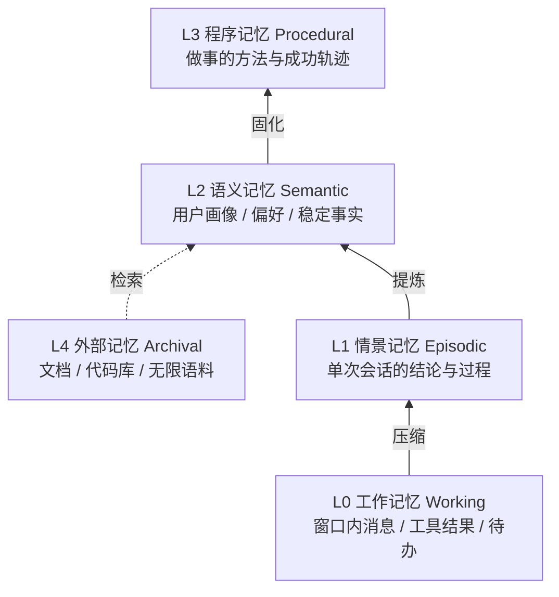
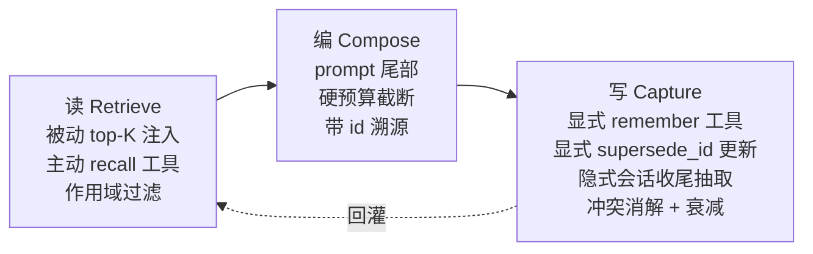

# 022 · Agent 多层记忆架构（2026-09-11）

> 编号：022 ｜ 类型：design ｜ 日期：2026-09-11 ｜ 修订：2026-09-12（v2，评审后）｜ 状态：未实施（方案待审）
>
> v2 修订要点：§5.1 重构为「极性闸门 + pending 三态闭环 + 显式 supersede_id」三件套；§4.2 打分公式补量纲归一化与权重闭合；§5.4 缓存方案改为 SQLite `data_version` 惰性失效（工具走 subprocess，进程内缓存跨不了进程边界）；新增注入查询多轮化、删除侧检索匹配（§5.2）；L1 砍掉 keywords 列改为全文检索（§4.3）。

## 1. 背景与目标

Divine 当前已有记忆能力的雏形（长期偏好记忆、会话摘要、RAG），但**层与层之间没有沉淀通路，读取侧只有单一通道**。
本方案给出一套完整的分层记忆架构，并基于现有代码给出可落地的改造路径。

目标：

1. 让跨会话的用户信息、**项目约定、历史结论**都能被稳定召回；
2. 消除现有 supersede 逻辑**静默覆盖语义相反记忆**的缺陷；
3. 记忆可读、可审计、可纠正，不变成黑盒。

非目标：引入向量数据库或 embedding 模型。全栈保持本地优先、零外部依赖，继续沿用现有自研 TF-IDF 检索原语。

## 2. 架构总览

五层模型（认知科学分层 + CoALA 术语对齐）：



| 层 | 存什么 | 介质 | 检索入口 | 生命周期 | Divine 现状 |
| --- | --- | --- | --- | --- | --- |
| L0 工作 | 窗口内消息、工具结果、待办 | `messages` + 滚动摘要 | 全量注入 | 会话内 | 已实现 |
| L1 情景 | 每次会话的结论与过程 | `session_summaries` | **应可跨会话检索** | 月级 | 半成品（仅同会话续接） |
| L2 语义 | 用户画像、偏好、稳定事实、项目约定 | `user_memories` | 被动 top-K + 工具召回 | 永久 | 已实现（单薄） |
| L3 程序 | 怎么做成一件事 | runbook / skill | 按意图匹配 | 半永久 | **缺失** |
| L4 外部 | 文档、代码库 | `rag_chunks` 倒排 | BM25 | 持久 | 已实现 |

### 五条设计原则（比层数更重要）

1. **每层必须同时具备独立写入触发器和检索入口。** 缺写入则层是空的，缺检索则层是黑盒——两者缺一，该层形同不存在。这是判断"某层是否真的建成了"的唯一标准。
2. **读取分层。** 被动注入控制在 3–5 条，其余靠工具按需召回。硬塞进 system prompt 会挤占工具 schema 与历史消息的预算。
3. **打分不能只看相似度，也不能混合不可比的量纲。** sim / importance / recency / confidence 需先归一化到同一尺度再加权（见 §4.2）。
4. **记忆必须可审计可编辑。** 用户能看到 AI 记住了什么、能删除、能纠正；每次覆盖留痕可回溯。删除与纠正的入口本身也要可靠（见 §5.2 删除侧）。
5. **冲突处理的失败模式必须良性。** 任何冲突判定（极性、相似度）都是启发式，必然误判；设计上必须保证误判的代价是「保留两条」或「挂起待确认」，而**永远不是静默错删**。

## 3. 读写闭环



| 段 | 关键约束 |
| --- | --- |
| 读 | 被动注入 ≤ 5 条；查询源取**最近 2–3 条 user 消息**合并（只取最后一条会被指代性提问打空）；其余由模型主动调 `recall_memories` 深挖；按 `project_id` 与全局分别取 top-K 再合并 |
| 编 | 固定注入 system prompt 尾部（尾部遵循率最强）；字符硬上限，超预算时逐条放行、单条超长则截断该条，**不允许因单条丢掉全部**；每条带 `id` 便于纠错与引用 |
| 写 | 显式（用户明说 / 模型判断）+ 显式更新（`supersede_id` 指定覆盖对象）+ 隐式（会话收尾自动抽取）三通道；相似记忆的自动覆盖收紧为「高重复判定」，语义更新交由模型显式指定（见 §5.1） |

## 4. 各层设计细节

### 4.1 L0 工作记忆（现状保留）

- 窗口：`history_for_model(session_id, limit=context_limit)`，默认 20 条。
- 压缩：`compact.py` 在新增 ≥ 12 行且 ≥ 4 个 user turn 时触发，摘要持久化到 `session_summaries`，通过 `cutoff_rowid` 滚动推进。
- 超长工具结果替换为 stub 占位（> 600 字符），最近 12 条完整保留。
- **本层无需改造。**

### 4.2 L2 语义记忆（改造重点）

**打分公式**（替换现有纯余弦排序）：

```
final = w_sim * sim_norm + 0.15 * importance + 0.05 * confidence + w_recency * recency

sim_norm = sim / max(sim of 本轮候选集)        # 相对归一化
recency  = exp(-Δt_days / τ)                  # Δt 以 last_accessed_at 为基准，无访问记录时回退 updated_at
```

- **量纲归一化**：TF-IDF cosine 的实际典型值在 0.1–0.5，而 importance/confidence 恒在 [0, 1]，直接线性混合会让 0.70 的 sim 权重形同虚设。`sim_norm` 用候选集内最大值做相对化，把各分量拉回同一尺度。
- **权重闭合**：`w_sim = 1 - 0.15 - 0.05 - w_recency`，差额自动归 sim，公式对任意 `w_recency` 取值恒闭合：

| category | τ（天） | w_recency | w_sim（自动） | 说明 |
| --- | --- | --- | --- | --- |
| `preference` | 180 | 0.05 | 0.75 | 长期稳定，几乎不衰减 |
| `fact` | 90 | 0.10 | 0.70 | 会随事实变化 |
| `event` | 30 | 0.20 | 0.60 | 时效性强 |

- **访问续命**：每次记忆被注入或被 `recall_memories` 命中时更新 `last_accessed_at`。被持续使用的记忆不因写入时间久远而沉底——对应记忆的"再巩固"。
- **importance / confidence 维持写入时取值**，本期不做动态调整（避免无依据的自学习）；`hit_count` 只服务 recency 续命，不参与打分。待评测数据齐了再评估是否引入动态调整。

**作用域**：新增 `project_id` 列（可空）。检索时项目作用域与全局作用域各取 top-K 后合并去重，项目记忆优先。

**冲突消解（P0，见 §5.1）**：语义更新不得依赖相似度启发式自动完成，覆盖动作必须显式或挂起待确认。

### 4.3 L1 情景记忆（从"摘要"升级为"可检索"）

`session_summaries` 当前是 `session_id` 主键、一对一，只在同会话续接时被读取。升级为情景记忆：

1. 表加 `project_id` 列（从 `sessions.project_id` 冗余写入，避免 join）；
2. 复用 `db/retrieval.rank_documents` 对**摘要全文**做跨会话检索，暴露为 `recall_memories` 工具的 `scope=session` 形态（见 §5.2，不单独开新工具）。

> v2 变更：砍掉原方案的关键词抽取（`keywords` 列）。摘要本身只有几百字，全文直接进 TF-IDF 无性能压力，单独的关键词产出管道（用什么抽、语义泛化差）不值得引入；若后续评测显示全文检索不足，再加关键词加权作为增量优化。

收益：能回答"上次那个方案最后定的什么""我们之前讨论过 X 吗"这类问题——这是当前架构完全答不了的。

### 4.4 L3 程序记忆（新建，最低优先级）

不在本期实施，仅登记设计：

- 触发条件：一条轨迹被判定成功（无报错、用户未纠正、工具链完整闭合）且重复出现 ≥ 2 次。
- 存储形态：复用的 skill 定义或精简 runbook（步骤 + 关键约束）。
- 风险：自动沉淀会引入错误 workflow，且难以回滚。**建议先只做人工导入通道，不自动写。**

## 5. 缺口清单与改造方案

### 5.1 P0 · supersede 静默覆盖语义相反的记忆

**位置**：`divine-server/app/db/memories.py:71`

```python
if is_subset or jaccard >= 0.5:
    conn.execute("UPDATE user_memories SET status = ?, superseded_at = ? WHERE id = ?", ...)
```

**根因**：`db/retrieval.py:18` 的 `tokenize` 是「英文词 + CJK 单字 + bigram」，不含语义。以 `用户喜欢Python` / `用户不喜欢Python` 为例：

- A tokens（8）：`{用户, 户喜, 喜欢, 用, 户, 喜, 欢, python}`
- B tokens（10）：`{用户, 户不, 不喜, 喜欢, 用, 户, 不, 喜, 欢, python}`
- jaccard = 7 / 11 ≈ **0.64 ≥ 0.5**，两个方向都会触发覆盖。

即**先存哪条都会被后一条干掉，语义直接反转且无日志**。偏好类记忆恰恰最短，命中率最高。

**v2 设计：三件套，一起落地，缺一不可。**

#### ① 极性闸门（只防"说反了"，不负责"更新了"）

```python
_NEGATION_HINTS = ("不", "没", "无", "别", "禁止", "拒绝", "讨厌", "不用", "不再是")
_FALSE_POSITIVE = ("不错", "无比", "别提", "毫无压力", "不亦乐乎")  # 先摘除再匹配，降低子串误伤

def _polarity(content: str) -> int:
    text = str(content or "")
    for phrase in _FALSE_POSITIVE:
        text = text.replace(phrase, "")
    return -1 if any(h in text for h in _NEGATION_HINTS) else 1
```

极性检测**必然误判**（子串匹配无法覆盖中文否定的全部形态），因此它只作为闸门而非裁决：误判的代价被下游的 pending 状态吸收（见原则 5）。

#### ② pending 三态闭环

`user_memories.status` 扩展为 `active / pending / superseded` 三态：

- 同 category 下候选旧记忆，**仅当极性相同且 `jaccard >= 0.85`**（原 0.5 大幅提高；子集判定同样要求极性相同且 token 数量差 ≤ 2，长度比落在 `[0.6, 1.7]`）时才自动 supersede——即自动覆盖**只防高重复**，不再试图处理语义变化；
- 极性不同或处于灰区的（0.5 ≤ jaccard < 0.85 且极性不同）→ 新记忆以 `pending` 状态入库，**旧记忆保持 active，两条都不删**；
- `pending` 不参与注入与检索（读取侧只取 `active`），不会污染上下文；
- 消费入口：`db/memories.py` 新增 `list_pending / confirm_pending / reject_pending` 三个 API；一期先接一个最简的服务端 API + 前端待确认列表（可先用设置页占位），**不依赖模型自觉**。确认后转 `active`，拒绝后转 `superseded`（留痕）。

#### ③ 显式 supersede_id（语义更新的正道）

改述式更新（"以前喜欢 Python，现在主用 Go 了"）没有否定词、jaccard 也低，任何相似度启发式都接不住。方案是不再让启发式猜，而是让模型显式指定：

- `remember` 工具新增可选参数 `supersede_id`：模型先用 `recall_memories` 找到旧记忆，把旧记忆的 `id` 传入；保存新记忆的同时把旧记忆置为 `superseded`，`superseded_by` 指向新记忆 id。**显式指定绕过一切相似度阈值，且天然留痕可回滚。**
- `remember` 工具描述同步改为："纠正旧记忆时，先用 recall_memories 查到旧记忆 id，随新记忆一起传入 supersede_id；系统不再自动覆盖改述后的说法。"

**附加改造（同批做）**：新增 `superseded_by` 列记录覆盖者 id，使覆盖关系可回溯、可一键恢复；自动 supersede 的收益（防重复）与显式 supersede 的能力（语义更新）分离后，两者各自的失败模式都是良性的：前者漏判只会留下重复条目，后者漏判由模型在 recall 结果里看到旧记忆而自我纠正。

### 5.2 P1 · 读取与纠错双断链，缺 recall / 删除匹配失灵

**位置**：`divine-server/app/tools/adapters/memory.py` 只注册了 `remember` 与 `forget_memory`；唯一读取入口是 `agent/core/prompts.py:111` `_memory_context()` 的被动注入（`search_memories(last_user_text, limit=5)`，字符上限 `_MEMORY_BLOCK_CHAR_LIMIT = 2200`）。

三个断点：

1. 模型发现注入的 5 条不够时，**没有任何手段主动深挖**；
2. 注入查询只取最后一条 user 消息（`prompts.py:99-111`），"那还用刚才说的那个方案吗"这类指代性查询会打空；
3. 删除侧 `forget_memory_by_content` 是 trim 后**精确匹配**，用户说"忘掉那条 Python 的记忆"几乎必然删不掉——原则 4 的可纠正闭环在删除端是断的。

**方案**（统一为工具面改造，一个批次）：

- **`recall_memories` 单工具多作用域**：参数 `query`（必填）、`scope`（`user` / `project` / `session`，默认 `user`）、`limit`（默认 5）。`scope=session` 时检索 `session_summaries` 全文。单一工具避免 `recall_memories` / `recall_sessions` 双工具稀释模型选择；`_MEMORY_RULES` 中补充"注入内容不足以回答时主动召回"的规则。
- **注入查询多轮化**：`_memory_context` 取最近 2–3 条 user 消息拼接后检索（`term_frequency` 天然去重，成本可忽略）。
- **删除侧检索匹配**：`forget_memory` 的 content 改为"原话或大意"语义匹配——复用 `search_memories` 取 top-3；实测标定（见下）后采用「高阈值 + 领先优势」双条件：top-1 余弦 ≥ 0.45 且领先 top-2 ≥ 0.15 才直接删，**其余一律返回候选列表（带 id）让模型向用户确认后按 id 删**。删除一律留痕（`superseded_at` + `superseded_by`）。
  > 实测依据：词汇余弦对无关记忆也能冲到 0.3+（"用户在东京买房了" vs "用户在上海工作" = 0.34），单守绝对阈值会误删；而口语化指认（"那条柯基的记忆" = 0.30）又够不到自动删除线。错问一次很便宜，错删一条不可逆，所以自动删除线收紧到 0.45 + 领先 0.15，中间地带全部走确认。

### 5.3 P2 · 无项目作用域

`user_memories` 表无 `project_id`（见 `db/migrations.py:124`），项目 A 的约定必然污染项目 B。

`projects` 表与 `sessions.project_id` 均已存在，改造为：

```sql
ALTER TABLE user_memories ADD COLUMN project_id TEXT;
CREATE INDEX IF NOT EXISTS idx_memories_project ON user_memories(project_id);
```

migration 沿用 `migrations.py:223` 既有的「检测列存在性 + `ALTER TABLE ADD COLUMN`」幂等写法。

历史数据回填：`source_session_id` 已在表内，通过 `sessions.project_id` 反查回填即可，无需人工判定；查不到会话的旧记忆保持 NULL（全局作用域），宁缺勿错。

### 5.4 P2 · 每轮全量扫描的性能隐患

`memories.py:128` 每次检索都 `list_active_memories(limit=500)` 并对全部条目做 tokenize + TF-IDF。记忆涨到千级后，这会实打实拖慢首字延迟。

**v2 方案修正**：原方案的"进程内缓存（写入时失效）"**不可行**——工具通过 subprocess 执行 `memory.py`（`tools/base.py`），写入发生在另一个进程的连接上，进程内失效跨不过进程边界。改为：

- **SQLite 层惰性失效**：server 进程内缓存 TF-IDF 索引，每次检索前检查 `PRAGMA data_version`；其他连接（含 subprocess 写入）提交后该值自动变化，检测到变化才重建索引。零轮询、零进程间通信，跨进程正确；
- 兜底限制扫描窗口：缓存命中时仅对最近 200 条 + 高 importance 条目建索引。

### 5.5 P3 · 写入依赖模型自觉

当前只在模型主动判定"该记"时才写，必然漏记。补充会话收尾的隐式抽取通道：会话结束时用本地小模型对增量对话做一次抽取，产出候选记忆（带 confidence），高置信直接入库，低置信进入待确认队列（复用 §5.1 的 pending 状态与消费入口）。

## 6. 落地路径

| 期 | 内容 | 涉及文件 | 预估 | 风险 |
| --- | --- | --- | --- | --- |
| 一期 | P0 三件套：极性闸门 + pending 三态与消费 API + 显式 `supersede_id` + `superseded_by` 留痕 | `db/memories.py`、`db/migrations.py`、`tools/adapters/memory.py`、`tests/test_memories.py` | 1 天 | 低（失败模式全部收敛为"保留两条"或"挂起"，只减少误删） |
| 二期 | P1 工具面：`recall_memories`（含 scope）+ 注入查询多轮化 + 删除侧检索匹配 + 打分归一化与访问续命 + `evals/memory_retrieval` 评测基线 | `tools/adapters/memory.py`、`db/memories.py`、`prompts.py`、`db/migrations.py`（`last_accessed_at` 列）、新增 evals | 1.5 天 | 中（改变模型行为，需回归 evals） |
| 三期 | P2 项目作用域（含 `source_session_id` 回填） | `db/migrations.py`、`db/memories.py`、`prompts.py` | 1 天 | 中（migration 幂等，回填规则简单） |
| 四期 | L1 跨会话检索（`scope=session`，摘要全文直检） | `db/summaries.py`、`db/migrations.py` | 1 天 | 中 |
| 五期 | 隐式抽取 + L3 | 新增模块 | 3+ 天 | 高（引入自动写入，需先建审计面） |

建议：一期单独提交并补回归用例；二、三期合并评审后实施；评测基线（`evals/memory_retrieval`，≥ 30 条 query → 期望记忆）必须**先于二期上线建好**，作为 §8 退出条件的量化依据；四期之后视收益再决策。

## 7. 验收标准

1. 存入「用户喜欢 Python」后再存「用户不喜欢 Python」：两条**均存活**，新记忆以 `pending` 入库、不出现在注入与检索结果中，且可通过待确认入口转正或拒绝；
2. 带 `supersede_id` 保存新记忆后，旧记忆变为 `superseded` 且 `superseded_by` 指向新记忆 id，可追溯可恢复；
3. 注入 block 不超过 2200 字符：超预算时逐条放行直到放不下，单条超长截断该条而非丢弃后续全部；
4. 注入记忆不足时，模型能通过 `recall_memories` 补充召回；指代性提问（依赖前几轮 user 消息的记忆）召回率不低于末句查询；
5. 「忘掉那条 Python 的记忆」这类非精确表述能通过检索匹配完成删除：高置信（top-1 ≥ 0.45 且领先 0.15）直接删，其余先确认；
6. 项目 A 的约定不出现在项目 B 的记忆注入中；
7. `evals/memory_retrieval` 上测得注入/召回 top-5 命中率基线并记录在案（作为是否引入 embedding 的量化门槛）；
8. 每次 supersede（自动或显式）均可通过 `superseded_by` 追溯覆盖者。

## 8. 风险与权衡

- **不加 embedding**：检索质量上限低于向量方案。取舍是保持本地优先、零依赖、零成本——与 Divine 的产品定位一致。以 §7-7 的评测基线为准：若 top-5 命中率不足，再考虑引入本地小 embedding 模型。**没有基线就没有退出条件**，这是 v2 把评测建设提前到二期上线的理由。
- **极性检测是启发式**：子串匹配 + 白名单覆盖不了中文否定的全部形态，必然误判。设计上接受这一点——误判的代价被 pending 状态吸收（原则 5），不会静默错删或错记。
- **自动 supersede 收紧后可能堆积重复条目**：防重复（jaccard ≥ 0.85 自动覆盖）与语义更新（显式 `supersede_id`）分离后，改述式更新若模型漏传 id，会留下新旧两条。缓解：recall 结果按 recency 排序自然压低旧条目；待确认入口与 `superseded_by` 留痕保证事后可人工清理。评测基线建好后应加入"重复条目率"观测。
- **打分加权的调参**：初始权重是拍的，需要用 `evals/` 的真实场景回归后再调，不要上线即定型。`sim_norm` 的相对归一化使权重对候选集分布不敏感，调参成本可控。
- **自动写入（五期）**：收益高但风险最高，必须建立在审计面完善之后，否则会污染记忆库且难以清理。五期低置信候选复用 pending 通道，天然带审计。
