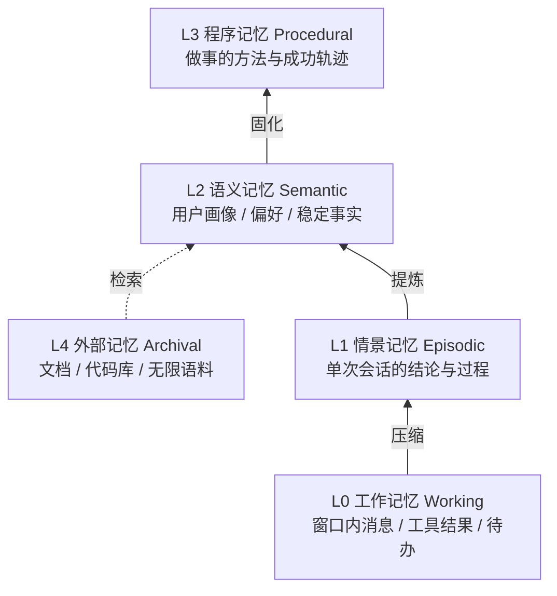
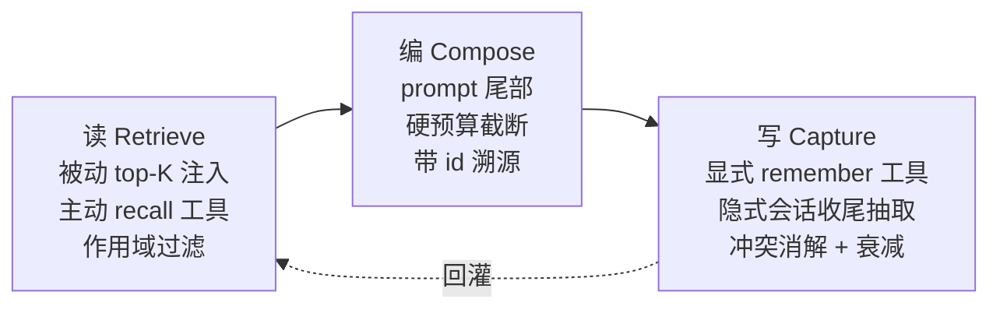

# 022 · Agent 多层记忆架构（2026-09-11）

> 编号：022 ｜ 类型：design ｜ 日期：2026-09-11 ｜ 状态：未实施（方案待审）

## 1. 背景与目标

Divine 当前已有记忆能力的雏形（长期偏好记忆、会话摘要、RAG），但**层与层之间没有沉淀通路，读取侧只有单一通道**。
本方案给出一套完整的分层记忆架构，并基于现有代码给出可落地的改造路径。

目标：

1. 让跨会话的用户信息、**项目约定、历史结论**都能被稳定召回；
2. 消除现有 supersede 逻辑**静默覆盖语义相反记忆**的缺陷；
3. 记忆可读、可审计、可纠正，不变成黑盒。

非目标：引入向量数据库或 embedding 模型。全栈保持本地优先、零外部依赖，继续沿用现有自研 TF-IDF 检索原语。

## 2. 架构总览

五层模型（认知科学分层 + CoALA 术语对齐）：



| 层 | 存什么 | 介质 | 检索入口 | 生命周期 | Divine 现状 |
| --- | --- | --- | --- | --- | --- |
| L0 工作 | 窗口内消息、工具结果、待办 | `messages` + 滚动摘要 | 全量注入 | 会话内 | 已实现 |
| L1 情景 | 每次会话的结论与过程 | `session_summaries` | **应可跨会话检索** | 月级 | 半成品（仅同会话续接） |
| L2 语义 | 用户画像、偏好、稳定事实、项目约定 | `user_memories` | 被动 top-K + 工具召回 | 永久 | 已实现（单薄） |
| L3 程序 | 怎么做成一件事 | runbook / skill | 按意图匹配 | 半永久 | **缺失** |
| L4 外部 | 文档、代码库 | `rag_chunks` 倒排 | BM25 | 持久 | 已实现 |

### 四条设计原则（比层数更重要）

1. **每层必须同时具备独立写入触发器和检索入口。** 缺写入则层是空的，缺检索则层是黑盒——两者缺一，该层形同不存在。这是判断"某层是否真的建成了"的唯一标准。
2. **读取分层。** 被动注入控制在 3–5 条，其余靠工具按需召回。硬塞进 system prompt 会挤占工具 schema 与历史消息的预算。
3. **打分不能只看相似度。** 需综合 importance / recency / confidence（见 §4.2）。
4. **记忆必须可审计可编辑。** 用户能看到 AI 记住了什么、能删除、能纠正；每次覆盖留痕可回溯。

## 3. 读写闭环



| 段 | 关键约束 |
| --- | --- |
| 读 | 被动注入 ≤ 5 条；其余由模型主动调 `recall_memories` 深挖；按 `project_id` 与全局分别取 top-K 再合并 |
| 编 | 固定注入 system prompt 尾部（尾部遵循率最强）；字符硬上限截断；每条带 `id` 便于纠错与引用 |
| 写 | 显式（用户明说 / 模型判断）+ 隐式（会话收尾自动抽取）双通道；新说法压旧说法前必须做极性检测 |

## 4. 各层设计细节

### 4.1 L0 工作记忆（现状保留）

- 窗口：`history_for_model(session_id, limit=context_limit)`，默认 20 条。
- 压缩：`compact.py` 在新增 ≥ 12 行且 ≥ 4 个 user turn 时触发，摘要持久化到 `session_summaries`，通过 `cutoff_rowid` 滚动推进。
- 超长工具结果替换为 stub 占位（> 600 字符），最近 12 条完整保留。
- **本层无需改造。**

### 4.2 L2 语义记忆（改造重点）

**打分公式**（替换现有纯余弦排序）：

```
final = 0.70 * sim + 0.15 * importance + 0.10 * recency + 0.05 * confidence
recency = exp(-Δt_days / τ)
```

按 category 差异化权重——偏好是稳定的，事件是易逝的：

| category | τ（天） | recency 权重 | 说明 |
| --- | --- | --- | --- |
| `preference` | 180 | 0.05 | 长期稳定，几乎不衰减 |
| `fact` | 90 | 0.10 | 会随事实变化 |
| `event` | 30 | 0.20 | 时效性强 |

**作用域**：新增 `project_id` 列（可空）。检索时项目作用域与全局作用域各取 top-K 后合并去重，项目记忆优先。

**冲突消解（P0，见 §5.1）**：覆盖旧记忆前必须做极性检测，否则语义相反的记忆会静默互删。

### 4.3 L1 情景记忆（从"摘要"升级为"可检索"）

`session_summaries` 当前是 `session_id` 主键、一对一，只在同会话续接时被读取。升级为情景记忆：

1. 表加 `project_id` 列（从 `sessions.project_id` 冗余写入，避免 join）；
2. 抽摘要时额外产出 3–6 个关键词写入 `keywords` 列；
3. 复用 `db/retrieval.rank_documents` 做跨会话检索，暴露为 `recall_sessions` 工具。

收益：能回答"上次那个方案最后定的什么""我们之前讨论过 X 吗"这类问题——这是当前架构完全答不了的。

### 4.4 L3 程序记忆（新建，最低优先级）

不在本期实施，仅登记设计：

- 触发条件：一条轨迹被判定成功（无报错、用户未纠正、工具链完整闭合）且重复出现 ≥ 2 次。
- 存储形态：复用的 skill 定义或精简 runbook（步骤 + 关键约束）。
- 风险：自动沉淀会引入错误 workflow，且难以回滚。**建议先只做人工导入通道，不自动写。**

## 5. 缺口清单与改造方案

### 5.1 P0 · supersede 静默覆盖语义相反的记忆

**位置**：`divine-server/app/db/memories.py:71`

```python
if is_subset or jaccard >= 0.5:
    conn.execute("UPDATE user_memories SET status = ?, superseded_at = ? WHERE id = ?", ...)
```

**根因**：`db/retrieval.py:18` 的 `tokenize` 是「英文词 + CJK 单字 + bigram」，不含语义。以 `用户喜欢Python` / `用户不喜欢Python` 为例：

- A tokens（8）：`{用户, 户喜, 喜欢, 用, 户, 喜, 欢, python}`
- B tokens（10）：`{用户, 户不, 不喜, 喜欢, 用, 户, 不, 喜, 欢, python}`
- jaccard = 7 / 11 ≈ **0.64 ≥ 0.5**，两个方向都会触发覆盖。

即**先存哪条都会被后一条干掉，语义直接反转且无日志**。偏好类记忆恰恰最短，命中率最高。

**修复方案**：

```python
_NEGATION_HINTS = ("不", "没", "无", "别", "禁止", "拒绝", "讨厌", "不用", "不再是")

def _polarity(content: str) -> int:
    return -1 if any(h in content for h in _NEGATION_HINTS) else 1
```

同 category 下的候选旧记忆，仅当以下**全部**满足时才 supersede：

1. 极性相同（`_polarity(new) == _polarity(old)`）；极性不同 → 不覆盖，改为标记待确认；
2. `jaccard >= 0.85`（从 0.5 大幅提高）；
3. 长度比落在 `[0.6, 1.7]`，避免短句吞掉长句；
4. 子集判定保留，但同样要求极性相同且 token 数量差 ≤ 2。

**附加改造（建议同批做）**：新增 `superseded_by` 列记录覆盖者 id，使覆盖关系可回溯、可一键恢复。

### 5.2 P1 · 读取侧单通道，缺 recall 工具

**位置**：`divine-server/app/tools/adapters/memory.py` 只注册了 `remember` 与 `forget_memory`；唯一读取入口是 `agent/core/prompts.py:111` `_memory_context()` 的被动注入（`search_memories(last_user_text, limit=5)`，字符上限 `_MEMORY_BLOCK_CHAR_LIMIT = 2200`）。

模型发现注入的 5 条不够时，**没有任何手段主动深挖**。

**方案**：新增 `recall_memories` 工具（category / project 作用域 / limit 参数），并在 `_MEMORY_RULES` 中补充"注入内容不足以回答时主动召回"的规则。

### 5.3 P2 · 无项目作用域

`user_memories` 表无 `project_id`（见 `db/migrations.py:124`），项目 A 的约定必然污染项目 B。

`projects` 表与 `sessions.project_id` 均已存在，改造为：

```sql
ALTER TABLE user_memories ADD COLUMN project_id TEXT;
CREATE INDEX IF NOT EXISTS idx_memories_project ON user_memories(project_id);
```

migration 沿用 `migrations.py:223` 既有的「检测列存在性 + `ALTER TABLE ADD COLUMN`」幂等写法。

### 5.4 P2 · 每轮全量扫描的性能隐患

`memories.py:128` 每次检索都 `list_active_memories(limit=500)` 并对全部条目做 tokenize + TF-IDF。记忆涨到千级后，这会实打实拖慢首字延迟。

方案：进程内缓存（写入时失效）或限制扫描窗口至最近 N 条 + 高 importance 条目。缓存方案更彻底，优先。

### 5.5 P3 · 写入依赖模型自觉

当前只在模型主动判定"该记"时才写，必然漏记。补充会话收尾的隐式抽取通道：会话结束时用本地小模型对增量对话做一次抽取，产出候选记忆（带 confidence），高置信直接入库，低置信进入待确认队列。

## 6. 落地路径

| 期 | 内容 | 涉及文件 | 预估 | 风险 |
| --- | --- | --- | --- | --- |
| 一期 | P0 supersede 极性修复 + `superseded_by` 留痕 | `db/memories.py`、`db/migrations.py`、`tests/test_memories.py` | 0.5 天 | 低（纯逻辑收敛，只减少误删） |
| 二期 | P1 `recall_memories` 工具 + 打分加权 | `tools/adapters/memory.py`、`db/memories.py`、`prompts.py` | 1 天 | 中（改变模型行为，需回归 evals） |
| 三期 | P2 项目作用域 | `db/migrations.py`、`db/memories.py`、`prompts.py` | 1 天 | 中（需 migration 与历史数据回填判定） |
| 四期 | L1 跨会话检索 | `db/summaries.py`、`db/migrations.py`、新增工具 | 1.5 天 | 中 |
| 五期 | 隐式抽取 + L3 | 新增模块 | 3+ 天 | 高（引入自动写入，需先建审计面） |

建议：一期单独提交并补回归用例；二、三期合并评审后实施；四期之后视收益再决策。

## 7. 验收标准

1. 存入「用户喜欢 Python」后再存「用户不喜欢 Python」，两条**均存活**且可分别召回；
2. 注入 block 不超过 2200 字符，超出按条截断而非整体丢弃；
3. 模型在注入记忆不足时能通过 `recall_memories` 补充召回；
4. 项目 A 的约定不出现在项目 B 的记忆注入中；
5. 每次 supersede 均可通过 `superseded_by` 追溯覆盖者。

## 8. 风险与权衡

- **不加 embedding**：检索质量上限低于向量方案。取舍是保持本地优先、零依赖、零成本——与 Divine 的产品定位一致。若后续评测显示 top-5 召回率不足，再考虑引入本地小 embedding 模型。
- **打分加权的调参**：初始权重是拍的，需要用 `evals/` 的真实场景回归后再调，不要上线即定型。
- **自动写入（五期）**：收益高但风险最高，必须建立在审计面完善之后，否则会污染记忆库且难以清理。
