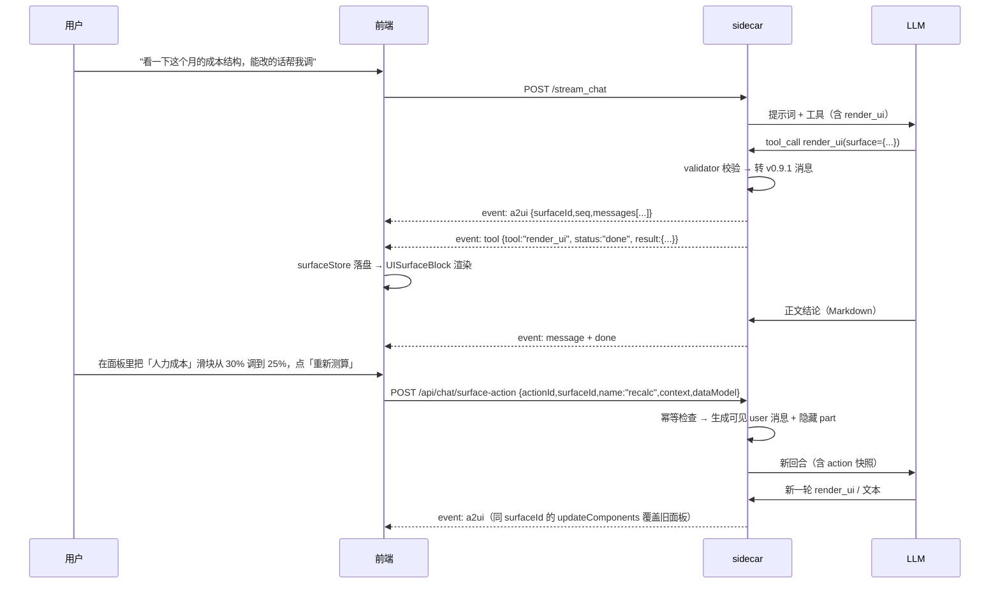

# 044 · Divine 接入 A2UI 方案设计（2026-10-09）

> 编号：044 ｜ 类型：design ｜ 日期：2026-10-09 ｜ 状态：**S1–S5 已实施（2026-10-10），待人工验收**  
> 目标：把 A2UI（Agent-to-UI，Google 主导的声明式 Agent 界面协议）接入 Divine，  
> 让 agent 能**用一套受控组件目录组合出可交互面板**（图表 + 表单 + 按钮），  
> 用户的操作能**回流成新一轮对话**，形成闭环。  
> 范围：新增「协议层 + 目录 + 校验 + 渲染 + 回流」五块；**不重写**现有工具卡 / ChartBlock / GraphBlock / Markdown 渲染链路。  
> 关联：design 020（GraphIR 范式，本方案的主要复用对象）、design 011（ask_user / interrupt）、design 013（user steering）、design 016（流式性能）、design 041 / review 009（主线程阻塞）、fix 005（工具卡状态收敛）。

---

## 0. 现状（代码事实）

### 0.1 后端流式协议：事件名 + 各异 payload，**没有统一 block 信封**

- SSE 编码器：`divine-server/app/sse.py` L7-22（`sse_event` / `error_event`）。
- 自定义事件透传机制：`divine-server/app/agent/core/sse.py` L12-17
  ```python
  def _custom_sse(payload):
      event_name = payload.get("event", "tool")   # payload 自带 "event" 键决定事件名
      data = {k: v for k, v in payload.items() if k != "event"}
      return sse_event(event_name, data)
  ```
  **这是本方案新增事件的落点**，零成本接入。
- 回合内事件清单（权威枚举在 `divine-app/src/services/sse.ts` L10-28 `SSEHandlers`）：  
  `think` / `think_done` / `message` / `plan` / `plan_sync` / `todo_update` / `tool` / `subagent` /  
  `scheduled_tasks_changed` / `calendar_events_changed` / `done` / `error`（另有 `compacted`）。
- `tool` 事件的构造点：`divine-server/app/agent/tools/execution.py` L1093-1110
  ```python
  payload = {"event": "tool", "tool": name, "status": ..., "result": _frontend_tool_result(output), ...}
  writer(payload)
  ```
- 前端事件分发：`divine-app/src/pages/chat/hooks/useChatStream.ts` L134-325 `buildStreamHandlers`（事件 → 局部更新消息）。

### 0.2 工具结果 → 渲染：靠 `result.data.*` 约定，而非 schema

- 出站裁剪：`divine-server/app/agent/state/persistence.py` L177-223 `_frontend_tool_result`
  - L184 `_FRONTEND_OPAQUE_KEYS = frozenset({"graphIR"})` —— **整块 payload 白名单，原样透传不截断**；其余字段递归截断（字符串 4000 字 / 列表 50 项）。
  - **本方案必须往这个集合里加键**，否则组件列表会被"50 项以上砍半"静默破坏。
- 各产物的前端判据（全部在 `divine-app/src/pages/chat/components/MessageItem/MessageHelpers.tsx`）：
  | 产物      | 判据                                                                         | 渲染组件                                        |
  | ------- | -------------------------------------------------------------------------- | ------------------------------------------- |
  | GraphIR | L43-52 `graphIRFromResult` 读 `result.data.graphIR`                         | `GraphBlock`（`ToolStatusCard.tsx` L204-206） |
  | 图表      | L21-36 `chartOptionFromResult` 读 `result.data.option`（`export_svg!==true`） | `ChartBlock`（`ToolStatusCard.tsx` L199-203） |
  | 文件列表    | L303-356 `toolFiles` 读 `data.files` / `data.results` / `result.filepath`   | `ToolFileList`（L230-238）                    |
  | diff    | `data.diff`                                                                | `DiffView`（L239-242）                        |

### 0.3 已有的「模型 → 声明式 UI」先例（本方案的直接参照物）

1. **`render_graph` + GraphIR**：后端工具 schema 强约束（`adapters/render_graph.py` L80-201）→ 后端校验器 `tools/graph/validator.py`（30KB，未知枚举硬报错 + 列出合法值让模型自纠）→ 前端手工镜像 `GraphBlock/GraphIR.ts`（白名单键集 + 禁 `on*`/几何/色值/`__proto__` + `parseGraphIR` 纵深防御）。**与 A2UI 的理念完全同构，只是范围更窄（只管图）。**
2. **`options` 卡片**：模型在正文里输出 ` ```options ` JSON 围栏 → 前端 `ChoiceBlock` 解析渲染成可点卡片（提示词见 `agent/core/constants.py` L133 `OPTIONS_CARD_HINT`）。**现状最接近 A2UI 的通道，但只能单选/多选，无布局、无数据绑定、无表单、动作不可回流上下文。**

### 0.4 设计系统资产（A2UI 目录要映射的目标）

- 基础控件：`divine-app/src/components/ui/` —— `Button` / `Input` / `TextArea` / `Select` / `Dropdown` / `Checkbox` / `Switch` / `Slider`(无，需确认) / `DateTimePicker` / `Modal` / `Tooltip` / `Toast` / `Tag` / `Flex` / `EmptyState` / `IconButton` / `LoadingOrb`。
- 颜色真源：`divine-app/src/styles/uiPalette.ts`（dark/light 双套 + `UI_COLORS`）；CSS token 在 `styles/index.less`。
- **铁律**：桌面 UI 深/浅主题只在前端（`theme.ts`），**后端不可见**。A2UI 的 `theme` / v1.0 `surfaceProperties` 因此必须收敛，见 §9.4。

### 0.5 与本方案直接相关的约束

- **无统一 block 封装**：渲染由 `ChatMessage` 字段驱动（`pages/chat/components/MessageItem/index.tsx` L212-284），不是 `switch(block.type)`。A2UI 面板需要新增一个**消息级**字段与渲染位。
- **工具参数 schema 是手写 JSON Schema** → `agent/core/schema.py` L61-80 `_make_args_model` 转 pydantic（`extra="allow"`，**未声明的属性不会被拦**）→ 最终校验仍要靠工具侧 validator。
- **工具注册**：`@register_tool(name, description, parameters)`（`tools/registry.py` L86-97），当前 **79 个**；`_build_tools` 按意图裁剪（`agent/tools/tools.py` L136 `_content_tool_allowed`）。
- **系统提示词**：`agent/core/prompts.py` L428-553 `_build_dynamic_prompt` 动态拼装；稳定节前置以命中前缀缓存，意图裁剪表在 `agent/intent/intent.py` L50 `ALWAYS_SECTIONS` / L491 `split_rule_sections`。
- **前端禁原生 `<button>`**；改动不主动跑 tsc/vite build；**后端改动必须重建 sidecar 才生效**（PyInstaller onefile）。

---

## 1. A2UI 协议事实（本方案的对齐基线）

来源：`a2ui.org` 规范 + 仓库 `a2ui-project/a2ui`（原 Google 发起，Apache 2.0，含 CopilotKit 贡献）。

### 1.1 版本矩阵

| 版本         | 状态        | 关键差异                                                                                                           |
| ---------- | --------- | -------------------------------------------------------------------------------------------------------------- |
| v0.8       | legacy    | `surfaceUpdate` / `dataModelUpdate` / `beginRendering` / `deleteSurface`；组件形如 `{"component": {"Text": {...}}}` |
| v0.9       | stable    | 引入 `createSurface`（创建与渲染解耦）、自定义目录、客户端函数；组件拍平                                                                   |
| **v0.9.1** | **当前生产线** | 标准化 MIME `application/a2ui+json`；放宽 `surfaceId` 约束                                                             |
| v1.0       | 候选        | 新增 `actionResponse`（客户端→服务端同步 RPC）、action id；`theme` 更名 `surfaceProperties`                                    |

> **本方案对齐 v0.9.1**，并把 v1.0 的变化隔离在一个版本边界模块内（§12.1）。

### 1.2 我们要用到的最小消息集（v0.9.1）

```jsonl
{"version":"v0.9.1","createSurface":{"surfaceId":"s1","catalogId":"https://divine.local/catalogs/divine-ui/v0_9_1.json"}}
{"version":"v0.9.1","updateComponents":{"surfaceId":"s1","components":[ /* 扁平组件列表 */ ]}}
{"version":"v0.9.1","updateDataModel":{"surfaceId":"s1","path":"/","value":{"rows":[...]}}}
{"version":"v0.9.1","deleteSurface":{"surfaceId":"s1"}}
```

- **邻接表模型**：组件是**扁平数组**，用 `id` 互相引用（不是嵌套树）。
  - v0.9.1 组件形如 `{"id":"root","component":"Column","children":["a","b"],"justify":"start"}`
  - 动态子节点（列表渲染）：`"children": {"path":"/rows","componentId":"row-tpl"}`
  - 约定：**必须有一个 `"id":"root"` 作为根**。
- **数据绑定**：字面量直接写值（`"text": "Hello"`），动态写 `{"path":"/user/name"}`（RFC 6901 JSON Pointer）。`updateDataModel` 用 `{path, value}` 直接设值，缺 `value` 即删除。
- **组件通用属性**：`id`（必填）、`accessibility`、`weight`。
- **动作**：`{"id":"btn","component":"Button","child":"btn-label","variant":"primary","action":{"event":{"name":"export_pdf","context":[...]}}}`。
- **目录（Catalog）**：一份 JSON Schema，声明本客户端允许的组件/函数/主题。客户端通过 `supportedCatalogIds` 声明支持哪些目录，agent 在 `createSurface` 里用 `catalogId` 指定。

### 1.3 官方生态（与选型相关）

- Web 渲染器：React / Lit / Angular **均为 v0.9.1 Stable，v1.0 尚在 Planned**；三者共用核心库 `@a2ui/web_core`（协议处理全在 core，框架层只做映射）。
- 其它：Flutter GenUI SDK Stable；SwiftUI / Jetpack Compose 仅 Planned。
- 传输：A2A / AG-UI / REST / WebSocket / MCP 均已支持；**SSE 是文档给出的原生形态之一，与 Divine 现状吻合**。
- **LangGraph 官方集成为 `💡 Proposed`** —— 即：没有现成的 LangGraph 接入件，本方案需要自己写生成器（这也正是 §10 的活）。

---

## 2. 价值论证与边界（先说清「为什么值得」）

### 2.1 现有两条通道的天花板

| 通道                                        | 能力上限      | 缺口                               |
| ----------------------------------------- | --------- | -------------------------------- |
| `options` 卡片                              | 单选 / 多选一次 | 无布局、无表单输入、无数据绑定、无后续交互            |
| 工具结果块（Chart/Graph/FileList）               | 单产物展示     | 一个工具 = 一块，**不能组合**；用户只能看，不能在里面操作 |
| Markdown + WebPreviewBlock（模型直出 HTML/SVG） | 任意样式      | 无组件级校验、样式不可控、XSS 面大              |

### 2.2 A2UI 补上的三件事

1. **组合**：一次把「KPI 文本 + 图表 + 数据表 + 操作按钮」组织成一块面板，而不是三张割裂的工具卡。
2. **闭环**：面板里的按钮能把**上下文（含用户在面板里改过的表单值）**送&#x56DE; agent，形成"看 → 调 → 再看"的往返，而不是"看一眼就结束"。
3. **受控**：模型只能在**我们声明的组件目录**里选，越界硬报错；比"直出 HTML"安全一个量级，比"自造私有 JSON 协议"更能跨模型稳定（多模型环境：DeepSeek / 混元 / Kimi / GLM-4）。

### 2.3 明确不做（架构克制，避免方案膨胀）

- ❌ 不做客户端函数调用（v0.9 `functionCall`）——不新增执行面。
- ❌ 不做任意样式/主题注入——只认 `tone` 语义色（§9.4）。
- ❌ 不做外部 catalog 加载——`catalogId` 只接受本机唯一值，其它一律降级为文本提示。
- ❌ 不做 v1.0 的服务端同步 RPC（`actionResponse`）——只做"动作 → 新回合"（§8.4）。
- ❌ 期一不做**组件级**增量渐进渲染——整块 surface 原子渲染（理由见 §11 S2 验收）。

---

## 3. 目标架构

```
┌─ divine-server ───────────────────────────────────────────────────────┐
│  LLM ──call──> render_ui(surface: {...})        app/tools/adapters/render_ui.py
│                    │
│                    ├─> app/tools/ui/validator.py   ← 校验（硬报错 + 合法枚举回灌）
│                    ├─> app/tools/ui/catalog.py     ← 单一真源（枚举/组件/限额）
│                    └─> app/tools/ui/versions/v0_9_1.py  ← 中立 IR → A2UI 消息
│                          │
│                          └─> writer({"event":"a2ui","surfaceId":..,"seq":..,"title":..,"messages":[..]})
│                                （沿用 agent/core/sse.py:_custom_sse 透传）
│  工具 content 只回"已渲染面板：<surfaceId>，含 N 个组件"（模型不需要看回 JSON）
└───────────────────────────────────────────────────────────────────────┘
                                    │ SSE
┌─ divine-app ──────────────────────▼───────────────────────────────────┐
│  SSEHandlers.a2ui  →  surfaceStore(reducer)  →  ChatMessage.surfaces[] │
│                                    │                                  │
│                    <UISurfaceBlock>  渲染位置：content 之后            │
│                          │                                            │
│        组件注册表 registry.tsx（id → React 组件）                      │
│        ├─ 基础件 → components/ui/*        （Button/Input/Select/...）  │
│        └─ 富媒体 ↑ 复用现有渲染器：ChartBlock / GraphBlock / ToolFileList 行样式
│                          │                                            │
│        用户点按钮 → actionCollector(取 context + 当前 dataModel)        │
│                          └─> POST /api/chat/surface-action → 新回合     │
└───────────────────────────────────────────────────────────────────────┘
```

### 3.1 一次完整往返（时序）



---

## 4. 组件目录（Catalog）设计

目录是本方案的**能力边界**：模型只能在这里面选，越界硬报错。它与 GraphIR 的 validator 是同一范式——**后端单一真源 + 前端手工镜像 + 快照测试对齐**（不共享代码，因为跨语言；靠 `tests/test_render_ui.py` 的快照锁死形态）。

### 4.1 单一真源与产物链

| 层    | 文件                                                        | 角色                                                                  |
| ---- | --------------------------------------------------------- | ------------------------------------------------------------------- |
| 真源   | `divine-server/app/tools/ui/catalog.py`                     | 组件枚举 / 每组件属性表 / 限额 / `tone` 集合 / action 白名单（**唯一可改处**）              |
| 产物   | `divine-server/app/tools/ui/divine_catalog.json`            | 由 `scripts/gen_ui_catalog.py` 生成，打进 sidecar 资源；亦作 `catalogId` 指向的文档 |
| 校验   | `divine-server/app/tools/ui/validator.py`                   | 读 catalog.py，做路径寻址错误 + 硬报错                                           |
| 前端镜像 | `divine-app/src/pages/chat/components/UISurface/types.ts`   | 手写 `UIComponent` 联合类型 + 白名单键集（**纵深防御**，见 §9.1 L3）                      |

- `catalogId` 取值：`https://divine.local/catalogs/divine-ui/v0_9_1.json`（本地稳定标识，见 §14 待决 4）。
- 与 graph 的做法一致：**catalog.json 是产物不是真源**，改能力只改 `catalog.py` 再跑生成脚本。

### 4.2 首批组件清单（18 个 = 布局 4 + 展示 6 + 输入 7 + 动作 1）

**A 组 · 布局（4）**

| 组件       | 关键属性                              | 映射                                      |
| -------- | --------------------------------- | --------------------------------------- |
| `Column` | `gap`(none/sm/md/lg)、`children`    | `components/ui/Flex`（纵向）                |
| `Row`    | `gap`、`align`、`wrap`、`children`   | `components/ui/Flex`（横向）                |
| `Card`   | `child`、`title?`、`tone?`          | 面板卡片容器（新增轻量件，走 token）                    |
| `Divider` | `orientation`                    | 纯样式 div（`uis-` 前缀）                      |

**B 组 · 展示（6）**

| 组件         | 关键属性                                          | 映射                                            |
| ---------- | --------------------------------------------- | --------------------------------------------- |
| `Text`     | `text`、`variant`(h1..h4/body/caption)         | 纯文本节点（**不做 HTML/Markdown 解析**，§9.2）           |
| `Badge`    | `text`、`tone`                                 | `components/ui/Tag`                           |
| `Image`    | `url`、`alt`、`aspectRatio?`                    | `` + 预留高度（§16.4）                         |
| `Table`    | `columns[{key,title}]`、`rows`、`maxHeight?`     | 新建 `uis-` 表格（内部滚动；**行数 ≤ 200**）                |
| `Progress` | `value`(0..1)、`label?`、`tone?`                 | 进度条（纯样式）                                      |
| `Steps`    | `items[{label,status}]`                        | 复用 design 015 的步骤状态语义（**不重复 PlanCard 信息**）      |

**C 组 · 输入（7）**

| 组件             | 关键属性                                                     | 映射                                |
| -------------- | -------------------------------------------------------- | --------------------------------- |
| `TextField`    | `label`、`value`(path)、`placeholder?`、`required?`         | `components/ui/Input`（40px 高）     |
| `TextArea`     | `label`、`value`(path)、`rows?`                             | `components/ui/TextArea`          |
| `NumberField`  | `label`、`value`(path)、`min/max/step`                     | `components/ui/Input`(type=number) |
| `Select`       | `label`、`value`(path)、`options[{value,label}]`            | `components/ui/Select`            |
| `ChoicePicker` | `value`(path)、`options`、`multiple?`                       | 复用 `ChoiceBlock` 的卡片样式（多选/单选）      |
| `Checkbox`     | `label`、`checked`(path)                                   | `components/ui/Checkbox`          |
| `Switch`       | `label`、`checked`(path)                                   | `components/ui/Switch`            |

**D 组 · 动作（1）**

| 组件       | 关键属性                                                       | 映射                          |
| -------- | ---------------------------------------------------------- | --------------------------- |
| `Button` | `text`、`variant`(primary/ghost/danger)、`disabled?`、`action` | `components/ui/Button`（**禁原生 `<button>`**） |

> **S5 追加富媒体组（E）**：`Chart` / `Graph` / `FileList` —— **只做 props 转发**，复用 `ChartBlock` / `GraphBlock` / `ToolFileList` 行样式，**禁止第二套 ECharts/X6 代码**（§11 S5）。

### 4.3 限额（validator 硬拒 + 前端二次裁剪）

| 项                  | 限额              | 理由                                      |
| ------------------ | --------------- | --------------------------------------- |
| 组件总数               | ≤ 120           | 单帧解析与首次渲染的可控上界                          |
| 嵌套深度               | ≤ 12            | 环检测 + 递归渲染的安全边界                         |
| 单 surface Chart     | ≤ 1             | ECharts 实例成本高                            |
| 单 surface Graph     | ≤ 1             | X6 异步创建 + 布局 + measure 成本更高             |
| **Chart + Graph 合计** | **≤ 2 / surface** | 同屏重组件上限（§16.2：`overscan:12` 会让离屏面板也 init） |
| Table rows         | ≤ 200           | UI 不是数据仓库；超出提示"用工具导出文件"                 |
| 面板总渲染高度            | ≤ 视口 1.5 倍      | 防单条消息撑爆虚拟列表（§16.4 高度抖动）                 |
| action 数量          | ≤ 8             | 动作区不变成菜单栏                               |
| surface 寿命         | 单条 assistant 消息内 | 跨消息复用留到 §14 待决 5                        |

> 超限的处理是**硬报错**（附当前值与上限），让模型自己拆成多次调用——与 `tools/graph/validator.py` 同风格，不做静默截断。

### 4.4 样例 surface（模型填的中立 IR）

```jsonc
// render_ui(surface = {...})  —— 这是"中立 IR"，不是 A2UI 协议 JSON；
// 转 A2UI v0.9.1 消息由 ui/versions/v0_9_1.py 负责（§1.2）
// 注：① Chart（富媒体组）S5 才接入，本样例不含；
//     ② actions 必须列出用到的**业务动作**，否则以"未登记的业务动作"被拒
//        （内置 submit/cancel/refresh/dismiss/open 免登记，见 §8.2）。
{
  "surfaceId": "cost-panel",
  "actions": ["recalc", "export_pdf"],
  "components": [
    {"id":"root",  "component":"Column", "gap":"md", "children":["hdr","kpi","tbl","ops"]},

    {"id":"hdr",   "component":"Text",  "text":"本月成本结构", "variant":"h3"},

    {"id":"kpi",   "component":"Row",   "gap":"sm", "children":["k1","k2","k3"]},
    {"id":"k1",    "component":"Badge", "text":"总成本 ¥128.4 万", "tone":"default"},
    {"id":"k2",    "component":"Badge", "text":"环比 -4.2%",      "tone":"success"},
    {"id":"k3",    "component":"Badge", "text":"人力占比 30%",     "tone":"warning"},

    {"id":"tbl",   "component":"Table", "maxHeight":320,
     "columns":[{"key":"name","title":"科目"},{"key":"amount","title":"金额"},{"key":"ratio","title":"占比"}],
     "rows":{"path":"/rows"}},

    {"id":"ops",   "component":"Row",   "gap":"sm", "children":["labor","recalc","export"]},
    {"id":"labor", "component":"NumberField", "label":"人力成本占比 (%)",
     "value":{"path":"/target/labor"}, "min":0, "max":100, "step":1},
    {"id":"recalc","component":"Button", "variant":"primary", "text":"重新测算",
     "action":{"name":"recalc", "context":[{"key":"labor","value":{"path":"/target/labor"}}]}},
    {"id":"export","component":"Button", "variant":"ghost", "text":"导出 PDF",
     "action":{"name":"export_pdf"}}
  ],
  "data": {
    "rows": [
      {"name":"人力","amount":"38.5 万","ratio":"30.0%"},
      {"name":"算力","amount":"42.1 万","ratio":"32.8%"},
      {"name":"带宽","amount":"21.3 万","ratio":"16.6%"}
    ],
    "target": {"labor": 30}
  }
}
```

- `Table.rows` 走 `{path:"/rows"}` 数据绑定，`updateDataModel` 换数据即换表，不用重发组件。
- 绑定路径**必须已存在于 `data`**，否则 validator 报错（并回灌 data 现有顶层键）。
- **S5 补充**：`Chart` 沿用同一模式——`option:{"path":"/chartOption"}` 指向 `data` 里的真实 option（用 `generate_chart` 先生成再引用，避免模型手搓 ECharts）。

---

## 5. 数据传输与持久化契约

### 5.1 新增 SSE 事件 `a2ui`

```jsonc
// event: a2ui
{
  "surfaceId": "cost-panel",
  "seq": 3,                    // 同一 surfaceId 内单调递增，用于乱序丢弃
  "source_call_id": "call_xx", // 关联 tool 事件（可选）
  "messages": [ /* 一帧内为完整的 A2UI 消息数组，见 §1.2 */ ]
}
```

- 后端构造点：`agent/core/sse.py` 内新增 `a2ui_sse()`，沿用 `_custom_sse` 的 `payload["event"]` 机制，**不改传输层**。
- 前端：`SSEHandlers` 增加 `a2ui?: (data) => void`，在 `useChatStream.ts` L134-325 的分发表里新增一项。
- **帧内完整性铁律**：一条 A2UI 消息**不得跨 SSE 帧切分**（不做 JSONL 流式拼接）。代价是首帧延迟，收益是解析零歧义。渐进渲染留到 §11 S5。

### 5.2 消息级新字段

```ts
// divine-app/src/types.ts
export interface UISurface {
  surfaceId: string;
  seq: number;
  catalogId: string;
  components: Record<string, UIComponent>;  // 邻接表，前端归一化后存 map
  rootId: string;
  dataModel: Record<string, unknown>;
  status: "live" | "closed";
  pendingActionId?: string | null;          // 乐观更新用
}

export interface ChatMessage {
  /* …现有字段… */
  surfaces?: UISurface[];   // ← 新增
}
```

- 渲染位：`pages/chat/components/MessageItem/index.tsx` L212-284 的 `.assistant-content` 内，**在 `MarkdownView` 之后、`error` 之前**插入
  ```tsx
  {message.surfaces?.map(s => <UISurfaceBlock key={s.surfaceId} surface={s} messageId={message.id} />)}
  ```
- 理由：面板是"结论的延伸操作区"，放在文字之后符合阅读顺序；DOM 顺序稳定，流式增长时不会抖动重排。

> ⚠️ **引用稳定性**：`surfaces` 数组必须保持引用稳定（`seq` 不变则引用不变），否则 `MessageItem`（`memo`）会因内联新数组导致**全部历史消息白重渲染**——这是 §16.3 的核心雷区。

### 5.3 持久化与历史回放

| 层    | 改动                                                                                                                |
| ---- | ----------------------------------------------------------------------------------------------------------------- |
| 前端类型 | `types.ts` L31-37 `MessagePart.type` 联合**增加 `"ui_surface"`**                                                      |
| 后端落库 | 回合结束（或收到 `deleteSurface`）时把**最终态**（components map + dataModel）序列化成一个 part 写入，`db.add_message_part`                |
| 落库裁剪 | 只存最终态，**丢弃中间 `updateComponents` 帧**；压缩后若 > 64KB 则只存 `components` 丢 `dataModel` 并把组件降级为静态文本                        |
| 历史回放 | 前端加载历史时从 part 重建 `UISurface`，`status:"closed"`（不可交互，可点"在新回合继续"）                                                   |
| 出站透传 | `persistence.py` L184 **`_FRONTEND_OPAQUE_KEYS` 增加 `"uiSurface"`**，防递归截断把组件列表砍半（同 `graphIR` 的理由，参照 design 020 §3） |

> ⚠️ 这一条是整个方案里**最容易被漏掉、后果最难查**的点：漏加 opaque key 时表现是"复杂面板渲染出来少了几个组件"，而非报错。

### 5.4 工具侧返回给模型的内容

```
content: "已渲染交互面板（surfaceId=cost-panel，11 个组件，2 个动作：recalc / export_pdf）。"
         "面板已直接呈现给用户，不需要在正文里重复其中数据。"
data:   {"uiSurface": {...最终态...}, "surfaceId": "cost-panel", "actionNames": ["recalc","export_pdf"]}
```

- 模型**不需要**看回完整 JSON（省 token，且避免它复述面板内容）。
- `data.uiSurface` 同时供前端在 `tool` 事件里兜底渲染（万一 `a2ui` 事件丢失/乱序）。

### 5.5 用户输入态（面板里改的值）的存储

面板里的「用户输入」有**四个时间点、四个不同落点**，必须分清——混了就会出现「刷新丢输入」或「对话历史被中间态污染」：

| 时间点                        | 落点                                                                                | 生命周期                     | 进模型上下文？         | 现有母本                                                                             |
| -------------------------- | --------------------------------------------------------------------------------- | ------------------------ | --------------- | -------------------------------------------------------------------------------- |
| ① 面板存活期、用户正在改（未提交）         | 前端**模块级 Map** `uiSurfaceStateStore`（key = `surfaceId`）                            | 组件卸载 / 虚拟列表滚出后仍在；**刷新丢** | ❌               | `ChoiceBlock/index.tsx` L173 `choiceStateStore`                                   |
| ② 同上，抗刷新（**推荐做**）           | **DB 新表 `ui_surface_states`**：按 `surface_id` **Upsert 覆盖写**，只存用户编辑过的字段（dirty diff） | 刷新 / 切会话 / 重开都保持         | ❌（否则历史被中间态污染）   | 对标 `messages.choice_state` + `POST /sessions/messages/{id}/choice_state`（`api/sessions.py` L109） |
| ③ 点动作提交                    | **新 `messages` 行**（role=`user`，content=按钮文案）+ 挂它的 part `a2ui_action`（`{name, context, data_model}`） | 永久（对话历史）                 | ✅（**只有正文进**，part 不进） | `db.add_message` + `db.add_message_part`（现有 part type：`think` / `tool_calls` / `tool_result`） |
| ④ 面板最终态（回合结束 / `deleteSurface`） | **assistant 消息的 `ui_surface` part**（components + dataModel）                        | 永久，回放用                   | ❌               | §5.3                                                                             |

**三条硬约束**：

1. **未提交的编辑态禁止写 `messages`**——它既不是对话内容，也会挤占 LLM 上下文预算（§0 的 token 预算 70% 治理）。所以 ② 必须独立落点，不能复用 `messages`。
2. **`message_parts` 不进模型上下文**：`agent/core/prompts.py` L204-214 的历史回溯只读 `row["content"]`，parts 仅供前端回放（`db/tool_runs.py` L41 / `db/history.py` L342）。**推论：③ 的动作参数必须写进可见正文字符串**（如「重新测算（人力成本占比=25%）」），否则模型只收到"重新测算"四个字、拿不到滑块值 → 见 §8.2 的 ⚠️。
3. **`ui_surface` part ≠ 用户输入**：那是"面板长什么样"，不是"用户做了什么"。回放要前者、回流分析要后者，**分开存**，别用同一份数据兼两个用途。

**② 的选型**：

- A. 复用 `messages.choice_state`：零新表，但语义越界（它是"选项卡片的已选态"）、且大小不可控（A2UI 的 `dataModel` 可能很大）。
- **B（推荐）. 新表 `ui_surface_states(surface_id TEXT PRIMARY KEY, message_id TEXT, session_id TEXT, data TEXT, updated_at TEXT)`**，按 `surface_id` **覆盖写**（不堆积行），只存 dirty 字段；沿用 ChoiceBlock 同款「**防抖写 + 失败不阻塞交互**」策略（`ChoiceBlock` L308-318）。
  - **写入口按会话，不按消息**（实施期修正，理由见 §6.3）：`POST /api/sessions/{session_id}/ui-surface-state` + 读取端 `GET /api/sessions/{session_id}/ui-surface-states`。原稿的 `POST /sessions/messages/{id}/ui_surface_state` 作废 —— 消息 id 在流式期是前端乐观 id，`done` 之后又换成服务端 id，拿它当写入口会让编辑态在 id 漂移时整份丢失；`message_id` 退化为「回显用」的可选字段。
  - 字段名用 `data`（不是 `data_model`）：这一列存的就是**面板当前态快照**，与请求体里的 `data_model` 同义；列名短一点，语义靠本注说明。

---

## 6. 后端实现任务（文件级）

| #   | 文件                                  | 动作 | 说明                                                                                                              |
| --- | ----------------------------------- | -- | --------------------------------------------------------------------------------------------------------------- |
| B1  | `app/tools/ui/__init__.py`          | 新增 | 包                                                                                                               |
| B2  | `app/tools/ui/catalog.py`           | 新增 | 组件枚举/属性表/限额/tone/action 白名单（**唯一真源**）                                                                           |
| B3  | `app/tools/ui/validator.py`         | 新增 | 路径寻址错误（`components[3].child` 这种）；未知组件/属性/引用缺失/环/深度/限额 → 硬报错 + 回灌合法枚举（照抄 `tools/graph/validator.py` 的错误风格）       |
| B4  | `app/tools/ui/versions/v0_9_1.py`   | 新增 | 中立 IR → A2UI v0.9.1 消息；**版本边界隔离**，v1.0 只改这里                                                                     |
| B5  | `app/tools/adapters/render_ui.py`   | 新增 | `@register_tool("render_ui", ...)`；参数 schema 手写（`surface` 对象 + 组件数组）；校验 → 出消息 → `writer(a2ui_sse(...))`；返回 §5.4 |
| B6  | `app/tools/adapters/__init__.py`    | 改  | 静态 import 新 adapter（L1-84 处）                                                                                    |
| B7  | `app/agent/core/sse.py`             | 改  | 新增 `a2ui_sse()`（复用 `_custom_sse`）                                                                               |
| B8  | `app/agent/state/persistence.py`    | 改  | L184 `_FRONTEND_OPAQUE_KEYS` 增 `"uiSurface"`                                                                    |
| B9  | `app/agent/core/prompts.py`         | 改  | L474-531 的 `parts` 追加 `_A2UI_SECTION`（**意图条件节**，见 §10）                                                          |
| B10 | `app/agent/core/prompt_sections.py` | 改  | 新增 `_A2UI_SECTION`（≤ 12 行 cheat-sheet，不塞完整 schema）                                                              |
| B11 | `app/agent/intent/intent.py`        | 改  | L50 之外新增 A2UI 节的适用意图判定；`_build_tools` 同步按开关裁剪 `render_ui`                                                       |
| B12 | `app/api/chat.py`                   | 改  | 新增 `POST /api/chat/surface-action`（§8）                                                                          |
| B13 | `app/db/…` + `app/schemas.py`       | 改  | `message_parts.type` 允许 `ui_surface`；action 幂等表（或复用内存 LRU）；**新表 `ui_surface_states` + 迁移**（§5.5 ②）                                                      |
| B14 | `scripts/gen_ui_catalog.py`         | 新增 | 由 catalog.py 生成 `divine_catalog.json`（对照 graph 的生成方式）                                                           |
| B15 | `tests/test_render_ui.py`           | 新增 | 校验器全量断言：合法样例通过、越界组件/缺引用/环/超限/坏 catalogId 全部被拒且报错可读；v0.9.1 消息快照                                                  |

| B16 | `app/api/sessions.py`               | 改  | 新增 `POST /sessions/messages/{id}/ui_surface_state`（面板编辑态落库，§5.5 ②）                                              |

**开关**：`settings` 增加 `ui_a2ui_enabled`（默认 **false**）。关闭时：不注入提示词节、`render_ui` 不进工具列表、`surface-action` 返回 404。**前后端读同一个开关**（后端读 DB settings，前端读 `/api/settings`）。

### 6.1 实施记录（S1 · 2026-10-10）

S1（后端骨架）已落地。**三处与设计稿的有意偏差**记录在此，避免后来者按旧文对照代码时找不到东西：

| 设计稿 | 实际实现 | 原因 |
| --- | --- | --- |
| B5：`render_ui` 内部 `writer(a2ui_sse(...))` | 适配器**不发事件**，只把 `data.a2uiMessages` 交回；由 `agent/tools/execution.py::_take_a2ui_payload()` 用 `runtime.stream_writer` 发 `event: a2ui`，并顺手从 tool result 里**摘除**该键 | **适配器拿不到 `runtime.stream_writer`**（只有 `execution.py` 有）。与 `scheduled_tasks_changed` 同一做法：执行层按工具返回值发事件，适配器保持纯函数。摘除是为了同内容不走两遍（`uiSurface` 已可供前端兜底） |
| B7：`agent/core/sse.py` 新增 `a2ui_sse()` | **不做**。`_custom_sse` 已按 `payload["event"]` 通用透传，加一层就是死代码 | 零成本接入正是 §0.1 的结论；多一个包装 = 多一个要维护的入口 |
| B14：`scripts/gen_ui_catalog.py` | **不做脚本**。改为**签入产物** `app/tools/ui/divine_catalog.json` + **漂移守卫测试** `test_catalog_artifact_matches_source` | 仓库既有做法（`graph_ir.schema.json` 就是签入产物 + `test_render_graph.py:478` 断言 `on_disk == json_schema()`），且 `divine-server/` 下没有 `scripts/` 目录；架构评审已把「graph schema 无生成脚本」列为小问题，不宜复制 |
| 开关 `ui.a2ui.enabled` | `ui_a2ui_enabled`（扁平键） | `settings_store` 是**扁平 dict**（`config.py::_build()`），点号路径不是一个可用键 |
| B9 / B10 / B11（提示词节 + 意图裁剪） | **S1 未做**，与前端一并留到 S2 | 开关默认关闭时无意义；先让后端骨架独立可测（§10.2 评测集尚未建） |

补充实现细节：

- **帧序**：`a2ui` 事件**先于**同一次调用的 `tool` 事件送出，避免「先看到工具卡、面板才补上」的闪动（§3.1 时序）。
- **`seq`**：暂用 `ctx.turn_index`（同一 `surfaceId` 跨回合单调递增即满足乱序丢弃）；同回合内同 surfaceId 重发属异常，S5 再收紧。
- **`render_ui` 归入 `_READ_ONLY_TOOLS`**：纯校验无 IO → 免审批、免锁（可与同批工具并行）、`plan_first` 期间放行。
- **`uiSurface` 已加入 `_FRONTEND_OPAQUE_KEYS`**（否则 >50 组件会被递归截断**静默砍半**）。
- **面板标题走帧封装顶层**（2026-10-10 补修）：`render_ui` 的 `title` 经 validator 归一化后，由 `to_sse_payload` 放进 `payload.title`（与 `surfaceId`/`seq` 同级），**不塞进 `createSurface`** —— 后者是 A2UI 协议消息，往里加自定义字段是要还的技术债。原先漏了这一步：schema 收了 `title`、validator 也留了它，但帧里没发、前端也没读，结果是「**除标题外一切正常**」的静默失效（面板 header 恒回落默认文案）。回归由 `test_sse_payload_shape`（断言该键存在，且不在 `createSurface` 里）与 `test_sse_payload_omits_missing_or_blank_title`（空/空白标题不吐键）守住。
- **校验器额外收紧的两条**（超出原稿但必要）：① 业务动作必须在 `surface.actions` 登记后才允许引用；② `{"path":...}` 绑定的路径**必须已存在于 `data`**，否则报错并回灌 data 现有顶层键。
- **测试**：`tests/test_render_ui.py` **42 项全绿** —— 校验器拒绝路径、归一化、v0.9.1 信封快照、适配器接线、执行层载荷、opaque key、开关、产物漂移守卫。
- **未做**：前端渲染器（S2）、`ui_surface_states` 与 `surface-action`（S3/S4）、提示词节（S2）。

### 6.2 实施记录（S2 · 前端渲染器，2026-10-10）

落地 `divine-app/src/pages/chat/components/UISurface/`（8 文件）+ `pages/chat/state/surfaceStore.ts`，合计约 2.2k 行；registry 首批 18 个组件 = 布局 4 + 展示 6 + 输入 7 + 动作 1（`Button`）。

| 设计稿 | 实际实现 | 原因 |
| --- | --- | --- |
| F2：解析失败「返回 `null`」 | 判别联合 `{ok:true,surface}` / `{ok:false,reason}` / `{deleted:true,surfaceId}` | `deleteSurface` 不是失败；`reason` 要能落进「此面板无法显示」那行提示（§9.3）。**「绝不抛」的承诺未变**——解析层仍是无 try/catch 的纯函数 |
| F2：单一 `parseUISurface` 入口 | 两个入口：`parseA2UIFrame`（主路径，吃 v0.9.1 消息帧）/ `parseUISurfaceIR`（兜底 + 历史回放，吃后端**中立 IR**） | 两条路径的输入形状根本不同：协议帧有 `createSurface` 信封，中立 IR 是 `{surfaceId,title,components,data,actions}`。共用同一个 `normalizeSurface` 内核，差异只在入口适配 |
| — | `OPAQUE_PROP_KEYS` 例外（Chart.option / Graph.ir 子树只拦原型污染键） | ECharts `series.onZero` 正撞 `^on[A-Z]` 规则；透传给第三方渲染器的数据不算「组件属性」，不该套属性层白名单（§16.3 同思路：转发而非重造） |

「**原子渲染一次成型**」的落地方式：一帧 `a2ui` 事件内固定带齐 `createSurface` + `updateComponents` + `updateDataModel`，前端**一次 setState** 上屏，不存在「先骨架后填充」的渐进态。

**未主动跑 `tsc` / `vite build`**（按项目约定）；面板的深/浅色、三档宽度、非法 payload 不崩与 §16.6 性能门槛属**人工验收项**，见 §11 待办。

### 6.3 实施记录（S3 · 持久化与回放，2026-10-10）

**落库从 `arguments` 重建，不从 tool result 取**：`agent/state/persistence.py::_collect_ui_surfaces()` 在回合收尾时扫本回合的 `tool_calls`，对 `render_ui` 的 **`args` 重跑一遍 validator**。理由是重跑 = 纯 CPU / 无状态 / 可重启 / 幂等，而 tool result 里只有规模摘要（真正的面板数据被 §6.1 那条「摘除」从 result 里拿走了）。只有能重建出合法 IR 的调用才会产出 `ui_surface` part，挂在**同回合的 assistant 文本消息**上；没有对应文本消息则该 part 丢弃（不悬空）。

| 设计稿 | 实际实现 | 原因 |
| --- | --- | --- |
| B16 / §5.5 ②：`POST /sessions/messages/{id}/ui_surface_state` | **按会话**：`POST /api/sessions/{session_id}/ui-surface-state`，另加读取端 `GET …/ui-surface-states` | `ui_surface_states` 的主键是 `surface_id`；而 `message_id` 在流式期是前端乐观 id（`local-assistant-*`）、`done` 之后又换成服务端 id —— 拿它当写入口会让编辑态在 id 漂移时**整份丢失**。改为会话级后，写入只依赖 `surface_id`，`message_id` 退化为「回显用」的可选字段 |
| §5.5 ②：防抖写 + 失败不阻塞 | 同；模块级 Map（跨 mount 存活，虚拟列表滚出再进来还在）+ 防抖落库 + **动作提交成功即清该 `surfaceId` 编辑态** | 镜像 `ChoiceBlock` 的 `choiceStateStore` 策略，不多一套心智 |

新增 `app/db/ui_surfaces.py`（`save_ / list_session_ / clear_ / clear_session_` 四个函数）+ 迁移建表 `ui_surface_states(surface_id PK, message_id, session_id, data, updated_at)` 与索引 `idx_ui_surface_states_session`；删除会话时一并清表。

前端：`api.ts::surfacesFromParts()` 从历史 `parts` 重建面板（`status:"closed"`，按钮显示为「在新回合继续」）、`uiSurfaceStateStore.ts`、`useSessionLoader` 加载历史后一次性 `GET …/ui-surface-states` 回填。

**测试**：`tests/test_a2ui_persistence.py` —— S3 组 9 项（重建、忽略他工具与坏 args、异常吞掉、part 挂载、无文本消息丢弃、表 upsert 覆盖不堆行、按会话列举与清理、HTTP 双端点、删会话清表）。

### 6.4 实施记录（S4 · 交互回流，2026-10-10）

`app/api/chat.py` L977 `POST /chat/surface-action`。两处对 §8.1 的补充：

| 设计稿 | 实际实现 | 原因 |
| --- | --- | --- |
| §8.1 请求体只列 7 个字段 | 追加与 `/stream_chat` **同构的回合档位字段**（`approval_mode` / `think` / `reasoning_effort` / `locale` / `ui_theme` / `model_id`） | 动作最终起的是**一个真回合**；档位不由前端补齐就会沿用后端默认值，用户会看到「深度思考莫名其妙被关掉」。前端侧由 `useChatStream.submitSurfaceAction` 统一补齐，面板本身不知道当前档位（`api.ts::SurfaceActionInput` 只有面板那一半字段） |
| §8.2 ③ 正文 = 按钮文案 | 正文 = `_surface_action_question()` 拼的 `label（key=value，…）` | 已按 ⚠️ 的硬约束执行：`message_parts` **不进模型上下文**（`prompts.py` 只读 `content`），结构化参数不带进正文 = 模型看不到用户选了什么 |

幂等：`_SURFACE_ACTION_SEEN`（OrderedDict）+ `_SURFACE_ACTION_TTL_SECONDS=60.0`，登记时顺手淘汰过期项；窗口内重复直接返回既有回合、**不新起回合**。并发：会话正在流式 → 409（前端排队提示）。

前端：`UISurface/useSurfaceAction.ts`（收集 `context` + `dataModel` → `actionId` 幂等键 → 乐观置 `pendingActionId` → 失败回滚 + Toast）+ `useChatStream.submitSurfaceAction`。

**测试**：`tests/test_a2ui_persistence.py` —— S4 组 10 项（正文内联 context、无 context / 超长值、幂等窗口内、过期淘汰、开关关闭 404、未知会话 404、流式中 409、重复不加回合、schema 必填、catalogId 一致性）。

### 6.5 实施记录（S5 · 富媒体与收敛，2026-10-10）

**目录扩到 21 组件**（布局 4 / 展示 6 / 输入 7 / **富媒体 3** / 动作 1），新增 `GROUP_LABELS["media"] = "富媒体"`、`RICH_MEDIA_COMPONENTS = {Chart, Graph}`、`CHART_OPTION_DROPPED_KEYS`，限额补 `MAX_RICH_MEDIA=2` / `MAX_CHART=1` / `MAX_GRAPH=1` / `MAX_FILE_ITEMS=50` / `MAX_CHART_OPTION_CHARS=40_000`。

**补齐了 S5 的两处实质缺口**（S1–S4 期间 import 了却没用）：

1. `CHART_OPTION_DROPPED_KEYS` 只被 import，`_strip_chart_theme` **从未被调用** → 配色收敛（§9.4 的「忽略任意样式字段」）实际上没生效。现挂在 `normalized()` 对 `Chart.option` 应用。
2. `MAX_CHART` / `MAX_GRAPH` 只进了限额表，**没有校验** → 「1 Chart + 1 Graph 合规、2 Chart 不合规」没落地。现在 `_check_rich_media()` 里既查总量也查单类。

**配色剥离的边界（答复 §14 待决 6）**：`_strip_chart_theme` **只剥顶层**展示性键（`color` / `backgroundColor` / `textStyle` / `animation` …），**不深挖 `series[].itemStyle`**。深挖会把「props 转发」做成第二套主题引擎，正是 §13-D 否决官方渲染器的同一条理由。

**Table / Steps 已在 S2 随展示组落地**，S5 只补 `Chart` / `Graph` / `FileList` 三个（§11 把 Table/Steps 划在 S5，实际提前）。

**③ 时机层的落点与 §10.1 表格不同**：

| 设计稿 | 实际实现 | 原因 |
| --- | --- | --- |
| §6 B9：`prompts.py` L474-531 的 `parts` 追加 `_A2UI_SECTION` | **不改 `prompts.py`**；在 `intent.py` 里对 `CONDITIONAL_SECTIONS` 遍历 `A2UI_INTENTS` 挂节 | `prompts.py` 已经在消费 `CONDITIONAL_SECTIONS`，节的定义与适用意图判定放同一处（`intent.py`）才不会两处漂移 |

**② 与 ③ 同源（§10.1 ③ 的硬要求）**已用代码 + 测试锁死：

- `agent/core/constants.py::A2UI_INTENTS = ("pdf","resume","document","chart","mermaid","svg","ux","html","project")` 是**唯一判据**；
- `intent.py` 用它挂 `_A2UI_SECTION`，`tools.py::_CONTENT_TOOLS["render_ui"]` 用它做工具可见性裁剪；
- `_A2UI_SECTION` **恰好 12 行**（cheat-sheet：默认不调用 + 两条同时满足才用 / 组件速查一行一组 / 硬约束 / 禁止项 / 反例），不重复工具 `DESCRIPTION`（重复费 token 且破坏前缀缓存）；
- `split_rule_sections` 按 `seen` 去重 —— 一个回合命中多个 A2UI 意图时该节**只注入一次**；
- **无 intent 时 `_content_tool_allowed` 全量放行**，保证追问轮不会「该用用不了」。
- 守卫测试：`test_a2ui_intents_are_the_single_criterion` / `test_a2ui_section_is_a_cheat_sheet` / `test_a2ui_section_only_for_matching_intents` / `test_render_ui_tool_visibility_follows_intents`。

**前端镜像**：`LazyMount`（`IntersectionObserver` + `rootMargin:"200px 0px"` 预取 + 无 observer 环境直挂兜底）—— 规避 `MessageList` 的 `overscan: 12` 把离屏面板一起 mount（§16.2）；占位高度与挂载后初始高度**同源**（Chart 用 `chartHeight(option)`、Graph 用 `CANVAS_MIN_HEIGHT`），避免重引入 §16.4 的高度抖动。`ChartComp` / `GraphComp` / `FileListComp` 只做 props 转发；`ToolFileRow` 从 `ToolFileList.tsx` 抽出复用（`FileList` 与工具卡产物列表同一行渲染）。

**未做（有意）**：inline ` ```a2ui ` 围栏 —— 按 §14 待决 2「期三再开且默认关闭」，本方案不收尾它；埋点与开关面板同理未做（开关本身已在，只是没有 UI 面板）。

### 6.6 UI 迭代（2026-10-10 · 内部块去卡片化）

用户反馈「内部卡片线条太多」。改动**只动 `UISurface.less`**，不动组件结构、IR 与协议（面板长什么样是纯展示决定）。

| 项 | 改前 | 改后 |
| --- | --- | --- |
| `.uis-card` | `1px` 边框 + `--radius-md` + `--color-surface-2` 底 + `overflow: hidden` | **无边框 / 无底色 / 无圆角**，`flex column` + `gap: 8px` |
| `.uis-card-title` | `padding: 8px 12px` + `border-bottom`，12.5px 次级色 | 13px 主色 + **3×13px 圆角竖条**（`::before`）；内容顶格，与竖条左对齐 |
| 竖条配色 | — | 默认 `--color-text-muted`（中性灰，**不引入强调色**，符合黑白体系）；`tone-primary/success/warning/danger` 才取语义色 |

理由：面板自身（`.uis-surface`）已经是一层带边框的卡片，块内再套一层就是「框套框」；一个面板常含 5–8 个块，线条叠加非常吵。分区改由竖条承担后，块与块之间只剩面板 `gap`。

**有意保留的线条**：面板 header 的 `border-bottom`（区分面板标题与内容）、`.uis-table-scroll` 的外框（数据网格需要边界）、输入控件的边框（控件语义，不是装饰）。

**同轮追加（用户连续反馈的两处）**：

- `Table` 行高 `padding: 7px 10px` → **四边 `12px`**（12.5px 字号下单行 ≈ 43px；用户两轮反馈后定稿：7px 太挤 → 10/12px → 12px）。
- `MessageItem/ToolStatusIcon.tsx`：`render_ui` 原先落到兜底 `<FileText>`，现指定 **`SquareMousePointer`**。该分支必须放在兜底之前，且已核对 `render_ui` 不会落进任何更早的 `includes(...)` 宽匹配分支（`svg` / `image` / `search` / `chart` / `ux` 等一个都不命中）。

**验证手法（临时基座，已移除）**：面板样式迭代期用过一份**临时** harness —— 走真解析（`parseUISurfaceIR`）+ 真组件（`UISurfaceBlock`），`?theme=dark` 切深色、`&narrow=1` 切 360px 窄窗、`&only=table,stats` 只渲染指定块（放大看细节），改 less 即时 HMR 预览。**该临时文件未入仓库**（2026-10-10 决定），需要时按同一手法临时起一份即可；关键是**不要再走「让模型吐 IR」那条链路**（打包版 sidecar 无 `render_ui`，本来也走不通）。样张：`docs/templates/019-a2ui-panel-preview-{light,dark}-20261010.png` + `019-a2ui-panel-table-20261010.png`（headless Chrome 截图）。

**遗留**：`Slider` 仍缺（首版用 `ChoicePicker` / `NumberField` 替代，§14 待决 3）。

**测试**：`tests/test_render_ui.py` **61 项**（S5 组 15 项：Chart option 对象/剥离顶层/不剥嵌套/非对象/超长、双 Chart 被单类限额拒、Graph 复用 `render_graph` validator/非对象、FileList 项/超限/不安全路径/未知字段、富媒体组件在目录内）。

---

## 7. 前端实现任务（文件级）

| #   | 文件                                             | 动作 | 说明                                                                                                             |
| --- | ---------------------------------------------- | -- | -------------------------------------------------------------------------------------------------------------- |
| F1  | `src/pages/chat/components/UISurface/types.ts` | 新增 | 镜像 `divine_catalog.json`：`UIComponent` 联合类型 + 白名单键集 + 禁用键（`on*` / `__proto__` / `style` / `className`）         |
| F2  | `.../UISurface/parseUISurface.ts`              | 新增 | 纵深防御解析：逐组件白名单裁剪、引用完整性、环检测；**非法就返回 null，绝不抛**（对照 `GraphIR.ts` L244-355）                                         |
| F3  | `.../UISurface/registry.tsx`                   | 新增 | `Record<string, ComponentType<CompProps>>`，A/B/C/D 组按 §4.2 映射                                                  |
| F4  | `.../UISurface/UISurfaceBlock.tsx`             | 新增 | 渲染根 + 状态容器（dataModel 在 React state 里）                                                                          |
| F5  | `.../UISurface/dataModel.ts`                   | 新增 | `{path}` 取值/写值（RFC 6901 子集）+ 变更订阅                                                                              |
| F6  | `.../UISurface/useSurfaceAction.ts`            | 新增 | 收集 context + dataModel → `POST /api/chat/surface-action`；乐观置 `pendingActionId`；失败回滚 + Toast                    |
| F7  | `src/services/sse.ts`                          | 改  | L10-28 `SSEHandlers` 增 `a2ui`                                                                                  |
| F8  | `src/pages/chat/hooks/useChatStream.ts`        | 改  | L134-325 增 `a2ui` handler：`surfaceStore.upsert()` → 写回 `setSessionMessages` 的 `surfaces`                       |
| F9  | `src/pages/chat/state/surfaceStore.ts`         | 新增 | 纯 reducer：`createSurface / updateComponents / updateDataModel / deleteSurface`；`seq` 乱序丢弃；**独立于 messageStore** |
| F10 | `src/types.ts`                                 | 改  | L31-37 加 `"ui_surface"`；L218-251 `ChatMessage` 加 `surfaces?`                                                   |
| F11 | `.../MessageItem/index.tsx`                    | 改  | L235-260 之后插入 `UISurfaceBlock`                                                                                 |
| F12 | `src/styles/…UISurface.less`                   | 新增 | 全部走现有 CSS token；类名统一 `uis-` 前缀（防全局类名互染，参照 `.diff-view` 事故）                                                     |
| F13 | `.../MessageItem/ToolFileList.tsx`             | 改  | 抽出可复用的行渲染子组件供 `FileList` 组件复用                                                                                  |
| F14 | i18n 三套 `translation.json`                     | 改  | 面板标题、动作进行中/失败、"面板已过期，可点击继续"等文案                                                                                 |
| F15 | 历史回放                                           | 改  | 加载历史时从 `ui_surface` part 重建（`status:"closed"`，按钮显示为"在新回合继续"）                                                   |
| F16 | `.../UISurface/uiSurfaceStateStore.ts`         | 新增 | 模块级 Map（跨 mount 存活）+ 防抖写 DB + 提交后清理；镜像 `ChoiceBlock` 的 `choiceStateStore` 策略（§5.5 ① ②）                     |

**约束遵守**：

- 确认类按钮一律用 `components/ui/Button`（禁原生 `<button>`）。
- 不做 CSS Modules（沿用现有 Less + `uis-` 前缀策略）。
- 未主动跑 tsc / vite build（按项目约定）。

---

## 8. 交互回流（Action）设计

### 8.1 请求

```http
POST /api/chat/surface-action
{
  "session_id": "…",
  "message_id": "…",        // 面板所属 assistant 消息（用于定位与回显）
  "surface_id": "cost-panel",
  "action_id": "act_7f3a…", // 前端生成 uuid，幂等键
  "name": "recalc",
  "context": { "target": { "labor": 25 } },   // action.context 求值结果
  "data_model": { "target": { "labor": 25, "label": "25%" } }  // 面板当前态
}
```

### 8.2 服务端行为

1. 校验 `name` ∈ catalog 声明的 action 白名单（默认 `submit` / `cancel` / `refresh`；domain action 如 `recalc` / `export_pdf` 必须在 catalog 里登记，**不允许模型临时发明**）。
2. `action_id` 幂等：60s 内重复 → 直接返回既有回合 id，不新起回合。
3. 生成一条**可见的 user 消息**：正文 = 按钮文案（`"重新测算"`），加隐藏 part `{type:"a2ui_action", name, context, data_model}`。
   - 为什么可见：必须可回放、可追溯、符合现有 user message 渲染；**不做隐藏注入**（隐藏注入会绕过 steering / plan / 工具预算这些既有中间件，且历史里会出现"agent 凭空自问自答"）。
   - ⚠️ **结构化参数必须落进正文，不能只放 part**：`message_parts` 不参与模型上下文（`prompts.py` L204-214 只读 `content`）。正文必须带求值结果，如 `重新测算（人力成本占比=25%）`；part 里的 `context` / `data_model` 仅供回放与分析。二者取自**同一个 `data_model` 快照**（§5.5 ③）。
4. 复用现有 `/stream_chat` 管线起新一轮（同一 session，串行：若该 session 正在流式中 → 返回 409 由前端排队提示）。

### 8.3 前端回填

- 面板内本地状态立即更新（乐观），按钮进入 `pendingActionId` 态（禁用 + LoadingOrb）。
- 新一轮若发来**同 `surfaceId`** 的 `updateComponents` / `updateDataModel` → **覆盖**旧面板（而非新开一块），用户看到的是"面板原地刷新"。
- 新一轮若发来 `deleteSurface` → 面板收起为一行可点击的"已关闭面板"摘要。
- **编辑态生命周期**（§5.5）：交互中即时写模块级 Map；防抖落 `ui_surface_states`；**动作提交成功即清掉该 `surfaceId` 的编辑态**（面板已被新一轮覆盖，旧编辑态不再有意义）。

### 8.4 与 interrupt / steering 的关系（划清边界）

| 机制                                   | 场景              | 本方案的处理                        |
| ------------------------------------ | --------------- | ----------------------------- |
| `ask_user` + LangGraph `interrupt()` | 回合**进行中**需要用户决策 | **不动**。A2UI 面板在期一/二只在回合结束后可交互 |
| `UserInjectionMiddleware`（steering）  | 用户打字插话          | 复用：期四支持"面板在回合进行中产生 → 点击走注入队列" |
| A2UI action                          | 回合**结束后**的操作    | 新回合（§8.2），走与用户打字完全同一条管线       |

**结论**：期一/二不碰暂停/恢复语义，动作永远表现为"用户说了一句话"。这让整个方案在 agent 内核上是**零侵入**的。

---

## 9. 校验与安全

### 9.1 三层防线

| 层        | 位置                                                          | 拦什么                                                                              |
| -------- | ----------------------------------------------------------- | -------------------------------------------------------------------------------- |
| L1 工具参数  | `render_ui` 的 `parameters` JSON Schema → `_make_args_model` | 结构级（但 `extra="allow"`，**不可作为唯一防线**）                                              |
| L2 工具校验器 | `app/tools/ui/validator.py`                                 | 未知组件/属性/引用缺失/环/超限/坏 catalogId；错误带路径 + 合法枚举                                       |
| L3 前端解析  | `parseUISurface.ts`                                         | 白名单裁剪 + 禁用键（`on*`/`__proto__`/`style`/`className`/`dangerouslySetInnerHTML`）+ 降级 |

**L2 与 L3 必须同时存在**：L2 保证模型自纠（错误可读），L3 保证"即使历史里躺着一条旧格式 part，UI 也不会崩"（纵深防御，与 GraphIR 同思路）。

### 9.2 具体禁令

- 文本一律按纯文本渲染（`Text` 不做 HTML/Markdown 解析）；需要富文本走现有 `MarkdownView`，不进面板。
- `Image.url` / `FileList.files[].path`：仅 http(s) 与工作区相对路径；拒绝 `..`、绝对路径、`file://`、`javascript:`、`data:`。
- 无脚本、无表达式求值、无模板字符串；`{path}` 只做 JSON Pointer 读值。
- 无网络请求：面板不触发任何前端发起的网络调用（动作必须回 agent 走正常工具链）。

### 9.3 失败降级路径（必须全部实现）

| 失败                   | 表现                                                                                |
| -------------------- | --------------------------------------------------------------------------------- |
| validator 拒绝         | 工具卡 `status:"error"` + 可读错误回灌模型（列合法组件名），模型自纠；连续 3 次撞墙走 `DebugLoopMiddleware` 的硬刹车 |
| `a2ui` 事件丢失 / seq 乱序 | 前端用 `tool.result.data.uiSurface` 兜底渲染                                             |
| 前端解析失败               | 面板位置显示一行"此面板无法显示（协议不兼容）"，**不影响**工具卡与正文                                            |
| 开关关闭                 | 完全不出现（工具不可见 + 提示词无相关节）                                                            |

### 9.4 主题与样式收敛

- **忽略** A2UI 的 `theme`（v1.0 `surfaceProperties`）里的任意样式字段；只接受 `tone`：  
  `default` / `primary` / `success` / `warning` / `danger`（映射 `uiPalette.ts` 语义色，图表语义色沿用 `#2F9E6E`/`#F3962F`/`#DD656D`/`#036EAD`）。
- 深/浅色**由前端 theme 决定**，后端不参与（铁律：桌面 UI 主题后端不可见）。
- 面板内所有尺寸用现有 token（圆角 xs/sm/md/lg/xl/full，控件高 40px）。

---

## 10. 提示词与工具暴露策略

### 10.0 先破一个误解：模型**不输出** A2UI JSON

这是最容易误解的一环，必须先说清：**A2UI 消息是 sidecar 的产物，不是模型生成的**。模型只做它已经很熟的那件事——**填工具参数**：

```
模型产出   render_ui 的工具参数（中立界面 IR：components + data）
   ↓       agent/core/schema.py:_make_args_model → pydantic
sidecar    A2UI v0.9.1 消息（ui/versions/v0_9_1.py）      ← 协议只在这一层
   ↓       event: a2ui（§5.1）
前端       parseUISurface → UISurfaceBlock
```

所以在模型眼里，`render_ui` 与它已经在用的 `render_graph`、`generate_chart` **完全同构**。三个附带好处：

1. 模型**不需要记**版本号、消息信封（`version` / `createSurface` / `updateComponents` 这些词一次都不出现在它面前）；
2. v0.9.1 → v1.0 升级对模型**完全透明**（只改版本边界模块）；
3. 输出形状由**工具 schema** 约束，而不是靠"它记得协议长什么样"——这正是多模型（DeepSeek / 混元 / Kimi / GLM-4）稳定性的来源。

配套推论：**主路径永远走工具，不走 text**。只有开 inline ` ```a2ui ` 围栏（模型在正文里直接吐协议 JSON）时，才需要在 prompt 里写协议细节——所以它被排到 S5 且默认关闭（跟现有 `options` 卡片同一条路子）。**本方案的主体不需要模型"会说 A2UI"。**

### 10.1 模型需要「知道」的三件事：三个杠杆

模型真要成功调用，取决于三件**互相独立**的事。它们的载体、代码位置、失效表现都不同：

| 层        | 载体                                                              | 决定      | 代码位置                                                                       | 失效表现           |
| -------- | --------------------------------------------------------------- | ------- | -------------------------------------------------------------------------- | -------------- |
| ① 契约层    | `@register_tool("render_ui", DESCRIPTION, parameters)` 的**参数 schema** | **怎么填** | `app/tools/adapters/render_ui.py`（照 `adapters/render_graph.py` L80-201 逐属性写约束） | 参数结构错、用了目录外组件  |
| ② 发现层    | `_build_tools` 的意图裁剪                                             | **能不能调** | `app/agent/tools/tools.py` L136 `_content_tool_allowed`；开关 `ui.a2ui.enabled` 也在此落地 | **看不见就调不到**（压根不调用） |
| ③ 时机层    | `_A2UI_SECTION` 挂在 `_build_dynamic_prompt` 的**意图条件节**             | **想不想调** | `app/agent/core/prompt_sections.py`（**定义**）+ `intent.py`（**挂载**，遍历 `A2UI_INTENTS` 写进 `CONDITIONAL_SECTIONS`；实施期修正见 §6.5） | 该用时不用、不该用时乱用   |

**主战场是 ①，不是提示词。** `DESCRIPTION` 是唯一 100% 每次请求都在场的教学面，且是模型做工具选择时读的第一手材料。提示词节只配当补充——重复 schema 里已有的东西既浪费 token 又**破坏前缀缓存**（项目的稳定节前置就是为了命中缓存）。

具体做法：

1. **契约随工具定义传输，一次到位**：`render_ui` 的 `parameters` JSON Schema 本身就是模型可见的契约（和 `render_graph` 一样，在参数描述里写用法约束），不进 system prompt 稳定前缀。
2. `_A2UI_SECTION` 只放 **≤ 12 行 cheat-sheet**（挂在意图条件节，闲聊/纯问答不注入）：
   - **何时用**：需要"组合展示 + 用户操作回流"时；单纯展示结论仍用 Markdown 与现有工具卡（**避免模型为用而用**）。
   - **组件速查**：一行一组（布局 / 展示 / 输入 / 富媒体），**只列名字**，不列属性。
   - **硬约束**：必须有 `root`；只允许目录内组件；每个动作的 `name` 必须在允许集合内；不要在正文重复面板内容。
   - **禁止项**：禁样式 / 坐标 / HTML / 脚本。
   - **反例一句话**："数据超过 200 行 → 用工具导出文件，不要塞进 Table"。
3. 与 `_CONTENT_TOOLS` 裁剪**同源**：A2UI 节的适用意图与 `render_ui` 的工具可见性必须用同一判据，否则会出现"提示词说了但工具没挂上"（或反之）。
4. **多模型稳定性**：DeepSeek / 混元 / Kimi / GLM-4 的 JSON 输出能力差异较大 → L2 错误信息必须"**可照抄自纠**"（回灌合法枚举 + 出错路径），并把 validator 的重试次数纳入既有 debug 循环。

### 10.2 失败模式与评测方法（不靠体感）

最可能的失败**不是 JSON 写错**，而是"模型压根不调用"（继续用 Markdown 描述）或"到处铺面板"。所以 S1 就要建评测集，把验收量化：

| 失败模式            | 症状                                  | 归属杠杆 | 首选对策                                    |
| --------------- | ----------------------------------- | ---- | --------------------------------------- |
| 该用不用            | 该给面板时仍输出一大段 Markdown 表格              | ③ / ① | 先改 `DESCRIPTION` 的"何时用"段；再考虑 §10.1 提示词节 |
| 不该用却用           | 每个回答都挂面板（"为用而用"）                    | ③    | `_A2UI_SECTION` 明确"单纯展示用 Markdown"；加反例  |
| 调了但一次不通过        | validator 报错、模型反复重试                 | ①    | 改造错误文案为"可照抄自纠"（附合法枚举 + 出错路径）            |
| 组件数量爆炸          | 单次 60+ 组件、面板占满整屏                    | ①    | §4.3 限额硬拒 + `DESCRIPTION` 写"要拆就多次调用"     |
| 正文复述面板          | 面板下方又贴一遍同样的数据表                      | ③    | §5.4 的 content 明确"面板已直接呈现，不需要重复"         |

**评测集（固定 12 条 prompt × 4 模型）**：

| 类别      | 条数 | 样例                                     |
| ------- | -- | -------------------------------------- |
| 该用（正例）  | 4  | 「给我看这月成本结构，并让我调人力占比再看一遍」               |
| 不该用（反例） | 4  | 「把刚才结论整理成三段」「解释一下什么是边际成本」              |
| 边界      | 4  | 「做个简单表格」「画个图」「对比三种方案」「帮我算一下」——看是否该降级到现有工具 |

**指标与放量阈值**：

| 指标                | 含义                     | 阈值         |
| ----------------- | ---------------------- | ---------- |
| 调用率（正例）           | 4 条正例里成功调 `render_ui` 的比例 | **≥ 3/4**  |
| 误用率（反例）           | 4 条反例里误调的比例            | **≤ 1/4**  |
| validator 一次通过率   | 首次调用即通过校验              | **≥ 80%**  |
| 平均组件数             | 单次 surface 组件数中位数       | 记录基线，用于查"爆炸" |

**修法顺序铁律**：不达标**先改 `DESCRIPTION`，再考虑加提示词节**。顺序反了就变成"用提示词去糊描述该干的活"，长期更难维护、且污染前缀缓存。

---

## 11. 分期实施计划

> **实施状态（2026-10-10 收尾）**：S1–S5 **全部落地**，逐期记录见 §6.1–§6.5。下表「验收标准」列即当前**未完成的人工验收项**清单（自动化部分已由 `tests/test_render_ui.py` 61 项 + `tests/test_a2ui_persistence.py` 19 项覆盖）。

| 期                   | 内容                                                                          | 交付物                                                   | 验收标准                                                                   |
| ------------------- | --------------------------------------------------------------------------- | ----------------------------------------------------- | ---------------------------------------------------------------------- |
| **S0** 勘探定型（0.5d）   | 确认 `@a2ui/web_core` 在 npm 上的可用性与 v0.9.1 支持面；用官方样例消息跑本地解析                    | 一段结论 + ADR（引依赖 or 自研 ~500 行解析/校验）                     | 能对我们自己的 §4.4 样例完成 parse + 校验；明确依赖取舍 ✅ **自研，不引依赖**（§13-D 结论）              |
| **S1** 后端骨架（1.5d）   | B1–B8、B14、B15                                                               | `render_ui` 工具可被模型调用并在 SSE 里吐出 `a2ui` 帧（前端先只 console） | validator 全量断言通过；`curl` 手工打一次 `/stream_chat` 能收到合法 `a2ui` 帧；关闭开关时工具不存在 ✅（§6.1） |
| **S2** 前端渲染器（2d）    | F1–F6、F9–F12（首批：布局+展示+输入+Button 共 18 个组件）                                   | 面板能在聊天流里渲染、表单可改、按钮可点（先只 console）                      | ✅ 代码落地（§6.2）；⏳ 人工验收：深/浅色、三档窗口宽度不破版、非法 payload 不崩、§16.6 性能门槛          |
| **S3** 持久化与回放（0.5d） | B13、F10、F15、§5.3                                                            | 刷新/切会话后面板还在，历史可回看                                     | ✅ 代码 + 测试落地（§6.3）；⏳ 人工验收：重启 sidecar 后历史面板正常渲染                     |
| **S4** 交互回流（1.5d）   | B12、F6、F14、§8                                                               | 面板动作 → 新回合 → 面板原地刷新                                   | ✅ 代码 + 测试落地（§6.4）；⏳ 人工验收：真实模型下动作跑通、失败回滚不丢状态                            |
| **S5** 富媒体 + 收敛（1d） | Chart / Graph / Table / FileList / Steps 接入；inline ` ```a2ui `（默认关）；埋点与开关面板 | 完整目录；体验收敛                                             | ✅ Chart/Graph/FileList + 提示词节/工具同源落地（§6.5）；**inline 围栏与埋点面板有意未做**（§14 待决 2）     |

**总计约 7.5 人日**（含自测），可按 §13-E 缩水到 S1+S2（≈3.5d）先拿"展示型面板"价值。

---

## 12. 风险与回滚

| # | 风险                       | 等级 | 缓解                                                          |
| - | ------------------------ | -- | ----------------------------------------------------------- |
| 1 | **协议仍在演进**（v1.0 候选，字段会变） | 中  | 版本边界模块 `ui/versions/v0_9_1.py`，业务只写中立 IR；升级只改一个文件 + 一份快照测试  |
| 2 | 多模型输出不稳定                 | 中  | L2 可自纠报错 + 降级到工具卡/文本；开关可一键关                                 |
| 3 | 前端新增渲染层带来复杂度             | 中  | 注册表 + 严格复用（Chart/Graph/FileList 只做 props 转发）；`uis-` 前缀防类名互染 |
| 4 | 回流动作与回合模型冲突（并发、重复）       | 中  | `action_id` 幂等 + 会话级串行（正在流式 → 409）                          |
| 5 | 浮层类组件（Modal）与既有层叠坑       | 低  | 期三前不做；做则遵循 `position:relative; z-index:30` 的既有约定            |
| 6 | 历史消息体积膨胀                 | 低  | 只存最终态 + 限额 + 超限降级为文本                                        |
| 7 | 模型"为用而用"，到处铺面板           | 中  | `_A2UI_SECTION` 写明"单纯展示用 Markdown"；§10.2 评测集量化误用率            |
| 8 | **渲染期卡顿 / 虚拟列表抖动**（§16）   | 中  | IntersectionObserver 懒 init + 引用稳定 + 高度预留 + §16.6 门槛        |


**回滚**：`ui.a2ui.enabled=false` 即可完全下线（不注入提示词、不注册工具、接口 404、前端收到 `a2ui` 事件直接忽略）。历史 `ui_surface` part 保留但前端降级为一行摘要。**无需数据迁移回滚**。

---

## 13. 备选方案对比

| 方案                                       | 结论        | 理由                                                                                                     |
| ---------------------------------------- | --------- | ------------------------------------------------------------------------------------------------------ |
| **A. 扩展现有 `options` 卡片**（加表单/布局）         | ❌ 否决      | 等价于自造私有协议；跨模型稳定性差、无数据绑定、组合能力天然受限，长期维护成本高于接标准                                                           |
| **B. MCP Apps / OpenAI Apps SDK**        | ❌ 否决      | 依赖 iframe / 外部宿主模型，与"本地优先 + 自研 sidecar + 原生组件"的架构取向不符                                                  |
| **C. 模型直出 HTML/SVG**（现有 WebPreviewBlock） | ❌ 否决      | 无组件级校验、样式不可控、XSS 面大。保留给"网页样张"场景，不承担交互面板                                                                |
| **D. 直接用官方 `@a2ui/react` 渲染器**           | ⚠️ 条件否决   | 其主题/样式系统与本项目极简黑白 + Less token + 40px 控件无法对齐，会长期打架。**仅作 S0 参考实现与行为对照**；若 `web_core` 解析器可用则只引 `web_core` |
| **E. 只做展示型 surface（无 action）**           | ✅ 可作为缩水路径 | S1+S2 即最小可用（≈3.5d），价值已可见；代价是"看了但不能操作"，闭环缺失                                                             |
| **F. 本方案（v0.9.1 + 自有目录 + 动作 → 新回合）**     | ✅ 推荐      | 复用 GraphIR 的成熟范式（后端 schema + 双端校验 + opaque key）；agent 内核零侵入；开关可回滚                                      |

---

## 14. 待决问题（需拍板）

> **收尾状态（2026-10-10）**：1 / 5 / 6 / 7 已按原建议落地；2 维持「期三再开」；3 未新增控件；4 维持本地 URL。逐条如下。

1. **期一是否包含动作回流（S4）？** ✅ **已含并落地**（§6.4）。取舍结论未变：不含则退化为「更好看的展示卡」。
2. **是否开放 inline ` ```a2ui ` 围栏？** ⏳ **本期有意未做**，维持「期三再开且默认关闭」。理由未变：两条入口 = 两套心智 + 两套解析路径；且主路径永远走工具（§10.0），开围栏反而把协议细节塞回模型面前。
3. **`Slider` 基础控件缺失？** 未新增，首版以 `ChoicePicker` / `NumberField` 代替（registry 目前无 `Slider`）。**这是当前目录里唯一「少一个基础控件」的缺口**，若验收反馈「调参数别扭」，按 40px 高 + token 圆角补一个即可（不改协议）。
4. **`catalogId` 用本地 URL 还是稳定公网 URL？** 维持**本地 URL**：`https://divine.local/catalogs/divine-ui/v0_9_1.json`（占位域，validator 只做等值比对）。有外部 host（MCP Apps / AG-UI）消费方时再迁。
5. **面板是否允许跨消息存活？** 已按**单消息生命周期**实现；动作刷新以同 `surfaceId` 原地覆盖（§8.3）。
6. **`Chart` 的 ECharts `option` 是否补清洗？** ✅ **已补**：`_strip_chart_theme` 剥**顶层**展示性键（含 `color`/`backgroundColor`/`textStyle`/`animation`/`darkMode`…）。**明确不做** `series[].itemStyle` 深挖 —— 那等于在 props 转发之上再造一套主题引擎，与 §13-D 否决官方渲染器的理由同源。若后续发现模型大量在 series 级写死配色，正确修法是**改 `DESCRIPTION` 先说清**（§10.2 修法顺序铁律），不是加深清洗。
7. **面板编辑态持久化选型？** ✅ **新表 `ui_surface_states`**（按 `surface_id` 覆盖写、只存 dirty 字段），不做复用 `messages.choice_state`。**一处偏差**：写入口改为**按会话**（`POST /api/sessions/{id}/ui-surface-state`）而非按消息 —— 理由见 §6.3（消息 id 在流式期是乐观 id，会漂）。

---

## 15. 与既有设计的关系

| 关联文档                               | 关系                                                               |
| ---------------------------------- | ---------------------------------------------------------------- |
| design 020（GraphIR / X6）           | **范式母本**：后端单一真源 + 硬报错自纠 + 前端手工镜像白名单 + opaque key 透传。本方案是它的"横向扩展" |
| design 011（ask_user）               | 边界互补：interrupt 管"回合中决策"，A2UI action 管"回合后操作"，期一不重叠               |
| design 013（user steering）          | 期四复用其注入队列实现"回合中面板点击"                                             |
| design 015（progress observability） | 面板 `Steps` 组件复用其步骤状态语义，但**不重复**其"计划进度"信息（PlanCard 仍是唯一来源）        |
| design 016（streaming performance）  | §16 的基线：**B1–B6 全部未实施**，流式期基线卡顿已存在；面板不得叠加恶化                     |
| review 009（主线程阻塞）                 | §16.5 的直接来源：渲染期**禁同步 IPC / 读文件**（那次卡顿根因是主线程同步阻塞，修完 23.2×）      |
| design 026（agent auto debug）       | validator 的"同一错误指纹连续 3 次"复用其硬刹车策略                                |
| review 005（能力复盘）                   | 若本方案实施，需在下一版能力复盘里更新"模型→UI 通道"一节                                  |

---

## 16. 性能影响与防卡顿设计

> 结论先行：**A2UI 本身不会卡**（解析 = 白名单裁剪 + 环检测，≤120 组件，亚毫秒~几毫秒；渲染一次成型、面板是静态的，无持续开销）。风险在于**它把什么放上了屏**——下面三处都是既有代码里的真实热点，必须提前规避。

### 16.1 开销构成（量化定位）

| 环节                | 量级            | 性质       |
| ----------------- | ------------- | -------- |
| `parseUISurface`  | 亚毫秒 ~ 几毫秒（≤120 组件） | 一次性，随组件数线性 |
| React 首帧渲染        | 与组件数线性        | 一次性      |
| 组件内部（ECharts / X6） | **主要成本**      | 见 §16.2  |
| 持续开销              | **无**（静态面板）    | 不像流式文本逐帧变 |

### 16.2 坑一：`overscan: 12` —— "屏幕外不会渲染"是错的

`pages/chat/components/MessageList/index.tsx` L68-79：

```ts
useVirtualizer({ estimateSize: () => 140, overscan: 12 })
```

**视口外最多还会 mount 12 项**。滚动路径上离屏的面板会被一起挂载；若其中含 ECharts / X6，就会一起 init。

而 `ChartBlock/index.tsx` L81-129 的 effect 依赖 `[option, theme]`，**每次触发都是 `dispose` + `echarts.init` 重建**（`notMerge: true`）+ 挂一个 `ResizeObserver → resize()`。`GraphBlock` 更重（X6 异步创建 + 布局 + `measure()`）。

**对策**：

- 重组件（`Chart` / `Graph` / `Image`）用 `IntersectionObserver` **懒 init**，未进视口只渲染**等高空占位**（`chartHeight(option)` 与 `CANVAS_MIN_HEIGHT` 已是固定值，直接复用）。
- **单 surface 内 Chart + Graph ≤ 2**（§4.3 限额），超了 validator 拒绝并让模型拆多次调用。

### 16.3 坑二：流式期引用不稳定（最重、最容易踩）

两层放大：

1. `MessageItem` 是 `memo` 的，而 `MessageList` 里有明确注释：*"内联箭头函数会让每次渲染都生成新引用导致 memo 失效（流式 chunk 更新时所有历史消息白重渲染）"*。若 `surfaces` 数组每帧重建，长会话就是**全量白渲染**。
2. 上面 `ChartBlock` 的 `dispose`/`init` 路径——**只要传给它的 `option` 引用变了，每帧就重建一个图表实例**。

**对策**：

- reducer **只替换变更的那个 surface**；`seq` 不变时引用保持不变（§5.2 的 ⚠️）。
- `option` / `ir` 走组件级缓存，保证引用稳定。
- 面板状态用 `startTransition` 走**独立通道**，不与文本流共用 rAF 合批。

### 16.4 坑三：面板高度抖动 → 虚拟列表重测 → 滚动跳

`.virtual-message-item` 是绝对定位 + `virtualizer.measureElement` 逐项测量。面板挂载后高度再变（图表 init 完、图片解码完）会触发重测 → `getTotalSize()` 变 → **滚动位置跳动**，体感是"面板一出现页面往上窜一下"。

**对策**：一切可变高度**提前预留**——Chart 固定高、Graph 占位、Image 给 `aspect-ratio`、Table 内部滚动（`maxHeight`）；容器加 `contain: layout paint style`。

### 16.5 硬禁令：渲染期禁同步 IPC / 读文件

review 009 的教训：那次卡顿根因是**主线程同步阻塞**（Tauri 同步命令 + git 子进程），修完 23.2×。因此：

- 面板渲染期**禁止同步 IPC / 读文件**；`FileList` 必须走现有异步预览路径。
- **面板里的 `Code`/代码高亮绝不能走流式高亮**——那等于把 design 016 的 B1（shiki 逐 token `setState` → O(n²)，文档写明"比 SSE 频率严重一个数量级"）塞进面板。

### 16.6 S2 验收量化门槛（不靠体感）

**压力样例**：单条消息 3 个面板（1 Chart + 1 Graph + 1 Table 200 行）+ 同会话 20 条历史消息；用项目现成的 headless Chrome + CDP 手法实测（`divine-ui-cdp-probe`）。

| 指标               | 门槛                        |
| ---------------- | ------------------------- |
| 面板上屏的单帧耗时        | **< 100 ms**              |
| 流式输出期间滚动帧率       | **≥ 50 FPS**              |
| 面板 init 期间的长任务   | **无 > 200 ms 的 long task** |
| 100 条消息会话中滚动     | 面板组件**多余 commit = 0**（Profiler 计数） |

> 主题切换会有一次必然峰值（`theme` 在 Chart/Graph 的 deps 里），可接受，但**不能出现空白面板**。
