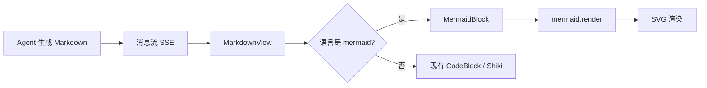

# Mermaid 可视化编排功能设计

> 版本：v1.0
> 日期：2026-08-11
> 状态：已实现（前端渲染 + mermaid_export）
> 关联模块：`divine-app/src/pages/chat/components/MarkdownView`、`divine-server/app/agent.py`、`divine-server/app/llm.py`

## 1. 背景与目标

AI 在回答“流程怎么走、任务怎么拆、处理链路是什么”时，目前只能输出文字和普通代码块，缺少“可视化编排”的呈现。

Mermaid 作为 Agent 与前端之间的中间表示，核心价值不是让模型“画一张图”，而是让模型输出具备“节点 + 边 + 结构”的机器可读文本，前端再把文本渲染成流程图。

目标：

- 聊天消息中的 `mermaid` 代码块自动渲染为流程图。
- Agent 在适合的场景稳定输出受控的 Mermaid flowchart，不破坏现有 Markdown 回答。
- 流式输出、解析失败、深浅主题都有可用的降级表现。
- 首版只做只读可视化预览，为后续升级到可编辑工作流保留中间表示。

非目标：

- 不做节点拖拽、连线编辑、节点配置面板。
- 不做工作流保存、版本管理和权限控制。
- 不做超大图优化（单图超过 30 个节点不是首版目标）。
- 不在后端解析 Mermaid；后端只负责生成 Markdown 和保存用户要求的 `.mmd` 源码。

## 2. 使用场景

### 2.1 用户主动要求画图

- “用流程图展示这个流程”
- “帮我梳理处理链路”
- “把执行步骤画出来”
- “分析一下这个任务的分支”
- “展示模型调用的调用链”

### 2.2 Agent 主动补充

- 回答包含多步骤说明，且用图表达比文字更清晰。
- 复杂任务生成了 `create_plan`，可在最终回答中附一张执行流程图。
- 文件处理、RAG 问答、定时任务等工具链路适合用一张小图表达。

### 2.3 用户粘贴 Mermaid

用户消息或 AI 消息中的任意 `mermaid` / `mmd` 代码块都走同一渲染路径，不需要只对 Agent 输出生效。

## 3. 整体架构



关键约束：

- Mermaid 只作为 Markdown 中的 fenced code block 存在，消息模型、SSE 协议和 SQLite 存储不变。
- 前端是唯一渲染入口，后端不感知 Mermaid。
- Agent 侧只增加输出规范，不新增工具、不新增 API。
- Mermaid 源码保留在消息原文中，用户复制、导出 Markdown 时仍是文本，不丢失结构。

## 4. 前端设计

### 4.1 渲染入口

修改 `divine-app/src/pages/chat/components/MarkdownView/index.tsx`：

- 在 `code` 渲染函数中识别 `language === "mermaid"` 或 `language === "mmd"`。
- 命中后返回新的 `MermaidBlock` 组件，不再走 `CodeBlock`。
- 未命中时保持现有 Shiki 高亮逻辑不变。
- `language.ts` 增加 `mermaid` / `mmd` 别名和展示标签 `Mermaid`。

### 4.2 MermaidBlock 组件

新增 `divine-app/src/pages/chat/components/MarkdownView/MermaidBlock.tsx`。

组件职责：

- 动态加载 `mermaid`，避免把 Mermaid 打包进首屏主包。
- 按当前主题生成 Mermaid 主题变量。
- 调用 `mermaid.render` 得到 SVG 字符串后渲染。
- 流式期间显示稳定的 loading 占位，不反复触发渲染。
- 解析失败时回退到现有代码块，不白屏、不抛异常。

初始化配置建议：

```ts
mermaid.initialize({
  startOnLoad: false,
  securityLevel: "strict",
  theme: "base",
  fontFamily: "var(--font-sans)",
  maxTextSize: 20000,
  themeVariables: {
    primaryColor: "#0f766e",
    primaryTextColor: "#ffffff",
    primaryBorderColor: "#0f766e",
    lineColor: "#64748b",
    secondaryColor: "#f0fdfa",
    tertiaryColor: "#f8fafc",
    clusterBkg: "#f8fafc",
    clusterBorder: "#cbd5e1",
    nodeBorderRadius: "8px",
  },
  flowchart: {
    htmlLabels: false,
    curve: "basis",
    padding: 12,
  },
});
```

主题适配：

- 组件渲染前读取根节点 `data-theme`，深色 / 浅色分别传入一套色值。
- 主题切换后重新渲染已展示的图，不依赖页面刷新。
- 颜色与现有 CSS token 语义一致，禁止在组件里写与设计 token 无关的色值。

### 4.3 流式行为

- `streaming === true` 时不调用 `render`，展示轻量 loading 占位，避免半截语法反复报错。
- 流式结束后只渲染一次。
- 如果消息较长且 Mermaid 块很晚才闭合，允许在流式过程中尝试 `mermaid.parse`；只有解析通过才渲染。
- 用递增的渲染序号或 `useRef` 防止异步渲染结果乱序覆盖。
- 组件卸载时清理已渲染的 SVG 和未完成的 Promise，避免 React StrictMode 下重复渲染。

### 4.4 失败降级

渲染失败时：

- 展示原 Mermaid 源码（复用 `CodeBlock` 的复制能力和 Shiki 高亮）。
- 显示一条不打断阅读的错误提示，例如“流程图解析失败，已显示源码”。
- 不弹窗、不影响整条消息，不把错误抛到 React 边界。

### 4.5 布局与样式

- 容器使用与代码块一致的圆角、边框和间距，不引入新的卡片嵌套。
- 容器最大高度建议 520px，超出后内部滚动。
- SVG 不强制拉伸，`max-width: 100%`，避免 1280px 窗口出现横向溢出。
- 节点文字、边文字由 Mermaid 排版，容器只负责裁剪和滚动。

## 5. Agent 输出规范

### 5.1 触发规则

在 `divine-server/app/agent.py` 的 `SYSTEM_PROMPT` 中增加 Mermaid 规则：

- 用户要求展示流程、处理链路、步骤关系、决策分支或架构时，输出一个 `mermaid` fenced code block。
- 其他回答不强制输出图，避免每轮都出现流程图噪音。
- 用户只要求画图时，回答可以只有代码块；其他情况允许在代码块外保留简要说明。

### 5.2 格式契约

Agent 输出的 Mermaid 必须满足：

- 只使用 `flowchart LR` 或 `flowchart TB`。
- 普通节点：`id[文字]`。
- 判断节点：`id{条件}`。
- 连线：`-->`。
- 分支标签：`|文字|`。
- 节点 id 简短唯一，如 `n1`、`a`。
- 节点数不超过 10 个。
- `subgraph` 最多 2 个。
- 不使用 `click` 事件、HTML 标签、emoji 图标和自定义 CSS class。
- 整个消息只输出一个 Mermaid 块，除非用户明确要求多个图。

### 5.3 Prompt 模板

```text
当用户要求展示流程、处理链路、步骤关系、决策分支或架构时，
在回答中输出一个 mermaid 围栏代码块，规则：
- 只使用 flowchart LR 或 flowchart TB
- 普通节点用 id[文字]，判断节点用 id{条件}
- 连线用 -->，分支标签用 |文字|
- 节点 id 简短唯一，节点数不超过 10 个
- 不使用 click、HTML 标签和自定义 class

示例：
flowchart LR
  A[接收需求] --> B{是否复杂}
  B -- 是 --> C[拆子任务]
  B -- 否 --> D[直接回答]
```

### 5.4 本地演示模式

`MockLLM._answer` 增加流程类问题的 Mermaid 回答，例如：

- “画一个流程”
- “工作流”
- “处理链路”
- “步骤图”

这样无 API Key 的演示模式也能直接验收渲染效果。

### 5.5 保存 / 导出工具

新增后端工具 `mermaid_export`，只处理“用户明确要求保存流程图”的动作：

- 保存位置：默认 `diagrams` 输出目录；指定 `path` 时写入 workspace 内相对目录。
- 文件格式：`.mmd`，内容是纯 Mermaid 源码，不写入额外 Markdown 标题。
- 参数：`title`、`content`、可选 `file_name`、可选 `path`。
- 实现方式：`MermaidExportAdapter` + `mermaid_export.py` 脚本，复用现有子进程工具协议。
- 新增 `diagrams` 输出类别，`/api/files` 可直接列出和下载。
- Agent 只有用户要求导出 / 保存时才调用，画图本身不自动落盘。

## 6. 安全与稳定性

| 风险 | 对策 |
| --- | --- |
| 模型输出不可渲染的 Mermaid | 前端 parse + render 失败后回退源码 |
| 流式半截语法反复报错 | 流式期间不渲染，结束后只渲染一次 |
| Mermaid 引入 XSS | `securityLevel: "strict"`，禁止 click 与 HTML 标签 |
| 包体积增长 | `import("mermaid")` 动态加载，拆到独立 chunk |
| 单图过大导致卡顿 | Prompt 限制节点数，前端容器滚动，不做全量布局优化 |
| 异步渲染乱序 | 组件内用渲染序号 / ref 做竞态保护 |

## 7. 验收标准

- 在聊天中发送“帮我画一个处理流程”，AI 消息中的 Mermaid 代码块渲染为流程图。
- 无 API Key 的 Mock 模式同样可验证渲染。
- 流式输出期间不闪错、不崩溃，输出结束后图正常出现。
- 故意构造非法 Mermaid 时，消息降级为源码，不出现白屏。
- 同一条消息包含多个 Mermaid 块时，每个块独立渲染。
- 深色 / 浅色主题下图例、节点、边和文字均可读。
- 1280px / 1440px 窗口下无页面级横向滚动条。
- `pnpm build` 和 `npx tsc --noEmit` 通过。
- Mermaid 源码保留在消息原文，复制 / 导出仍可用。

## 8. 实施拆解

1. 前端：新增 MermaidBlock、接入 MarkdownView、补样式。
2. 前端：动态加载 Mermaid，处理流式、主题、失败降级。
3. Agent：更新 SYSTEM_PROMPT，补充 MockLLM 演示回答。
4. 后端：新增 `mermaid_export` 工具，注册 `diagrams` 输出类别。
5. 验证：构建、类型检查、工具脚本单测、浏览器双主题截图、非法输入降级。

## 9. 演进建议

首版把 Mermaid 当“只读中间表示”，后续如果出现以下信号，再升级：

- 用户要求拖动节点、修改连线：把 Mermaid 解析为 React Flow 的 nodes / edges。
- 用户要求保存可执行工作流草稿：以 JSON DAG 作为持久化格式，再把 `.mmd` 作为预览视图。
- 用户要求点击节点查看详情：在前端做节点 hover / click 交互，不改 Agent 协议。

在出现这些需求前，不引入 React Flow、X6 或 G6，避免提前增加复杂度和包体积。
