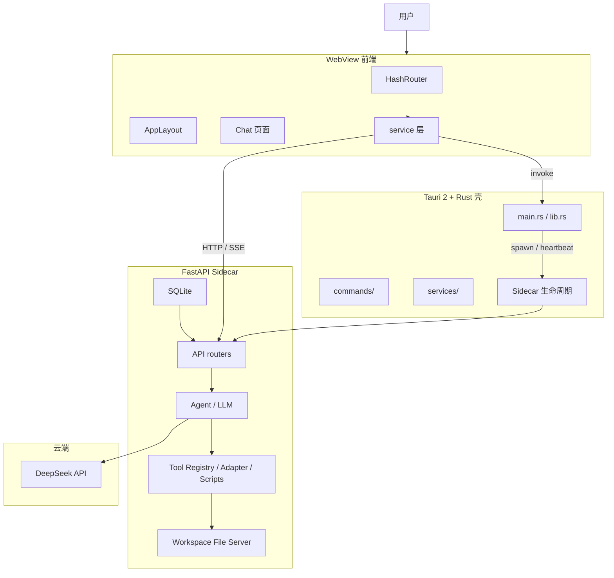
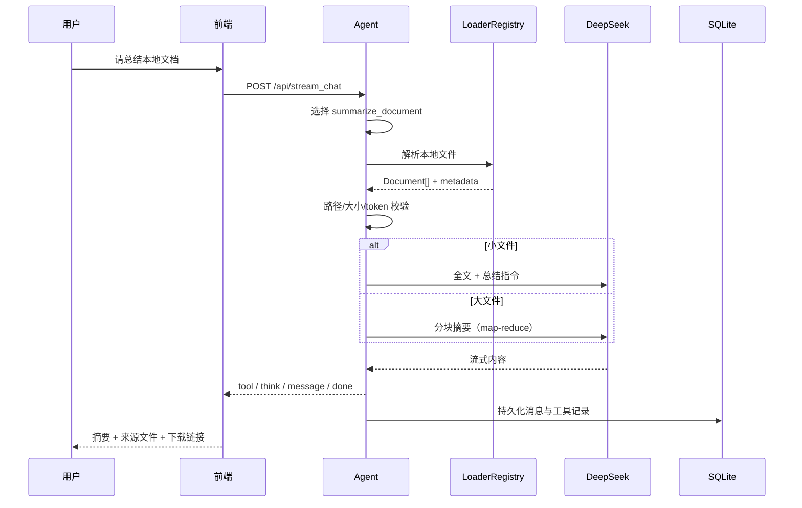
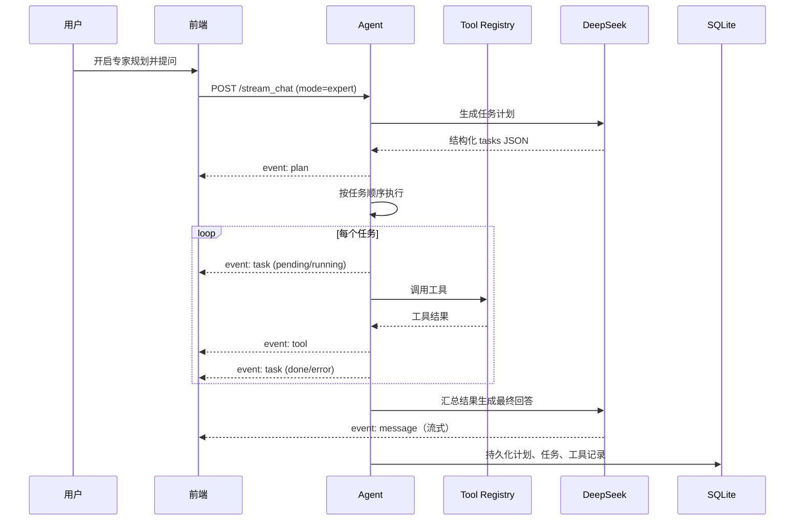

# AI Workspace 桌面助手项目方案

> 版本：v1.0（定稿）
> 日期：2026-08-07
> 状态：已确认，作为开发依据
> 参考输入：《设计文档.docx》《需求文档.md》《UI设计文档.md》

## 1. 文档说明

本文档把产品需求、UI 约束、技术架构和工程化方法收敛为一份可评审、可执行的方案。工程化采用桌面壳、后端服务、前端应用分层，并遵循服务层先行、平台化打包、安全前置等原则。

本文档只描述方案与验收标准，不包含代码实现。

## 2. 产品定位

AI Workspace 是一个本地优先、隐私可控、支持工具调用和流式 Markdown 的桌面 AI 助手：

- 用户通过聊天完成问答、文档生成、文件操作和本地知识检索。
- 所有会话、消息、设置和工具产物默认保存在本地。
- 模型调用使用 DeepSeek OpenAI 兼容接口，支持思考模式。
- 用户无需安装 Python，桌面安装包内置 FastAPI sidecar。
- 工具系统可扩展，新增工具不改核心路由和 Agent 代码。

## 3. 需求范围

### 3.1 Phase 1 最小可用版（P0）

- DeepSeek 流式对话，`base_url` / `api_key` / `model` 可配置；默认 `DeepSeek-V4-Pro`，可切换 `DeepSeek-V4-Flash`。
- `POST /stream_chat`，SSE 事件流：`think`、`message`、`tool`、`done`、`error`。
- 深度思考模式：先流式展示思考链，再展示正式回答；思考链不进入模型历史。
- 多轮对话：按 `session_id` 维护历史，新会话互相隔离。
- 会话管理：新建、删除、重命名、切换、标题自动生成、按时间倒序。
- SQLite 本地存储：`sessions`、`messages`、`message_parts`、`tool_runs`。
- 工具系统：ToolAdapter 基类、装饰器注册中心、子进程 JSON stdin/stdout 协议。
- 统一 workspace：文档、表格、笔记按类别归档，支持下载。
- React + Vite + TypeScript + 自研组件桌面 UI（不引入 AntD）。
- Tauri 2 + Rust 壳：启动 FastAPI sidecar、心跳、退出清理。
- PyInstaller 按平台打包 sidecar，随 Tauri 安装包分发。

### 3.2 Phase 2（P1）

- 专家规划模式：`plan` / `task` SSE 事件、待办整合进思考过程块、`plan_runs` / `task_runs` 持久化。
- 文件读取、目录浏览、文件名模糊搜索。
- 剪贴板读写，通过 Tauri 命令桥接。
- 本地 RAG：embedding、向量存储、文档切片、Top-K 检索。
- 导出 Markdown / 纯文本，可选 PDF。
- 高风险工具首次调用确认弹窗。
- 工具结果长度控制。

### 3.3 Phase 3 / Phase 4（P2）

- 消息重生成、插件系统、多模型切换、Token 统计与费用估算。
- 本地小模型、混合推理、完全离线模式。

## 4. 架构设计总览



## 5. 技术选型

| 层 | 方案 | 说明 |
| --- | --- | --- |
| 桌面壳 | Tauri 2 + Rust | 不迁 Electron，保留 Rust 资产 |
| 前端构建 | Vite + TypeScript | 替换旧式打包链路 |
| 路由 | React Router `createHashRouter` | 桌面端刷新/重启可恢复，不依赖 Tauri fallback |
| UI | 自研组件 + CSS Variables | 不引入第三方组件库，按设计 token 自研桌面组件 |
| 聊天组件 | 自研 | 不引入第三方聊天组件库 |
| 状态 | 按域拆分 | session / message / config / input 独立 |
| 本地后端 | FastAPI + Uvicorn | SSE 原生支持、异步并发 |
| Agent | LangChain Core + 自研 Agent 编排 | 模型抽象、工具绑定、RAG 复用 LangChain，执行循环自研 |
| 模型 | DeepSeek | 支持 `reasoning_content` 与工具调用 |
| 工具 | Python 子进程脚本 | JSON stdin/stdout，独立隔离 |
| 存储 | SQLite | 会话、消息、parts、工具记录 |
| 打包 | PyInstaller + Tauri | sidecar 按平台目录组织 |
| 文档解析 | LangChain Document Loaders | 统一转为 `Document`，避免手写解析器 |

### 5.1 决策记录

- **Tauri 2 而不是 Electron**：包体、内存和启动性能更优，Rust 侧可以复用成熟 sidecar 生命周期经验。
- **HashRouter 而不是 BrowserRouter**：桌面端无 SEO 和分享链接需求，三平台 WebView 行为一致。
- **不引入 Ant Design**：会话、设置、弹窗、下拉等控件全部自研，统一使用设计 token，保证视觉完全可控。
- **React 18 起步**：先稳定一版，后续再评估 React 19。
- **会话懒创建**：进入应用和“新建对话”不创建会话，首次发送才创建并写回 URL。
- **Web MVP 先行**：先跑通 FastAPI + React 的浏览器模式，再接入 Tauri 壳，降低首版风险。

## 6. 前端架构

### 6.1 目录结构

```text
src/
  app/
    router.tsx
    providers.tsx
  layout/
    AppLayout.tsx
    Sidebar.tsx
  pages/
    chat/
      index.tsx
      components/
        SessionList/
        MessageList/
        MessageItem/
        ThinkBlock/
        ToolStatusCard/
        ChatInput/
        HomePage/
      state/
        sessionStore.ts
        messageStore.ts
        configStore.ts
        inputStore.ts
  services/
    tauri.ts
    api.ts
    sse.ts
    workspace.ts
    storage.ts
  constant/
    storage.ts
  styles/
```

### 6.2 路由设计

```text
#/chat                      无会话首页，不创建会话
#/chat?sessionId=xxx        唯一真实会话页
*                           兜底回 #/chat
```

规则：

- 进入应用不自动打开最新会话，也不创建会话。
- “新建对话”只清空消息、输入和回答状态，回到 `#/chat`。
- 首次发送时调用 `createSession()`，把 `sessionId` 写回 URL。
- 带 `sessionId` 的入口直接恢复该会话。

### 6.3 service 层先行

- `services/api.ts`：统一 HTTP 请求封装，收敛 FastAPI 路由。
- `services/sse.ts`：负责 POST SSE 流式读取、半包拼接、事件分发。
- `services/tauri.ts`：Tauri `invoke` adapter，禁止组件内直接调用 Tauri API。
- `services/workspace.ts`：文件列表、下载链接、导出逻辑。
- 禁止在方法内动态 `import` Tauri 包；所有 `@tauri-apps/*` 只在模块顶部静态导入。

### 6.4 状态拆分

- `sessionStore`：会话列表、当前 sessionId、懒创建、重命名、删除。
- `messageStore`：当前会话消息、流式追加、工具状态、思考块。
- `configStore`：模型、API Key 状态、思考默认值、上下文限制。
- `inputStore`：输入内容、附件、工具菜单、发送态。

### 6.5 自研组件与设计系统

- 不引入 AntD 或第三方组件库，按钮、输入框、下拉、弹窗、开关等基础控件按设计文档自研。
- 所有颜色、圆角、间距、字号收敛为 CSS Variables 设计 token。
- 组件按域拆分：会话列表、聊天时间线、思考块、工具状态卡、Composer、文件卡片、设置弹窗、确认弹窗。
- 组件只消费 token，不硬编码色值；黑白主题通过根节点 `data-theme` 切换。

**Flex 布局组件**

- 提供统一的 `Flex` 组件，替代散落的手写 flex 样式。
- 布局间距统一走 `gap`，组件内不写零散 margin。

| 属性 | 说明 |
| --- | --- |
| `direction` | `row` / `column` / `row-reverse` / `column-reverse` |
| `justify` | `start` / `center` / `end` / `space-between` / `space-around` / `space-evenly` |
| `align` | `stretch` / `start` / `center` / `end` / `baseline` |
| `wrap` | `nowrap` / `wrap` / `wrap-reverse` |
| `gap` | 数字或 `[row, column]`，取值来自间距 token |
| `inline` | 是否使用 `inline-flex` |

**思考过程 loading**

- 思考过程加载统一使用 `thinking-orbs`，不引入自研加载动画。
- 默认用法：`import { ThinkingOrb } from 'thinking-orbs'`，`<ThinkingOrb state="shaping" size={20} />`。
- 状态映射：默认 / 规划用 `shaping`，搜索用 `searching`，工具执行用 `working`，生成回答用 `composing`，等待输入用 `breathing`。
- 组件自动跟随 `data-theme` 与 `prefers-color-scheme`，与黑白主题一致；`prefers-reduced-motion` 下显示静态帧。

**启动初始化 loading**

- 打开应用时的初始化 loading 使用 `<ThinkingOrb state="connecting" size={64} />`，在首屏居中显示。
- loading 与 sidecar 健康检查绑定：FastAPI 健康检查通过或首屏数据就绪后淡出，不固定时长空等。
- 首帧不闪烁：启动时内联脚本先解析本地主题，再渲染 Orb。

### 6.6 UI 设计约束

布局与视觉：

- 桌面端两栏：会话栏固定 248px（可折叠）+ 主区域；聊天内容最大宽度 860px 居中。
- 用户消息使用右侧对话气泡；AI 消息使用左对齐时间线，不使用气泡；角色通过消息标签区分。
- 强调色 `#0f766e`，中性灰背景 `#f4f5f7`，圆角不超过 8px；不使用渐变、光斑和装饰卡片。
- 正文字号固定 14px，标题 15-18px，辅助信息 12-13px；`letter-spacing: 0`。
- 主区域只有消息时间线内部滚动；用户向上滚动时不强制拉回底部。

组件与交互：

- 会话列表：顶部“新建对话”、搜索、分组列表、选中态左侧 3px 强调竖条；右键重命名 / 删除 / 导出。
- Chat Header：会话标题、模型状态、深度思考开关、清空上下文（需确认）、导出。
- 思考块：默认折叠，灰色小字，内容不参与复制；专家规划时折叠标题显示待办数量。
- 工具状态卡：准备 / 执行中 / 进度 / 完成 / 失败内联展示，不弹窗；文件工具完成后显示文件名、大小、下载链接。
- Composer：多行自动增高，Enter 发送、Shift+Enter 换行，空内容禁用发送；底部放置附件、工具、深度思考、专家规划开关。

流式渲染：

- 流式阶段禁用语法高亮，结束后一次性高亮。
- 使用 `useDeferredValue` 降低渲染频率，`requestAnimationFrame` 控制滚动。
- SSE 用 `fetch + ReadableStream` 处理半包，不依赖 `EventSource`。

快捷键：

| 快捷键 | 功能 |
| --- | --- |
| Enter | 发送 |
| Shift+Enter | 换行 |
| Ctrl+N | 新建会话 |
| Ctrl+F | 搜索会话 |
| Ctrl+K | 聚焦输入区 |
| Ctrl+Shift+T | 切换深度思考 |
| Esc | 关闭弹窗 / 取消操作 |

验收要点：1280px / 1440px 无横向滚动条；流式输出不跳动；控件不重叠；键盘可达、焦点可见。

### 6.7 黑白主题换肤设计

**目标**

- 同一套组件同时支持深色 / 浅色两套主题，切换不刷新、不闪烁。
- 主题由 token 驱动，不允许组件直接硬编码色值。

**Token 体系**

- 所有颜色收敛为语义 CSS Variables：`--color-bg`、`--color-surface`、`--color-border`、`--color-text`、`--color-text-secondary`、`--color-accent` 等。
- 根节点通过 `data-theme="dark"` / `data-theme="light"` 切换两套 token 定义。
- 阴影、焦点环、滚动条、选区色同样 token 化，避免切换后残留硬编码颜色。

**主题来源与持久化**

- 提供三态：浅色 / 深色 / 跟随系统。
- 默认跟随系统 `prefers-color-scheme`。
- 用户选择存入 `configStore`，并同步到后端 `/api/settings`；桌面端同时落盘应用配置。
- 应用启动时先用内联脚本读取本地主题，再渲染首屏，避免“先深后浅”或“先浅后深”闪烁。

**主题接入**

- 主题只由 CSS Variables 驱动，根节点 `data-theme="dark"` / `data-theme="light"` 切换 token。
- 不依赖组件库主题算法，所有自研组件统一消费同一套 token。

**组件与状态色**

- 代码块在两套主题下都保持深色底，保证代码高亮对比度。
- success / danger / warning 分别提供深浅两套值，均满足 WCAG AA。
- 错误色保留红色语义，但只作为功能色，不参与主题主色。

**切换规则**

- 切换时只更新根节点 `data-theme`，不重建页面、不重新请求会话数据。
- 背景、边框、文字色允许 150ms 过渡；图标、布局、间距不参与过渡。
- 流式输出、工具执行期间允许切换，不影响进行中的 SSE 流。

**验收标准**

- 深浅两套主题下所有页面状态一致。
- 刷新、重启应用后主题保持。
- 切换无闪烁、无布局跳动。
- 代码扫描无遗漏的硬编码色值。

## 7. 后端架构

### 7.1 目录结构

```text
backend/
  app/
    main.py
    config.py
    db.py
    schemas.py
    sse.py
    agent.py
    llm.py
    api/
      chat.py
      sessions.py
      files.py
      settings.py
    tools/
      base.py
      registry.py
      adapters/
      scripts/
  workspace/
  data/
```

### 7.2 API 路由

| 方法 | 路径 | 说明 |
| --- | --- | --- |
| GET | `/api/health` | 健康检查 |
| POST | `/api/stream_chat` | 流式聊天 |
| GET | `/api/sessions` | 会话列表 |
| POST | `/api/sessions` | 创建会话 |
| GET | `/api/sessions/{id}` | 会话详情与消息 |
| PATCH | `/api/sessions/{id}` | 重命名 |
| DELETE | `/api/sessions/{id}` | 删除 |
| POST | `/api/sessions/{id}/clear` | 清空上下文 |
| GET | `/api/sessions/{id}/export` | 导出 |
| GET | `/api/files` | 工作区文件 |
| GET | `/api/files/{category}/{filename}` | 下载文件 |
| GET/PUT | `/api/settings` | 设置读取与保存 |

### 7.3 Agent 与 LLM

- `llm.py`：DeepSeek OpenAI 兼容流式调用，支持 `reasoning_content` 和 `tool_calls`。
- 提供本地演示模式，无 API Key 时也可完整演示流式回答和工具调用。
- Agent 循环：流式输出 → 检测工具调用 → 执行 Adapter → 注入工具结果 → 继续生成。
- 思考内容只保存到 `message_parts`，绝不拼入模型历史。

### 7.4 LangChain 应用设计

**定位**

LangChain 在项目中作为模型抽象层和工具/RAG 编排基础，不把完整 AgentExecutor 当作黑盒使用。SSE 流式输出、思考链、SQLite 持久化和工具状态可视化由自研 Agent 循环控制。

**使用的 LangChain 组件**

| 组件 | 用途 |
| --- | --- |
| `ChatOpenAI` | 对接 DeepSeek OpenAI 兼容接口，启用 streaming |
| `SystemMessage` / `HumanMessage` / `AIMessage` / `ToolMessage` | 统一模型消息结构 |
| `bind_tools` + `StructuredTool` | 把 ToolAdapter 包装成模型可调用的工具 |
| `StrOutputParser` / `RunnableLambda` | 简单链路编排 |
| `RecursiveCharacterTextSplitter` | Phase 2 RAG 文档切片 |
| `Retriever` 接口 | Phase 2 基于 SQLite 向量的自定义检索器 |

**不使用的部分**

- 不把 `AgentExecutor` 作为唯一入口：工具执行状态、思考链和 SSE 事件需要自定义循环。
- 不把 SQLite 会话管理交给 LangChain memory：历史仍由统一数据层读写，模型只接收 `role + content`。
- 不默认接入 LangSmith：保持本地优先，可后续作为可选调试开关。

**工具桥接**

- 每个 `ToolAdapter` 通过注册中心暴露元数据。
- LangChain 侧包装为 `StructuredTool`，只负责参数生成和结果解析。
- subprocess 执行、超时、路径校验、下载 URL 仍由 ToolAdapter 完成。
- 新增工具只新增脚本、Adapter 和装饰器，不改 Agent 与 LangChain 绑定逻辑。

**Agent 循环**

```text
SQLite 历史
  -> LangChain Messages
  -> bind_tools 的 ChatOpenAI.astream
  -> 解析 AIMessageChunk
  -> 输出 message / think SSE 事件
  -> 检测 tool_calls
  -> 执行 ToolAdapter
  -> 追加 ToolMessage
  -> 下一轮生成
  -> 持久化可见消息与 message_parts
```

**思考模式**

- DeepSeek 的 `reasoning_content` 是非标准扩展字段，LangChain 通常把它放进 `AIMessageChunk.additional_kwargs` 或 `response_metadata`。
- `llm.py` 负责把该字段标准化为 `think` 事件，不让 Agent 和前端感知 LangChain 内部结构。
- 思考内容只写入 `message_parts`，不拼接进后续模型上下文。

**Phase 2 RAG**

- 文档切片使用 LangChain `RecursiveCharacterTextSplitter`。
- embedding 使用 DeepSeek/OpenAI embedding 接口或本地 embedding，按上线环境二选一。
- SQLite 保存向量，自定义 `Retriever` 做余弦相似度 Top-K 检索。
- 检索结果通过 prompt 注入模型，不经过 LangChain 的隐藏记忆机制。

### 7.5 LangChain Document Loader 应用设计

**定位**

Phase 2 的文件读取和 RAG 索引统一使用 LangChain 的 Document Loader，把不同格式归一为统一的 `Document` 对象（`page_content` + `metadata`），项目内部不再为每种格式手写解析器。

**加载器映射**

按文件扩展名维护加载器注册表：

| 格式 | 加载器 | 说明 |
| --- | --- | --- |
| `.txt` / `.md` | `TextLoader` / `UnstructuredMarkdownLoader` | 纯文本与 Markdown |
| `.json` | `JSONLoader` | 按 jq 路径提取内容 |
| `.csv` | `CSVLoader` | 表格转文本 |
| `.docx` | `Docx2txtLoader` | Word 文档 |
| `.pdf` | `PyPDFLoader` | PDF 文本提取 |
| 目录 | `DirectoryLoader` | 按 glob 批量加载 |

加载器主要来自 `langchain-community.document_loaders`；对 xlsx 等社区加载器不稳定的格式，保留自研 fallback，但输出仍统一为 `Document`。

**统一处理管线**

```text
本地文件
  -> LoaderRegistry 按扩展名选择 Loader
  -> Document 对象（content + metadata）
  -> 文件大小/路径白名单校验
  -> RecursiveCharacterTextSplitter 切片
  -> embedding
  -> SQLite 向量表
```

**约束**

- Loader 只在本地执行，不把文档内容发送到 LangChain 或第三方服务。
- `TextLoader`、`JSONLoader`、`CSVLoader`、`Docx2txtLoader`、`PyPDFLoader` 都是本地解析包装，解析过程完全离线；不注册任何依赖云端 API 的加载器。
- 需要较重系统依赖的加载器（如 `unstructured`）按格式按需引入，缺失时走自研 fallback，不允许阻塞本地解析。
- 超过文件大小上限或 token 上限时截断，避免 OOM。
- `metadata` 至少包含 `source`、`file_path`、`file_size`、`modified_at`。
- 路径必须经过 workspace 白名单校验，禁止越界读取。
- 重复索引同一文件时先删除旧切片，再写入新切片。

**文件工具复用**

- `read_file` 工具优先走 LoaderRegistry，得到 `Document` 后返回可渲染 Markdown。
- 纯文本、JSON、CSV 等轻量格式可走快速路径，但对外仍保持统一返回结构。
- 目录浏览和文件名搜索不依赖加载器，走文件系统服务。

### 7.6 文档解析 → 模型总结 → 输出流程

**触发方式**

- 用户直接要求“总结这个文件”。
- Agent 自动识别并选择 `read_file` / `summarize_document` 工具。
- 本地 RAG 问答时，先检索相关片段，再基于片段总结回答。

**主流程**



**内容策略**

| 场景 | 策略 |
| --- | --- |
| 内容 token 不超过阈值（默认 3000） | 全文直接进入模型上下文 |
| 大文件总结 | map-reduce：每块先摘要，再合并为最终摘要 |
| 大文件问答 | 向量检索 Top-K 相关片段，只把相关片段送入模型 |
| 超长结果 | 摘要结果超过阈值时继续分层压缩 |

**map-reduce 摘要流程**

```text
Document[]
  -> RecursiveCharacterTextSplitter 切片
  -> 每块调用模型生成局部摘要
  -> 汇总局部摘要
  -> 调用模型生成最终结构化摘要
  -> 流式输出
```

**上下文组装**

模型上下文包含：

- 系统指令：本地文件摘要、Markdown 输出、保留关键事实。
- 文件元数据：文件名、路径、格式、大小、修改时间。
- 文档正文或局部摘要。

规则：

- 不把超大文件全文一次性塞入上下文。
- 不把思考链写入模型上下文。
- 摘要结果标注来源文件，方便前端展示下载链接。

**SSE 事件**

| 事件 | 内容 |
| --- | --- |
| `tool` | `parsing` → `summarizing` → `done` |
| `think` | 思考过程 |
| `message` | 流式摘要正文 |
| `done` | 完成信息、文件信息 |

**持久化**

- `messages`：保存用户问题和助手摘要正文。
- `message_parts`：保存来源文件元数据和分块计划。
- `tool_runs`：保存工具名、入参、解析结果、输出摘要。
- 原始文件保留在 workspace，不复制进数据库。

**UI 展示**

- 工具状态卡显示：解析中 → 总结中 → 完成。
- 摘要以 Markdown 渲染，支持表格、列表、代码块。
- 来源文件以特殊链接展示，可下载或打开原文件。
- 长摘要正常滚动，不弹窗打断阅读流。

### 7.7 专家规划与任务执行

**定位**

“专家规划”用于复杂多步任务：模型先输出结构化任务清单，再按顺序执行子任务，前端实时展示规划、执行状态、工具调用和最终结果。

示例：

```text
用户：整理最近一周的新闻热点并生成一份周报
专家规划：生成 3 个任务
  1. 搜索新闻热点（skill）
  2. 整理要点（skill）
  3. 生成 Word 周报（word_document）
执行中：web_search -> web_fetch -> word_document -> 完成
```

**触发方式**

- Composer 底部工具栏提供“专家规划”开关，紧邻“深度思考”开关；Chat Header 可选镜像同一开关。
- 开关默认关闭；关闭时走普通流式回答，开启时走“先规划后执行”。
- `POST /stream_chat` 请求增加可选字段：`{"mode": "expert"}`。
- 普通模式直接回答；专家模式先规划后执行。

**开关规则**

- 开关状态保存在 `configStore`，本地持久化，不要求登录。
- “专家规划”和“深度思考”可以同时开启；专家模式默认包含规划展示，不强制关闭思考。
- 流式执行期间开关禁用，避免中途切换模式造成状态不一致。
- 开启后请求自动带 `mode: "expert"`，前端接收 `plan` / `task` 事件并更新思考过程块。
- 移动端降级为同一开关，不新增入口层级。

**主流程**



**任务计划格式**

计划阶段输出 JSON：

```json
{
  "tasks": [
    {
      "id": "task-1",
      "title": "搜索新闻热点",
      "agent": "skill",
      "input": "搜索最近的新闻热点"
    },
    {
      "id": "task-2",
      "title": "整理要点",
      "agent": "skill",
      "input": "基于搜索结果整理要点"
    }
  ]
}
```

**SSE 事件扩展**

| 事件 | data 字段 |
| --- | --- |
| `plan` | `plan_id`、`tasks` |
| `task` | `task_id`、`title`、`status`、`agent`、`input`、`output`、`error` |
| `tool` | 沿用现有工具状态协议 |

**前端交互**

- 规划待办整合进思考过程块，不单独展示规划卡片。
- 思考过程块内以任务清单呈现待办，每个任务显示 pending / running / done / error 状态。
- 默认折叠，折叠标题提示待办数量，例如“思考过程 · 3 个待办”；执行开始时自动展开，执行完成后可收起。
- 工具状态卡片仍内联展示，不弹窗打断阅读。
- 每个待办可展开查看输入、输出和关联工具调用。
- 高风险工具仍走用户确认弹窗，计划阶段不执行。

**待办在思考过程中的呈现**

```text
思考过程 · 3 个待办            [展开/收起]

  [x] 搜索新闻热点
  [ ] 整理要点
  [ ] 生成 Word 周报

  - 先确定任务拆解方式
  - 每个任务按顺序执行
  - 最后汇总结果生成回答
```

- 待办状态变化通过 `task` SSE 事件实时更新。
- 思考文本和待办清单都属于 `think` 展示区域，不参与复制。
- 待办清单只用于展示和进度反馈，不写入模型历史上下文。

**执行策略**

- 默认按任务顺序执行，避免并行工具冲突。
- 任务间存在数据依赖时等待前序任务完成。
- 互相独立且低风险的任务后续可并行执行。
- 工具仍必须通过注册中心白名单，禁止任意命令。

**持久化**

- 实施阶段 3.5 新增 `plan_runs`、`task_runs` 两张表，字段定义见 §10。
- `plan` 事件写入 `plan_runs`，`task` 事件写入 `task_runs`。

**安全边界**

- 专家模式只能调用已注册工具，不能生成任意命令。
- 文件、剪贴板等高危工具仍需要用户确认。
- `web_search` / `web_fetch` / `browser` 属于联网能力，作为独立工具注册并明确网络策略，首版默认不启用。
- 工具结果写入 SQLite 时仍按长度上限截断。

## 8. Rust 壳架构

### 8.1 目录结构

```text
src-tauri/src/
  main.rs
  lib.rs
  state.rs
  error.rs
  commands/
    mod.rs
    sidecar.rs
    system.rs
    clipboard.rs
    settings.rs
  services/
    mod.rs
    sidecar.rs
    platform.rs
    permissions.rs
  menu.rs
  events.rs
```

### 8.2 设计原则

- `main.rs` 和 `lib.rs` 只做组装，不写业务。
- 命令层保持薄，只做参数解析和返回值转换，逻辑下沉 `services/`。
- 前端 `invoke` 命令名和参数视为稳定接口。
- `unsafe` 集中到平台相关模块，不扩散。
- sidecar 生命周期抽成独立 service：解析路径、复制持久目录、spawn、pid 文件、退出整树清理。

### 8.3 命令清单（首版）

| 领域 | 命令 |
| --- | --- |
| Sidecar | `start_sidecar`、`stop_sidecar`、`sidecar_health`、`get_sidecar_env` |
| 系统 | `open_local_file`、`open_folder`、`normalize_workspace_path` |
| 剪贴板 | `read_clipboard`、`write_clipboard` |
| 设置 | `get_app_settings`、`set_app_settings` |

### 8.4 窗口标题栏策略

- macOS 首版使用 `titleBarStyle: "Overlay"` + `hiddenTitle: true`：保留红绿灯按钮，隐藏原生标题文字，WebView 内容延伸到顶部。
- 前端顶部预留约 70px 左侧安全区给 macOS 红绿灯，顶部条整体作为 `data-tauri-drag-region` 拖拽区。
- Windows / Linux 保留系统原生标题栏，不引入自绘方案。
- 应用内 Chat Header 与系统标题栏职责分离：Chat Header 只承载会话标题、模型状态和操作按钮。

### 8.6 全屏模式处理

- 全屏与最大化分开：最大化保留标题栏；全屏隐藏标题栏或改为自动隐藏，内容充满窗口。
- 进入 / 退出：调用 `setFullscreen(true / false)`，监听 `onResized` 并查询 `isFullscreen()` 更新 UI 状态。
- 快捷键：Windows / Linux 用 F11，macOS 用 Ctrl+Cmd+F，Esc 可退出全屏。
- 应用标题栏行为：全屏时默认隐藏窗口按钮或应用头部，鼠标移到顶部安全区时滑出，或保留一个“退出全屏”悬浮按钮。
- macOS：全屏会进入系统 Space，需要处理刘海屏安全区 `env(safe-area-inset-*)`；保留的原生红绿灯绿色按钮负责进入全屏。
- Windows / Linux 使用系统原生全屏行为，F11 进入 / 退出，Esc 可选退出。
- 状态持久化：全屏状态与窗口位置、大小、最大化状态一起保存，重启后恢复。

**验收标准**

- 全屏下无标题栏遮挡，内容完整。
- 可通过按钮、快捷键或 Esc 退出全屏。
- 全屏 / 退出全屏不闪烁、不布局跳动。
- 窗口状态（位置、大小、最大化、全屏）重启后恢复。

### 8.7 文件打开与路径安全

- 消息中的文件卡片携带受控文件标识（workspace 内相对路径或文件 ID），不把绝对路径明文暴露给渲染层。
- 点击文件卡片：前端调用 `open_local_file(file_id)`，Rust 侧解析并校验路径位于 workspace 白名单内，再用系统默认应用打开；越界路径直接返回结构化错误。
- 文件路径必须 `resolve` / `canonicalize` 后仍在 workspace 内，拒绝符号链接逃逸。
- 可选支持“在文件夹中显示”：Windows 打开资源管理器、macOS 打开 Finder、Linux 打开文件管理器。
- Web MVP 阶段没有 Tauri，文件卡片降级为 `/api/files/{category}/{filename}` 下载链接。
- UI 交互：文件卡片可点击，hover 显示“打开”提示；AI 侧生成的文件与用户侧上传的文件使用同一套打开逻辑。

## 9. Sidecar 与打包

### 9.1 平台目录

```text
bin/
  darwin-arm64/
    ai-workspace-sidecar
    _internal/
  darwin-x64/
    ai-workspace-sidecar
    _internal/
  win32-x64/
    ai-workspace-sidecar.exe
    _internal/
  linux-x64/
    ai-workspace-sidecar
    _internal/
```

### 9.2 打包链路

- `build-sidecar.sh`：支持显式目标平台，PyInstaller 产物落到 `bin/<target>/`。
- `prep-sidecar.mjs`：按目标平台改写 `tauri.conf.json` 的 resources map，执行 Vite 构建，组装 DMG / NSIS。
- Rust 从 `resource_dir/bin/` 读取当前平台 sidecar，保留 `_up_/bin/` 作为旧包 fallback。
- `tauri.conf.json` 默认提交开发平台 map，保证本机 `tauri build` 可直接运行。
- 不跨平台混用 PyInstaller 的 `_internal/`。

### 9.3 版本更新与静默增量更新

**总体策略**

首版采用单层整包更新：一个更新清单、一个平台完整 bundle，由 Tauri 官方 updater 完成检查、下载、验签和安装。不提前做 sidecar 热更新和前端资产增量更新。

```text
更新检查
  └── 完整 bundle（macOS .app.tar.gz / Windows .exe/.msi / Linux AppImage）
       -> 验签 -> 安装 -> 下次启动或 relaunch
```

**为什么不拆三层**

- 首版更新频率低，整包体积可控。
- 三层更新需要维护多套清单、版本对齐、回滚和兼容逻辑，复杂度和故障面明显上升。
- sidecar 和前端都随包发布，单包更新天然保证三者版本一致。
- 用户感知差异主要是下载量，不是核心体验。

**更新流程**

- 使用 `tauri-plugin-updater`。
- 官方 updater 的下载产物就是当前平台的完整 bundle（macOS `.app.tar.gz`、Windows `.exe/.msi`、Linux AppImage），不是增量包。
- 应用启动时后台 `check()`，空闲时 `download()`，只在需要时 `install()` / `relaunch()`。
- Windows：NSIS/MSI 支持 `basicUi`、`quiet`、`passive` 安装模式，可选择静默或被动安装。
- macOS：没有真正的无感替换，通常后台下载完整 bundle，验签后下次启动或 relaunch 时替换。
- Linux：AppImage 可直接原地替换或通过 AppImageUpdate 更新。

**与手动下载安装的区别**

- 自动发现版本：用户不需要知道新版本存在，也不需要去官网或 Release 页找包。
- 自动匹配平台：只下载当前系统和架构的产物，避免下错安装包。
- 自动验签：客户端内置公钥，配合 SHA256 校验，防止下载到被篡改的包。
- 自动安装与重启：Windows 可静默/被动安装，macOS 安装后 relaunch，Linux 替换 AppImage。
- 失败保护：安装失败时保留旧版本和日志，手动覆盖安装更容易破坏当前环境。
- 支持私有更新端点、灰度发布和最低版本约束，适合企业分发。

**后续可选优化**

- 只有当 sidecar 体积成为明确痛点时，再单独增加 sidecar 更新层：独立清单 + 平台产物 + 校验 + 替换 `Resources/bin/<target>/` + 空闲重启。
- 前端资产不单独拆更新层，纯 UI 修复也随完整 bundle 发布。
- 若未来需要真正的二进制增量，再评估 `bsdiff` / `courgette`，首版不做。

**静默更新规则**

- 启动后延迟检查，之后按固定间隔检查，不阻塞启动。
- 下载在后台进行，只显示轻量状态，不弹强制更新框。
- 这里的“后台”指应用运行期间的非阻塞异步下载，不是系统级后台服务；应用退出后下载不会继续。
- 交互参考 Codex 桌面端：发现更新时在侧边栏或设置页显示轻量提示，点击后下载并重启完成，不打断当前工作。
- updater 本身不负责弹确认框：是否提示、何时安装、是否 relaunch 都由应用代码决定。
- Windows 默认 `basicUi` 会显示安装器基础 UI 并要求交互；要静默需配置 `installMode: "quiet"` 或 `"passive"`。
- macOS / Linux 安装过程不弹系统确认框，但需要应用在合适时机调用 `relaunch()`，或提示用户下次启动生效。
- 高危更新（Shell 替换、依赖升级）默认“下载完成，下次启动应用”。
- 更新失败不影响当前版本继续使用，并保留日志便于排查。

**安全要求**

- 更新端点必须 HTTPS。
- 所有更新产物与清单必须签名，客户端内置公钥验签。
- 每个文件校验 SHA256。
- 清单包含版本、平台、大小、hash、签名和最低支持版本。
- 禁止降级安装。

## 10. 数据模型

### sessions

| 字段 | 类型 | 说明 |
| --- | --- | --- |
| id | TEXT | 主键 |
| title | TEXT | 标题 |
| created_at | TEXT | 创建时间 |
| updated_at | TEXT | 更新时间 |

### messages

| 字段 | 类型 | 说明 |
| --- | --- | --- |
| id | TEXT | 主键 |
| session_id | TEXT | 会话外键 |
| role | TEXT | user / assistant |
| content | TEXT | Markdown 正文 |
| created_at | TEXT | 创建时间 |

### message_parts

| 字段 | 类型 | 说明 |
| --- | --- | --- |
| id | TEXT | 主键 |
| message_id | TEXT | 消息外键 |
| type | TEXT | think / tool |
| content | TEXT | JSON 内容 |
| order | INTEGER | 展示顺序 |

### tool_runs

| 字段 | 类型 | 说明 |
| --- | --- | --- |
| id | TEXT | 主键 |
| session_id | TEXT | 会话 |
| tool_name | TEXT | 工具名 |
| status | TEXT | start / progress / done / error |
| input | TEXT | 入参 JSON |
| output | TEXT | 结果 JSON |
| started_at | TEXT | 开始时间 |
| finished_at | TEXT | 结束时间 |

### plan_runs

| 字段 | 类型 | 说明 |
| --- | --- | --- |
| id | TEXT | 主键 |
| session_id | TEXT | 会话 |
| status | TEXT | planned / running / done / error |
| plan | TEXT | 计划 JSON |
| created_at | TEXT | 创建时间 |
| finished_at | TEXT | 完成时间 |

### task_runs

| 字段 | 类型 | 说明 |
| --- | --- | --- |
| id | TEXT | 主键 |
| plan_id | TEXT | 计划外键 |
| session_id | TEXT | 会话 |
| title | TEXT | 任务标题 |
| agent | TEXT | 执行 agent |
| input | TEXT | 入参 JSON |
| output | TEXT | 结果 JSON |
| status | TEXT | pending / running / done / error |
| started_at | TEXT | 开始时间 |
| finished_at | TEXT | 结束时间 |

说明：`plan_runs` 与 `task_runs` 由专家规划模式（§7.7）使用，普通对话不写入。

## 11. SSE 事件协议

统一事件格式：

| 事件 | data 字段 |
| --- | --- |
| `think` | `content` |
| `message` | `content` |
| `tool` | `tool`、`status`、`message`、`progress`、`download_url` |
| `plan` | `plan_id`、`tasks` |
| `task` | `task_id`、`title`、`status`、`agent`、`input`、`output`、`error` |
| `done` | `message` |
| `error` | `code`、`message` |

示例：

```text
event: tool
data: {"tool":"word_document_tool","status":"done","message":"生成完成","download_url":"/api/files/documents/demo.docx"}
```

`plan` / `task` 是专家规划模式的扩展事件，普通模式不推送（详见 §7.7）。

前端使用 `fetch + ReadableStream`，用 buffer 处理半包，不依赖 `EventSource`。

## 12. 工具系统

### 12.1 脚本协议

- stdin 接收 JSON：`{"workspace": "/path", "params": {}}`
- stdout 输出 JSON：`{"success": true, "file_name": "...", "filepath": "..."}`
- stderr 输出错误
- 脚本无状态，一个脚本只做一个能力

### 12.2 Adapter 基类

子类只需定义：

- `script_name`
- `category`
- `timeout`
- `supports_progress`
- `build_params()`

基类统一处理 subprocess、超时、退出码、JSON 解析、文件校验、下载 URL 和错误格式。

### 12.3 注册中心

- 使用 `@register_tool("name", description=..., category=...)` 注册。
- 提供 `get_tool()`、`all_tools()`。
- 新增工具只需新增脚本 + Adapter + 装饰器，不改路由和 Agent。

### 12.4 首版工具

| 工具 | 能力 | 产物目录 |
| --- | --- | --- |
| `word_document` | 生成 Word 文档 | `documents/` |
| `spreadsheet` | 生成 Excel 表格 | `spreadsheets/` |
| `notes` | 生成 Markdown 笔记 | `notes/` |

## 13. 安全与隐私

- DeepSeek API Key 只存后端环境变量或本地设置文件，前端只返回“是否已配置”。
- 工具脚本只能访问 workspace 及白名单目录，路径穿越直接拒绝。
- 禁止任意 shell 执行；工具必须通过注册中心白名单调用。
- Rust capabilities 最小化：shell 只留 `open`，fs scope 精确到应用数据目录。
- 配置 CSP：`default-src 'self'` + 白名单 `connect-src`。
- `.gitignore` 排除 `.venv`、`node_modules`、`workspace`、`data`、`bin/**`、`dist`。
- 高风险工具（文件、剪贴板）首次调用需用户确认。

## 14. 实施计划

### 阶段 0：基线冻结与安全前置

- 冻结需求、UI、接口和命令清单。
- 建立 `.gitignore` 和数据清理规则。
- 确认首版平台与打包方式。

### 阶段 1：后端 MVP

- SQLite 数据层。
- FastAPI 路由与 SSE 协议。
- DeepSeek 流式接入 + 本地演示模式。
- Agent 工具调用循环。
- ToolAdapter、注册中心、三个示例工具。

### 阶段 2：前端 MVP

- Vite + React + TS + HashRouter 骨架。
- 自研组件骨架和设计 token。
- 会话列表、聊天时间线、思考块、工具状态卡、Composer。
- service 层：API、SSE、workspace。
- 会话懒创建与 URL 恢复。

### 阶段 3：桌面壳

- Rust 模块化拆分。
- Sidecar 生命周期。
- 系统 API：打开文件、打开目录、剪贴板。

### 阶段 3.5：专家规划模式

- SSE 增加 `plan` / `task` 事件。
- 前端把规划待办整合进思考过程块，任务状态实时更新。
- SQLite 增加 `plan_runs`、`task_runs`。
- 联网工具按独立模块评估后接入。

### 阶段 4：打包与验收

- PyInstaller 平台目录。
- `build-sidecar.sh`、`prep-sidecar.mjs`。
- DMG / NSIS 构建与回归。
- `tauri-plugin-updater` 集成：更新清单、签名、灰度与最低版本约束。

### 阶段 5：Phase 2 扩展

- LoaderRegistry、文件工具、文档总结、RAG、导出、确认弹窗。

## 15. 验收标准

### E2E-01 首版可用

- 安装后无需安装 Python 即可新建会话、输入问题、看到流式回答。
- 重启后历史仍在。

### E2E-02 多轮对话

- 第一轮告知信息，第二轮追问时能基于历史正确回答。

### E2E-03 思考模式

- 开启后先显示灰色思考链，再显示正式回答；思考链不进入历史。

### E2E-04 工具扩展

- 新增工具只新增脚本、Adapter 和装饰器，不改路由与 Agent。

### E2E-05 文件产出

- 工具完成后展示状态、文件名、大小和下载链接。

### E2E-06 路径安全

- 工具越界访问被拒绝并返回结构化错误。

### E2E-07 前端质量

- 1280px / 1440px 布局完整，无横向滚动条。
- 流式输出不跳动，代码块不闪烁。
- 会话列表、聊天区、输入区不重叠。
- 关键操作键盘可达，焦点可见。

## 16. 风险与边界

- 单页聊天链路拆分是主要风险，按模块平移，不做新旧页面并行。
- Tauri 命令签名视为稳定接口，Rust 侧重构不改变前端行为。
- 自研组件必须收敛为基础组件模块，避免页面内重复实现和样式漂移。
- HashRouter 只解决应用内导航，不承担 Web 旧链接兼容。
- 无 H5 分支，不保留移动端桥接和响应式残留。
- PyInstaller onedir 产物必须按平台目录组织，避免跨平台混用。

## 17. 已确认决策

| 项目 | 决策 |
| --- | --- |
| 文档形态 | 方案定稿为 Markdown，作为开发依据 |
| UI 组件库 | 不引入 AntD，自研组件 + CSS Variables |
| 实施顺序 | 先 Web MVP，再接入 Tauri 壳 |
| 首版目标平台 | macOS ARM 优先 |
| 更新策略 | 单层整包 + `tauri-plugin-updater`，不拆三层更新 |
| 专家规划 | 提供开关，待办整合进思考过程块，不单独做规划卡片 |
| LangChain 定位 | 模型抽象与工具 / RAG 编排基础，Agent 循环自研 |
| 文档解析 | 本地 LoaderRegistry，文档不上传 |
| 会话策略 | 懒创建，首次发送才建 sessionId 并写回 URL |
| 主题换肤 | 黑白双主题 + 跟随系统，token 化设计，Phase 2 接入 |
| 原生标题栏 | macOS 用 Overlay 保留红绿灯；Windows / Linux 保留系统原生标题栏，不自绘 |
| 全屏模式 | 全屏隐藏 / 自动隐藏标题栏，F11、Ctrl+Cmd+F、Esc 可切换 |
| 文件打开 | 点击文件卡片经 Tauri 白名单校验后调用系统默认应用打开 |
| 启动 loading | `ThinkingOrb state="connecting" size={64}`，sidecar 就绪后淡出 |
| PDF 导出 | Phase 2 可选 |
| 本地 RAG embedding | Phase 2 实施前再评估本地或云端 |
